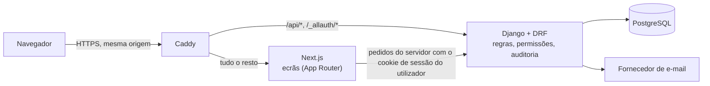
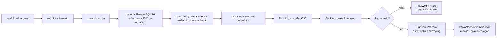

# Base técnica do MVP · Rasto

**Versão:** 1.3 · 3 de Novembro de 2026 (substitui a 1.2; alterações em 0.3: *stack* Next.js + Django, entrega a 30/11/2026, âmbito alargado)
**Autor:** Antonewton Emanuel Lungoge Quima
**Âmbito:** TCC de Engenharia Informática, ISPTEC
**Entradas usadas:** `base-ux-plataforma.md` v1.0 (comportamento), `especificacao-interface-rasto.md` v1.0 (ecrãs, rotas, Sprint 1), `guia-de-marca-rasto.md` v1.0, `rasto.css` e `rasto.tokens.json` v1.0, `wireframes-rasto.html`, `indice-tcc-rasto.md` v1.0 e o relatório já gerado (Capítulos I e II aprovados).
**Estado:** aprovada pelo autor a 3 de Novembro de 2026. Entrega do TCC a 30 de Novembro de 2026. *Stack* fixada pelo autor: Next.js no *frontend*, Django no *backend*, PostgreSQL.

**Regra de precedência dos números:** os números do inquérito usados aqui são os do Capítulo II do relatório (com uma casa decimal), que vêm do Excel. Onde a base de UX ou o contexto arredondam ("96%", "quase todas as respostas"), prevalece o Capítulo II.

---

## 0. Convenções

| Marca | Significado |
|---|---|
| **[D]** | Dado do inquérito de Fevereiro de 2026 (n = 24), ou de fonte citada. As percentagens são sobre o total e não por papel (base de UX, 0.2). |
| **[UX x.y] / [UI x.y]** | Secção da base de UX / da especificação de interface que justifica o requisito. |
| **[S]** | Suposição técnica deste documento. |
| **[CONFIRMAR]** | Ponto legal, de preço ou de versão a confirmar antes de entrar no relatório como facto. |
| **ADR-nn** | Registo de decisão (secção 12). |
| **P0 / P1 / P2** | Prioridades da base de UX, secção 13. |

Nomes de código (tabelas, classes, rotas) em português sem acentos (`Organizacao`, `Interaccao`), para que o relatório e o código usem os mesmos termos (ADR-12).

### 0.1 Pontos das entradas que alteram esta base

| # | Onde | O quê | O que fiz |
|---|---|---|---|
| 1 | Base de UX 6.5 | O exemplo "Valor do cheque · 12 de 25" (ronda USD 80 000, cheque até USD 50 000) não sai de nenhuma fórmula definida. | Defini a fórmula em 5.3. Com os parâmetros de partida o exemplo dá **14 de 25**. A actualizar na base de UX. |
| 2 | Especificação de interface 0.2 (n.º 3) | Diz que os SVG de `logo/` e `sinais/` não estão no projecto. | Estão em `rasto-marca-v1.zip` (`logo/*.svg`, `sinais/*.svg`). Os componentes usam esses ficheiros. |
| 3 | Especificação de interface 2.3 | A configuração do Tailwind está no formato da versão 3 (`tailwind.config.js`). | Uso o executável autónomo do Tailwind 3.4, que aceita esse ficheiro sem Node.js (ADR-11). |
| 4 | Base de UX 1.1, guia de marca 1.1 e contexto | "62% dos fundadores apontam a falta de financiamento" atribuído ao IFC/Startup Genome (2023). | **Resolvido no relatório:** o número vem de INAPEM e Unitel (2023) *apud* Manuel (2023), não da IFC. Não é usado para justificar requisitos técnicos. |
| 5 | Base de UX 1.1 | "~2% de mais de 200 startups obtiveram capital de risco [PNUD 2024]". | Confirmado no relatório do PNUD ([2024], p. 7), que atribui o número a estudos anteriores. Citar como fonte secundária. |
| 6 | Contexto, base de UX e v1.0 desta base | "Segurança e privacidade em quase todas as respostas." | **Incorrecto.** No Capítulo II (Tabela 11), a segurança aparece em 20 de 24 respostas (83,3%), e a privacidade e a facilidade de uso em 9 cada (37,5%). Os requisitos passam a citar cada número em separado. A privacidade continua a justificar requisitos por outra via: a Lei n.º 22/11 e os 50,0% com dificuldade frequente na partilha segura (Tabela 7). |
| 7 | Contexto e v1.0 desta base | "50% gerem tudo por e-mail e Excel." | A pergunta é de escolha múltipla: **metade usa o e-mail e metade usa folhas de cálculo**. Não se sabe quantos usam os dois (Capítulo II, Tabela 5). |
| 8 | Capítulo II aprovado, Tabela 2 | Planeia **7 sprints**, com a autenticação no Sprint 1 e o módulo da aceleradora no Sprint 2. O pedido desta tarefa junta os dois no Sprint 1. | Sigo o pedido (secção 10). A Tabela 2 tem de ser alinhada depois de aprovares o plano: proposta em 10.1. Não alterei o relatório. |
| 9 | Contexto vs relatório | O contexto diz "a plataforma ainda não tem nome definitivo". | O relatório fixou **Rasto** como definitivo. Retirei "nome provisório" deste documento. |
| 10 | Índice do TCC, 4.4 | Fala em "precisão no top-*k*". | A métrica que os dados permitem não é precisão (6.1). No Capítulo IV, chamar-lhe "proporção de pedidos vindos do top-*k*". |

### 0.2 Alterações face à v1.0

| Secção | Alteração | Porquê |
|---|---|---|
| Cabeçalho, 0.1 | Nome definitivo; fontes do 62% e do 2% como no relatório; inconsistências 6 a 10 | Factos fixados no relatório (Capítulos I e II) |
| 1.2 | Novo critério "interacção no cliente e sem rede" e pesos revistos: A 4,70 · B 3,10 · C 3,50 (era 5,00 · 2,95 · 3,45), com análise de sensibilidade | Um 5,00 em 5 não se defende perante um júri, e a opção A tem uma fraqueza real (RNF04, S-08) |
| 1.4 | Configuração do HTMX compatível com a CSP | Sem ela, a CSP sem `unsafe-inline` partia os indicadores do HTMX |
| 2.1, 2.2 | Justificações com os números do Capítulo II e a tabela de origem; privacidade 37,5% em vez de "quase todas"; Lei n.º 22/11, art. 29.º no RF20 e no RNF09 | Rastreabilidade exacta para o Quadro 7 e o Quadro 8 do relatório |
| 4.1 | `PEDIDO_ACESSO.criado_em` e `RELACAO.versao` | Usados nas consultas (6.2) e na concorrência (8.1), mas ausentes do diagrama |
| 6.1, 6.2 | % da ronda sem `CROSS JOIN` com a taxa e com `sem_conversao`; mediana inclui revogados; "precisão no top-*k*" passa a "proporção de pedidos vindos do top-*k*" | Erro da v1.0: sem taxa, o indicador dava 0% em silêncio; nome da métrica incorrecto |
| 7.6 | Art. 29.º e obrigações do Quadro 1 do Capítulo I; linha nova "decisões automatizadas" | Coerência com o Capítulo I |
| 10, 10.1 | Feriados de 4 e 9 de Fevereiro de 2027; corte previsto no Sprint 1; proposta de nova Tabela 2 | Calendário incompleto; conflito com o Capítulo II aprovado |
| 11.1 | Lista consolidada de trabalho futuro | Pedido do contexto ("lista de trabalho futuro"); estava espalhada |

**Verificação feita nesta versão** (PostgreSQL 16.15 e Python 3.12, numa instância temporária): as 6 consultas da secção 6.2 que não dependem das tabelas das turmas correram sobre um caso de teste com o exemplo da HU19. Deram 37,5% comprometido, 17 dias até ao primeiro soft commit, a conversão esperada por etapa, a relação parada certa, mediana de resposta de 2 dias, aceitação de 50% e 75% no top-3. Sem taxa de câmbio, `sem_conversao = 1`. As restrições da 4.2 (validado completo, pesos a somar 100, uma só configuração activa, um só pedido pendente) recusam as linhas proibidas. Os 12 testes da 5.5 passam contra o código da 5.4, incluindo a propriedade com Hypothesis. A consulta do estado da turma e os *triggers* da auditoria não foram executados: só serão testados com as migrações reais.

### 0.3 Alterações face à v1.2 (decisão do autor, 3 de Novembro de 2026)

| Secção | Alteração | Porquê |
|---|---|---|
| 1.5 (nova), ADR-02, ADR-11 | *Stack* passa a **Next.js (*frontend*) + Django REST (*backend*) + PostgreSQL**. A recomendação da 1.3 (Django + HTMX) fica como análise; não é a escolha final. | Decisão do autor. A 1.5 regista a justificação e as consequências, para o relatório. |
| 8.1 | A API JSON deixa de ser secundária: é a única interface do *backend*. Autenticação por sessão com *cookie* na mesma origem e CSRF; entrada, 2FA e recuperação pelo modo *headless* do allauth. | Consequência da 1.5; mantém a ADR-04 (sem JWT). |
| 10 | Entrega a **30/11/2026**; voltam ao âmbito a API JSON, os lembretes por e-mail, as actualizações periódicas e o Kanban com arrastar. | Decisão do autor. |
| 13.1 | Repositório com `backend` Django (pasta raiz actual) e `frontend/` Next.js. | Consequência da 1.5. |

---

## 1. Stack

### 1.1 Opções comparadas

Todas as opções usam PostgreSQL, Docker e um monólito modular (ADR-01).

| | **A · Django + HTMX** | **B · Next.js + NestJS** | **C · Next.js de ponta a ponta** |
|---|---|---|---|
| Composição | Django 5.2 LTS (Python 3.12), templates no servidor, HTMX para interacções parciais, Tailwind compilado, Django REST Framework para a API JSON. | Next.js (React) no cliente e no servidor, NestJS (TypeScript) para a API, Prisma ou TypeORM. | Next.js com App Router e Server Actions, Prisma ou Drizzle, Auth.js. |
| Peças a manter | 1 aplicação, 1 linguagem | 2 aplicações, 1 linguagem, contrato de API entre elas | 1 aplicação, 1 linguagem |
| Autenticação, sessões, CSRF, hashing | Incluídos no framework, maduros desde 2005 | A montar com Passport e bibliotecas à parte | Auth.js mais configuração própria |
| Administração interna | Admin do Django para suporte (D-04, D-05, auditoria só de leitura) | A construir | A construir |
| Migrações e ORM | Incluídos, com migrações versionadas | Prisma ou TypeORM | Prisma ou Drizzle |
| Peso no telemóvel | HTML vindo do servidor, ~14 KB de HTMX: cumpre o orçamento de 120 KB de JS [UI 4.2] | Hidratação React; cumprir 120 KB exige disciplina | Melhor que B com Server Components, mas o modelo é mais recente e muda entre versões |
| Alojamento | 1 contentor + PostgreSQL num VPS pequeno | 2 contentores + PostgreSQL | 1 contentor (ou plataforma *serverless*, com custo variável) |
| Facilidade de justificar no relatório | Alta: segurança por omissão documentada, LTS com datas públicas | Média: arquitectura mais pesada do que o problema pede | Média: fronteira entre cliente e servidor difícil de explicar a um júri |

### 1.2 Pontuação (1 = fraco, 5 = forte) [S]

| Critério | Peso | A | B | C |
|---|---|---|---|---|
| Produtividade de uma equipa de 1 a 2 pessoas | 25% | 5 | 2 | 4 |
| Maturidade e suporte de longo prazo | 15% | 5 | 4 | 3 |
| Custo de alojamento | 15% | 5 | 3 | 4 |
| Segurança por omissão | 20% | 5 | 3 | 3 |
| Interacção no cliente e funcionamento sem rede (Kanban, rascunhos, fila de sincronização) | 10% | 2 | 5 | 4 |
| Facilidade de justificar no relatório | 15% | 5 | 3 | 3 |
| **Total ponderado** | | **4,70** | **3,10** | **3,50** |

**Leitura honesta da tabela.** A opção A perde num critério real: o pipeline sem rede (RNF04) e o Kanban (S-08) pedem JavaScript próprio, que em React viria quase feito. Os pesos e as notas são suposições minhas [S]. A nota mais frágil é a da **produtividade**, porque depende da linguagem que já dominas, e eu não sei qual é.

**Sensibilidade:** se dominares JavaScript/TypeScript e não Python, a produtividade passa a A = 2 e C = 5. Mesmo assim, A fica com 3,95 e C com 3,75. A recomendação mantém-se, mas por pouco. Nesse caso, a escolha entre A e C deve ser tua e ficar registada no ADR-02.

### 1.3 Recomendação: A · Django + HTMX

1. **Uma linguagem, uma aplicação, um processo de implantação.** É o que um estudante consegue manter e defender sozinho.
2. **A segurança vem com o framework:** protecção CSRF, escape automático nos templates, sessões no servidor, gestor de palavras-passe com Argon2, cabeçalhos de segurança, ORM parametrizado. Cada linha da tabela OWASP (7.4) aponta para um mecanismo que já existe.
3. **Coerente com a interface:** a especificação pede HTML pronto vindo do servidor, pouco JavaScript e formulários que funcionam em redes lentas [UI 4.2]. É o modelo nativo do Django.
4. **Django 5.2 é LTS** (suporte de segurança até Abril de 2028 [CONFIRMAR data no calendário oficial do Django]), o que cobre o TCC e um ano de operação.

**Custo da escolha:** menos componentes React prontos (o Kanban com arrastar, S-08, exige JavaScript próprio, ~5 KB) e menos oferta de emprego em Angola para Python do que para JavaScript [S]. Aceito o custo: o Kanban é P2 e o arrastar é só um atalho [UI 3.3].

### 1.5 Decisão final do autor: Next.js + Django REST (v1.3)

O autor fixou a *stack* em **Next.js no *frontend*, Django no *backend* e PostgreSQL**. É uma quarta opção, D, que não estava na comparação da 1.2: junta o *backend* da opção A ao *frontend* das opções B e C.

| Critério | Efeito da opção D face à A |
|---|---|
| Produtividade | Duas aplicações e um contrato de API para manter; em troca, componentes React para o Kanban com arrastar e para as interacções sem recarregar a página. |
| Segurança | Mantém-se o essencial: o Django continua a tratar de sessões, CSRF, Argon2, permissões e auditoria. O Next.js não guarda segredos nem fala com a base de dados. |
| Desempenho em rede lenta | Os ecrãs são desenhados no servidor pelo Next.js (*Server Components*), por isso a primeira pintura continua a ser HTML pronto; o JavaScript do cliente fica só nos componentes interactivos. O orçamento de 120 KB (RNF01) passa a ser medido no *build*. |
| Custo | Um contentor a mais (Node.js) no mesmo VPS. |
| Justificação no relatório | Separação clara entre apresentação e regras de negócio; a API serve também uma futura aplicação nativa. |

**Arquitectura:**



- **Mesma origem:** o navegador vê um só domínio; o Caddy encaminha `/api/` e `/_allauth/` para o Django. As sessões continuam em *cookie* `HttpOnly` com CSRF (ADR-04), sem *tokens* no navegador.
- **Autenticação:** modo *headless* do django-allauth (cliente *browser*): entrada, 2FA por TOTP, recuperação de palavra-passe e sessão por JSON.
- **Regras de negócio só no Django:** o Next.js só desenha; as permissões por papel e por objecto (7.1) são verificadas na API. Uma falha no *frontend* nunca dá acesso a dados.
- **Contrato:** esquema OpenAPI gerado pelo Django (drf-spectacular) e tipos TypeScript gerados a partir dele.

### 1.4 Componentes e versões de partida

| Camada | Escolha | Nota |
|---|---|---|
| Linguagem e framework | Python 3.12, Django 5.2 LTS | |
| Base de dados | PostgreSQL 16 | Restrições `CHECK`, índices parciais, `generate_series` nos indicadores |
| Interface | Templates do Django, HTMX 2, JavaScript próprio sem framework | Alpine.js não entra: obriga a `unsafe-eval` na CSP. No HTMX: `htmx.config.allowEval = false` e `includeIndicatorStyles = false` (senão injecta estilos em linha), e sem atributos `hx-on`, para a CSP não precisar de `unsafe-inline` |
| CSS | `rasto.css` (tokens) + Tailwind 3.4 (executável autónomo, CSS purgado) | ADR-11 |
| Autenticação | `django-allauth` (contas, recuperação, MFA por TOTP) | ADR-04 |
| Protecção contra força bruta | `django-axes` | |
| Hashing | Argon2id (`argon2-cffi`) | |
| API JSON | Django REST Framework | Sessão + CSRF; sem JWT (ADR-04) |
| CSP | `django-csp` | |
| Tarefas agendadas | Comandos de gestão do Django chamados por cron + tabela de saída de e-mails | Sem Redis (ADR-07) |
| E-mail | Fornecedor transaccional com *webhook* de devoluções (ex.: Brevo, Mailjet, Amazon SES) [CONFIRMAR plano gratuito] | Necessário para o estado "erro de envio" do convite |
| Servidor | Gunicorn atrás de Caddy (TLS automático) | |
| Ficheiros estáticos | WhiteNoise | |
| Testes | pytest, pytest-django, factory_boy, Hypothesis, Playwright, axe-core | |
| Qualidade | Ruff (lint e formato), mypy no domínio, pip-audit | |

---

## 2. Requisitos

### 2.1 Requisitos funcionais

A coluna **Justificação** liga cada requisito ao dado ou à fonte que o sustenta. Números do inquérito: Capítulo II do relatório (as tabelas citadas são as desse capítulo).

| ID | Requisito | Prior. | Justificação |
|---|---|---|---|
| **Autenticação e contas** | | | |
| RF01 | O sistema autentica utilizadores por e-mail e palavra-passe e encaminha cada um para a área do seu papel (startup, investidor, entidade validadora, administração). | P0 | Ordem de desenvolvimento do contexto; uma conta, um papel [UX 4.1] |
| RF02 | O sistema permite recuperar a palavra-passe sem revelar se o e-mail existe. | P0 | [UI 8, C-02]; OWASP A07 |
| RF03 | O utilizador pode activar a autenticação em dois passos (TOTP) com códigos de recuperação. É obrigatória para a administração. | P0 | Pedido do contexto; a administração verifica entidades, que é a raiz da cadeia de confiança [UX 6.1] |
| RF04 | O sistema regista o consentimento (finalidade, versão do texto, data) na criação de cada conta. | P0 | Lei n.º 22/11 (consentimento livre, específico, explícito e informado; Cap. I, Quadro 1); privacidade em 37,5% das respostas (Tabela 11) [D] |
| **Entidade validadora e verificação** | | | |
| RF05 | Uma aceleradora ou universidade regista-se em 3 passos (entidade, comprovativos, responsável) com rascunho guardado. | P0 | Jornada da aceleradora [UX 3.1]; E-01 |
| RF06 | A administração verifica a entidade com 4 critérios fixos (existência legal, presença pública, responsável com e-mail institucional, programa realizado), pede informação, recusa com motivo ou suspende. | P0 | Diferencial 1: sem verificação não há sinal caro de falsificar (Spence) [UX 5.2]; D-02 |
| RF07 | Uma entidade por verificar pode criar turmas em rascunho, mas não pode convidar nem validar. | P0 | [UX 5.2] |
| **Turmas e convites** | | | |
| RF08 | A entidade cria turmas com programa, edição, início e fim, e vê a frase de validação que vai assinar. | P0 | Medo reputacional da aceleradora [UX 3.1]; E-04 |
| RF09 | A entidade convida startups por lista de e-mails (validação por linha) ou por ligação pessoal de uso único para copiar para WhatsApp. | P0 | Convites como pico negativo da jornada [UX 3.1]; WhatsApp como canal principal [S persona] |
| RF10 | O sistema mostra o estado de cada convite (pendente, aceite, recusado, expirado, cancelado, erro de envio) e permite reenviar, cancelar e corrigir. | P0 | [UX 5.3]; tarefa A6 |
| RF11 | Ao aceitar um convite, a startup cria conta (ou junta-se à turma, se já existir), e o sistema cria o sinal de participação em "pendente de validação". | P0 | Startups entram por convite [Dec-2]; [UX 5.3] |
| **Sinais** | | | |
| RF12 | A entidade valida, recusa (com motivo) ou retira sinais das startups das suas turmas. Só a participação pode ser validada em lote. | P0 | [UX 5.4]; E-07, E-08 |
| RF13 | Cada sinal validado guarda e mostra o que foi confirmado, quem validou, a data da validação e a data do facto. O texto confirmado fica guardado tal como a entidade o viu. | P0 | Teoria da sinalização; regra "sem nome e data, não é validado" [UX 6.2] |
| RF14 | A startup declara marcos com data e pede validação a uma entidade a que está ligada. | P1 | [UX 5.4]; tarefa S3 |
| RF15 | O investidor vê os sinais validados numa secção separada e anterior à dos declarados; os pendentes nunca lhe aparecem. | P1 | Princípio P1; H-13 |
| **Perfil da startup** | | | |
| RF16 | A startup preenche um perfil com 6 campos obrigatórios para publicar, indicador de completude e métricas sugeridas por fase. | P1 | 95,8% pedem a gestão do perfil (Tabela 9); 91,7% com até 3 anos no ecossistema; 58,3% com falta frequente de indicadores (Tabela 7); categoria "não sei que métricas mostrar" nas respostas abertas [D] |
| RF17 | A startup vê o seu perfil como o investidor o vê, nas camadas 1 e 2. | P1 | Princípio P2; tarefa S4 |
| RF18 | A startup regista ligações externas para documentos, que só ficam visíveis a investidores com pedido de acesso aceite. | P1 | Data room em último lugar, 45,8% (Tabela 9), apesar de 79,2% o acharem útil isoladamente [D]; cofre fora do escopo |
| **Investidor e compatibilidade** | | | |
| RF19 | O investidor regista-se e define o mandato (sectores e fase obrigatórios; cheque em Kz ou USD, geografia e risco opcionais). | P1 | [UX 5.5]; H-01 |
| RF20 | O sistema sugere startups ordenadas por compatibilidade com o mandato, com a pontuação sempre decomposta por critério e a frase "mede o encaixe, não a qualidade". | P1 | Categoria "acesso a investidores do nicho" nas respostas abertas [D]; princípio P3; Lei n.º 22/11, art. 29.º (decisões automatizadas: a sugestão apoia a decisão humana, Cap. I 1.4) |
| RF21 | A administração altera os pesos e parâmetros da compatibilidade, com pré-visualização, versão e registo de quem mudou. | P1 | H-02 (pesos por validar); medo da administração de mudanças sem rasto [UX 1.4] |
| RF22 | A administração gere as listas de sectores, fases, geografias e níveis de risco sem alterar código. | P1 | H-03, H-04; D-04 |
| **Pedido de acesso** | | | |
| RF23 | O investidor pede acesso com uma nota (até 300 caracteres); a startup aceita, recusa (motivo opcional por categoria) ou deixa expirar em 14 dias; pode revogar mais tarde. | P1 | Segurança 83,3% e privacidade 37,5% (Tabela 11); 50,0% com dificuldade frequente na partilha segura (Tabela 7); categoria "falta de resposta" [D]; [UX 5.6] |
| RF24 | Ao decidir um pedido, a startup vê "porque este investidor encaixa" com a mesma decomposição e a lista do que passa a ficar visível. | P1 | Simetria de informação [UX 6.5]; H-05 |
| RF25 | Depois de recusa ou expiração, o mesmo investidor só volta a pedir à mesma startup ao fim de 90 dias. | P1 | [UX 5.0] |
| **Pipeline e indicadores** | | | |
| RF26 | Cada lado tem o seu pipeline privado com as etapas Identificado → Contactado → Reunião → Análise → Soft commit → Term sheet → Fechado, e Perdido com motivo obrigatório. | P2 | 75,0% sem processo bem estruturado (Tabela 4); 54,2% com dificuldade frequente em saber a etapa de cada investidor (Tabela 7) [D]; Dec-3 |
| RF27 | A startup adiciona investidores de fora da plataforma ao pipeline. | P2 | Metade usa o e-mail e metade usa folhas de cálculo (Tabela 5) [D]; princípio P4 |
| RF28 | O utilizador regista reuniões, contactos e soft commits (com valor) numa linha a partir da relação. | P2 | 54,2% com falta frequente de registo de reuniões e soft commits (Tabela 7); 58,3% pedem registo de contactos e reuniões (Tabela 9) [D] |
| RF29 | O sistema calcula, a partir do pipeline, a conversão por etapa, o tempo até ao primeiro soft commit, a % da ronda comprometida e as relações paradas. | P2 | 70,8% pedem painéis (Tabela 9); 58,3% com falta frequente de indicadores (Tabela 7) [D] |
| RF30 | O sistema assinala relações sem movimento há 21 dias e envia lembrete, que pode ser adiado. | P2 | 54,2% com dificuldade frequente em saber a etapa (Tabela 7) [D]; princípio P5 |
| **Actualizações e notificações** | | | |
| RF31 | A startup publica actualizações mensais com métricas da fase pré-preenchidas; publicadas não se editam, corrigem-se com nova actualização. | P2 | Categoria "não sei que métricas mostrar" [D]; H-09, H-10 |
| RF32 | O sistema envia notificações na aplicação e por e-mail, sem mensagens internas. | P1 | [UX 4.1]; H-14 |
| RF33 | Todos os estados pendentes expiram nos prazos configurados, com lembretes antes de expirar. | P0 (convites) · P1 (pedidos) | Princípio P5 |
| **Administração e dados** | | | |
| RF34 | A administração define parâmetros (prazos, taxa de câmbio de referência USD/Kz com data). | P1 | Valores em Kz e USD [UX 5.7]; H-16 |
| RF35 | O titular exporta os seus dados, pede rectificação e elimina a conta; a administração regista e responde aos pedidos. | P2 | Lei n.º 22/11 |
| RF36 | O sistema regista em auditoria, sem possibilidade de alteração, as verificações, validações, decisões de pedidos, alterações de pesos, aberturas de documentos e acções administrativas. | P0 | Cadeia de confiança [UX 6.1]; persona da administração |

### 2.2 Requisitos não funcionais

| ID | Requisito | Métrica de aceitação | Justificação |
|---|---|---|---|
| RNF01 | Desempenho em rede lenta | 1.ª pintura de conteúdo < 3 s em "Slow 4G" num Android de gama média; HTML + CSS crítico ≤ 50 KB e JS inicial ≤ 120 KB comprimidos | [UI 4.2]; H-I04 |
| RNF02 | Telemóvel primeiro | Todos os ecrãs utilizáveis a 360 px sem rolagem horizontal | [UI 2.1] |
| RNF03 | Acessibilidade | WCAG 2.2 AA; 0 violações graves do axe nos ecrãs do sprint | [UI 4.1] |
| RNF04 | Tolerância a falhas de rede | Nenhum formulário perde dados; rascunho local com hora visível | Regra 5 da base de UX |
| RNF05 | Controlo de acesso | 100% dos pontos de entrada cobertos pelo teste da matriz de permissões (7.1) | OWASP A01; segurança 83,3% (Tabela 11) [D] |
| RNF06 | Confidencialidade em trânsito | TLS 1.2+ em todos os pedidos; HSTS | OWASP A02 |
| RNF07 | Protecção de credenciais | Argon2id; bloqueio após 5 falhas em 15 min | OWASP A07 |
| RNF08 | Auditabilidade | Registo de auditoria só de acréscimo, com cadeia de hash verificável | ADR-09 |
| RNF09 | Explicabilidade | Toda a pontuação mostrada decompõe-se em critérios que somam o total | Princípio P3; Lei n.º 22/11, art. 29.º (Cap. I 1.4) |
| RNF10 | Disponibilidade | ≥ 99% mensal medido por monitor externo (alvo de MVP) [S] | Alojamento de baixo custo |
| RNF11 | Recuperação | RPO ≤ 24 h, RTO ≤ 4 h; restauro testado todos os meses | 7.7 |
| RNF12 | Manutenção | Cobertura de testes ≥ 80% em domínio, políticas e serviços; CI verde para integrar | 9 |
| RNF13 | Localização | Interface em português de Angola; formatos locais (Kz, espaço como separador de milhares, `dd/mm/aaaa`, fuso Africa/Luanda) | [UI 5] |
| RNF14 | Custo | Alojamento, e-mail e cópias abaixo de ~20 EUR/mês no MVP [CONFIRMAR preços] | 9.4 |
| RNF15 | Portabilidade | Implantável com um `docker compose up` num servidor Linux qualquer | ADR-10 |
| RNF16 | Privacidade por omissão | Perfis da startup só para investidores autenticados; mandato do investidor só para startups a quem pede acesso | [UX 4.2, 4.7]; privacidade 37,5% (Tabela 11); Lei n.º 22/11 |

---

## 3. Histórias de utilizador do MVP

Formato: *Como [papel], quero [acção], para [resultado].* Critérios em Dado / Quando / Então. A coluna **RF** liga a história aos requisitos. Os prazos vêm dos parâmetros (D-05) e os textos da base de UX 8.

### 3.1 Sprint 1 (P0)

**HU01 · Entrar** (RF01) — Como utilizador registado, quero entrar com e-mail e palavra-passe, para chegar à área do meu papel.
- Dado que tenho conta activa de entidade, quando introduzo credenciais correctas, então sou levado a `/e`.
- Dado que erro a palavra-passe, quando submeto, então vejo "E-mail ou palavra-passe incorrectos" sem indicação de qual campo falhou.
- Dado que errei 5 vezes em 15 minutos, quando tento de novo, então a conta fica bloqueada 15 minutos para esse IP e recebo a explicação.
- Dado que tenho 2FA activa, quando acerto a palavra-passe, então tenho de introduzir o código TOTP antes de entrar.

**HU02 · Recuperar palavra-passe** (RF02) — Como utilizador, quero redefinir a palavra-passe, para recuperar o acesso.
- Dado qualquer e-mail, quando peço recuperação, então vejo "Se o e-mail existir, enviámos uma ligação".
- Dado uma ligação com mais de 1 hora ou já usada, quando a abro, então vejo "Esta ligação expirou" e posso pedir outra.
- Dado que redefino a palavra-passe, quando confirmo, então todas as outras sessões da conta terminam.

**HU03 · Registar a entidade** (RF05) — Como gestora de uma aceleradora, quero registar a entidade e enviá-la para verificação, para poder convidar startups.
- Dado que estou no passo 2, quando fecho o navegador e volto, então os passos 1 e 2 estão como os deixei.
- Dado um comprovativo com mais de 2 MB ou que não é PDF, JPEG ou PNG, quando o envio, então vejo o erro e os outros campos mantêm-se.
- Dado que os 3 passos estão completos, quando submeto, então o estado passa a "Submetida", vejo o prazo indicativo e a administração é notificada.

**HU04 · Verificar uma entidade** (RF06, RF36) — Como administração, quero verificar uma entidade com critérios fixos, para não deixar entrar entidades falsas.
- Dado um processo com algum critério diferente de "Cumpre", quando olho para "Verificar entidade", então o botão está desactivado com a explicação.
- Dado 4 critérios em "Cumpre", quando verifico, então a entidade passa a "Verificada" e a decisão fica na auditoria com autor, data e hora.
- Dado critérios em "Falta", quando peço informação, então a entidade recebe as notas desses critérios e o processo passa a "Pedido de informação" com prazo de 14 dias.
- Dado uma entidade verificada, quando a suspendo com motivo, então os sinais que validou passam a "Validado com aviso".

**HU05 · Criar turma** (RF07, RF08) — Como gestora, quero criar a turma do programa, para convidar as startups.
- Dado que escrevo o programa, a edição e as datas, quando altero qualquer campo, então a pré-visualização da frase de validação actualiza-se.
- Dado o fim antes do início, quando submeto, então vejo "o fim ({data}) é antes do início ({data})".
- Dado que a entidade ainda não está verificada, quando crio a turma, então fica em rascunho e os convites ficam bloqueados com explicação.

**HU06 · Convidar startups** (RF09, RF10) — Como gestora, quero convidar várias startups de uma vez, para não as registar uma a uma.
- Dado uma lista com 3 e-mails, um deles inválido, quando valido, então a linha inválida é assinalada e o botão diz "Enviar 2 convites".
- Dado um e-mail que já pertence a uma startup, quando envio, então essa startup recebe convite para se juntar à turma, sem conta nova.
- Dado um e-mail já convidado para esta turma, quando envio, então é ignorado com aviso.
- Dado um convite pendente, quando passam 14 dias, então passa a "Expirado" e posso reenviá-lo; ao 7.º dia o destinatário recebeu lembrete.
- Dado que o fornecedor de e-mail devolveu a mensagem, quando abro a turma, então o convite aparece como "Erro de envio" com a acção "Corrigir e-mail".
- Dado que escolho "Por ligação", quando copio, então recebo a mensagem pronta para WhatsApp com uma ligação pessoal de uso único.

**HU07 · Aceitar convite** (RF04, RF11) — Como fundadora, quero aceitar o convite da aceleradora, para entrar na plataforma.
- Dado um convite válido, quando aceito, crio a palavra-passe e aceito o aviso de privacidade, então a conta de startup fica ligada à turma, o consentimento fica registado com data, e o sinal de participação fica "Pendente de validação".
- Dado um convite expirado, quando abro a ligação, então vejo "Este convite expirou em {data}. Peça um novo convite a {Entidade}".
- Dado um convite já aceite, quando abro a ligação, então vejo "Este convite já foi aceite" e a ligação para entrar.
- Dado que tenho sessão de investidor, quando abro um convite de startup, então vejo que é preciso outra conta.

**HU08 · Validar participações** (RF12, RF13, RF36) — Como gestora, quero confirmar a participação das startups da turma, para que os investidores vejam o selo com o nosso nome.
- Dado participações pendentes, quando selecciono várias e confirmo, então todas passam a "Validado" com o meu nome, a data e a frase exacta que vi.
- Dado um marco pendente, quando tento seleccioná-lo em lote, então a caixa está desactivada com a explicação "Marcos validam-se um a um".
- Dado que recuso, quando não escrevo motivo, então não consigo submeter; o motivo vai só para a startup.
- Dado um sinal validado, quando retiro a validação com motivo, então passa a "Retirado", volta a declarado para o investidor e a retirada fica na auditoria.

**HU09 · Painel da entidade** (RF06, RF10, RF12) — Como gestora, quero ver numa página o estado da entidade e o que está à minha espera, para saber o que fazer em 10 segundos.
- Dado cada um dos 6 estados de verificação, quando abro `/e`, então vejo o estado com o texto da base de UX 8.5.
- Dado 2 participações por confirmar e 1 convite expirado, quando abro `/e`, então "À espera de si" mostra os 3 itens, ordenados pelo prazo mais próximo.
- Dado uma turma activa, quando comparo as contagens do painel com E-05 e E-07, então os números coincidem.

### 3.2 Núcleo da ligação (P1)

**HU10 · Publicar o perfil** (RF16, RF17) — Como fundadora, quero publicar um perfil mínimo, para que investidores me encontrem.
- Dado os 6 campos obrigatórios preenchidos, quando abro o Início, então "Publicar perfil" fica activo mesmo com a completude abaixo de 100%.
- Dado que falta o resumo, quando tento publicar, então vejo o campo em falta com ligação para ele.
- Dado que abro "Ver como investidor", quando alterno para a camada 2, então vejo o contacto, as ligações para documentos e os indicadores.

**HU11 · Declarar marco e pedir validação** (RF14) — Como fundadora, quero declarar o lançamento do MVP e pedir à aceleradora que o confirme.
- Dado um marco com data, quando peço validação a uma entidade de uma turma minha, então o sinal passa a "Pendente · {Entidade} até {data}".
- Dado uma entidade a que não estou ligada, quando procuro validadores, então ela não aparece.
- Dado que a entidade recusou, quando abro o sinal, então vejo o motivo e o marco continua como declarado.

**HU12 · Definir mandato** (RF19) — Como investidor, quero dizer em que startups invisto, para receber sugestões que encaixam.
- Dado só sectores e fase preenchidos, quando guardo, então o mandato mínimo fica completo e vejo a contagem real de startups compatíveis.
- Dado o cheque em USD, quando escrevo o valor, então vejo a equivalência "≈ Kz … · taxa de referência de {data}".
- Dado o campo risco, quando o preencho, então vejo "ainda não conta (peso 0)".

**HU13 · Ver sugestões explicadas** (RF20) — Como investidor, quero ver porque cada startup encaixa, para escolher depressa.
- Dado startups compatíveis, quando abro Sugestões, então cada cartão mostra "N de 100" e os 4 critérios com pontos que somam N.
- Dado 0 compatíveis, quando abro Sugestões, então vejo o vazio honesto com "Ver compatibilidades parciais" e "Avisar-me quando surgir uma".
- Dado uma startup sem valor de ronda, quando vejo o cartão, então o critério cheque diz "A startup ainda não indicou o valor da ronda" e não "sem encaixe".

**HU14 · Pedir acesso** (RF23, RF25) — Como investidor, quero pedir acesso com uma nota, para ver contacto e documentos.
- Dado uma nota com 301 caracteres, quando escrevo, então o contador impede passar de 300.
- Dado um pedido enviado, quando volto ao perfil, então vejo "Pendente · responde até {data}" e "Retirar pedido".
- Dado um pedido recusado há 30 dias, quando tento pedir de novo, então vejo "Pode voltar a pedir a partir de {data + 90 dias}".

**HU15 · Decidir um pedido** (RF23, RF24, RF18) — Como fundadora, quero decidir com segurança sobre um investidor que não conheço.
- Dado um pedido pendente, quando o abro, então vejo os dados do investidor marcados como declarados, "porque este investidor encaixa", a nota e a lista do que passa a ficar visível.
- Dado que aceito, quando o investidor abre o perfil, então vê a camada 2 e a relação entra no meu pipeline em Contactado.
- Dado que revogo o acesso, quando o investidor abre o perfil, então a camada 2 e as ligações deixam de aparecer, e eu fui avisada de que ligações já guardadas continuam a abrir no serviço externo.

**HU16 · Alterar pesos** (RF21, RF36) — Como administração, quero alterar os pesos depois das entrevistas, sem programar e com rasto.
- Dado pesos que somam 95, quando guardo, então vejo "Os pesos têm de somar 100 (soma actual: 95)".
- Dado novos pesos, quando pré-visualizo, então vejo como mudaria a ordem das sugestões de 3 mandatos de exemplo.
- Dado que activo a versão nova, quando um investidor abre Sugestões, então a pontuação usa a versão nova e a auditoria guarda a versão anterior, a nova e o autor.

### 3.3 Acompanhamento (P2)

**HU17 · Mover no pipeline** (RF26, RF28) — Como fundadora, quero mover cada investidor de etapa, para saber onde estou.
- Dado uma relação em Reunião, quando a movo para Soft commit, então tenho de indicar valor e moeda, e o indicador da ronda é recalculado.
- Dado que marco como perdida, quando não escolho motivo, então não consigo confirmar; depois de confirmar vejo "Registado. A ronda continua…" e "Desfazer".
- Dado que estou sem rede, quando movo a relação, então o movimento fica guardado no aparelho e é enviado quando a rede voltar.

**HU18 · Adicionar investidor de fora** (RF27) — Como fundadora, quero registar um investidor que não está na plataforma, para ter o processo todo num sítio.
- Dado nome e organização, quando guardo, então a relação aparece em Identificado com a marca "fora da plataforma".

**HU19 · Ver indicadores da ronda** (RF29) — Como fundadora, quero saber em 1 minuto quanto já tenho e o que está parado.
- Dado soft commits de Kz 18 400 000 e USD 10 000 numa ronda de USD 80 000 com taxa de 920, quando abro o Início, então vejo "≈ USD 30 000 · 37,5% comprometido" com a data da taxa.
- Dado menos de 3 relações, quando abro a conversão por etapa, então vejo "Ainda sem dados suficientes".

**HU20 · Relação parada** (RF30) — Como fundadora, quero ser avisada quando uma relação pára, para agir antes de a perder.
- Dado uma relação sem movimento nem interacção há 21 dias, quando corre a tarefa diária, então a relação fica marcada e recebo um lembrete.
- Dado que adio o lembrete 7 dias, quando corre a tarefa nesse período, então não recebo novo lembrete.

**HU21 · Publicar actualização** (RF31) — Como fundadora, quero publicar a actualização do mês sem ajuda.
- Dado a actualização do mês anterior, quando abro a nova, então as métricas vêm pré-preenchidas com a variação.
- Dado que publico, quando tento editar, então só posso criar "Correcção à actualização de {data}".
- Dado que um e-mail falhou, quando vejo a actualização, então vejo a lista de quem não recebeu.

**HU22 · Exportar e eliminar os meus dados** (RF35) — Como titular, quero exportar e eliminar os meus dados, para exercer os meus direitos.
- Dado que peço a exportação, quando o ficheiro fica pronto, então recebo um JSON com os meus dados pessoais e os da minha conta.
- Dado que peço a eliminação, quando confirmo com a palavra-passe, então a conta fica desactivada de imediato e os dados pessoais são anonimizados no prazo definido em 7.6.

---

## 4. Modelo de dados

### 4.1 Diagrama ER

Chaves primárias UUID (ADR-13). Valores monetários em inteiros com a moeda de origem (ADR-14). Datas em UTC.

```mermaid
erDiagram
    PAPEL ||--o{ UTILIZADOR : "tem"
    UTILIZADOR ||--o{ CONSENTIMENTO : "concede"
    UTILIZADOR ||--o{ MEMBRO_ORGANIZACAO : "pertence"
    ORGANIZACAO ||--o{ MEMBRO_ORGANIZACAO : "tem"
    ORGANIZACAO ||--o{ VERIFICACAO_ENTIDADE : "é verificada em"
    VERIFICACAO_ENTIDADE ||--o{ COMPROVATIVO : "anexa"
    ORGANIZACAO ||--o{ TURMA : "organiza"
    TURMA ||--o{ CONVITE : "emite"
    TURMA ||--o{ STARTUP_TURMA : "inclui"
    STARTUP ||--o{ STARTUP_TURMA : "participa"
    CONVITE |o--o| STARTUP_TURMA : "origina"
    UTILIZADOR ||--o{ MEMBRO_STARTUP : "pertence"
    STARTUP ||--o{ MEMBRO_STARTUP : "tem"
    STARTUP ||--o{ RONDA : "abre"
    STARTUP ||--o{ DOCUMENTO_LIGACAO : "partilha"
    STARTUP ||--o{ SINAL : "tem"
    ORGANIZACAO ||--o{ SINAL : "valida"
    TURMA |o--o{ SINAL : "comprova"
    UTILIZADOR ||--o| INVESTIDOR : "é"
    ORGANIZACAO |o--o{ INVESTIDOR : "emprega"
    INVESTIDOR ||--|| MANDATO : "define"
    MANDATO ||--o{ MANDATO_ITEM : "inclui"
    ITEM_CATALOGO ||--o{ MANDATO_ITEM : "é usado"
    ITEM_CATALOGO ||--o{ STARTUP : "classifica"
    INVESTIDOR ||--o{ PEDIDO_ACESSO : "envia"
    STARTUP ||--o{ PEDIDO_ACESSO : "recebe"
    CONFIGURACAO_COMPATIBILIDADE ||--o{ PEDIDO_ACESSO : "pontuou"
    STARTUP ||--o{ RELACAO : "lado startup"
    INVESTIDOR ||--o{ RELACAO : "lado investidor"
    RONDA |o--o{ RELACAO : "conta para"
    PEDIDO_ACESSO |o--o{ RELACAO : "cria"
    RELACAO ||--o{ MOVIMENTO_ETAPA : "regista"
    RELACAO ||--o{ INTERACCAO : "regista"
    STARTUP ||--o{ ACTUALIZACAO : "publica"
    UTILIZADOR ||--o{ LEMBRETE : "recebe"
    UTILIZADOR ||--o{ NOTIFICACAO : "recebe"
    UTILIZADOR ||--o{ REGISTO_AUDITORIA : "pratica"
    UTILIZADOR ||--o{ PEDIDO_TITULAR : "submete"

    PAPEL {
        string codigo PK "startup|investidor|entidade|admin"
        string nome
    }
    UTILIZADOR {
        uuid id PK
        string email UK
        string nome
        string papel_codigo FK
        string password_hash "Argon2id"
        bool mfa_activa
        bool activo
        datetime criado_em
        datetime anonimizado_em "nulo até eliminação"
    }
    CONSENTIMENTO {
        uuid id PK
        uuid utilizador_id FK
        string finalidade "conta|comunicacoes|gravacao_teste"
        string versao_texto
        datetime concedido_em
        datetime retirado_em
    }
    ORGANIZACAO {
        uuid id PK
        string tipo "aceleradora|universidade|fundo|corporate"
        string nome_legal
        string nif
        string site
        string estado_verificacao "rascunho|submetida|em_analise|pedido_info|verificada|recusada|suspensa|expirada"
        datetime verificada_em
        uuid verificada_por FK
    }
    MEMBRO_ORGANIZACAO {
        uuid utilizador_id FK
        uuid organizacao_id FK
        string funcao "responsavel|membro"
    }
    VERIFICACAO_ENTIDADE {
        uuid id PK
        uuid organizacao_id FK
        json criterios "4 critérios: estado, evidência, nota"
        string decisao
        string motivo
        date prazo_resposta
        uuid decidido_por FK
        datetime decidido_em
    }
    COMPROVATIVO {
        uuid id PK
        uuid verificacao_id FK
        string ficheiro "caminho privado"
        string tipo_mime
        int tamanho_bytes
        string sha256
    }
    TURMA {
        uuid id PK
        uuid organizacao_id FK
        string programa
        string edicao
        date inicio
        date fim
        string estado "rascunho|activa|encerrada"
    }
    CONVITE {
        uuid id PK
        uuid turma_id FK
        string email
        string token_hash UK "SHA-256; o token não é guardado"
        string canal "email|ligacao"
        string estado "pendente|aceite|recusado|expirado|cancelado|erro_envio"
        datetime expira_em
        datetime aceite_em
        uuid enviado_por FK
    }
    STARTUP {
        uuid id PK
        string nome
        uuid sector_id FK
        uuid fase_id FK
        uuid provincia_id FK
        string cidade
        string resumo "até 280"
        string contacto_fundador "camada 2"
        string estado "rascunho|publicado|despublicado"
        datetime publicado_em
        datetime actualizado_em
    }
    MEMBRO_STARTUP {
        uuid utilizador_id FK
        uuid startup_id FK
        string funcao "fundador|membro"
    }
    STARTUP_TURMA {
        uuid startup_id FK
        uuid turma_id FK
        uuid convite_id FK
        datetime entrou_em
    }
    RONDA {
        uuid id PK
        uuid startup_id FK
        bigint valor_alvo
        string moeda "AOA|USD"
        date data_inicio
        string estado "aberta|fechada|cancelada"
    }
    DOCUMENTO_LIGACAO {
        uuid id PK
        uuid startup_id FK
        string titulo
        string url "só https; camada 2"
        datetime criado_em
    }
    SINAL {
        uuid id PK
        uuid startup_id FK
        string tipo "participacao|marco"
        string descricao
        date data_facto
        uuid validador_id FK "Organizacao"
        uuid turma_id FK
        string estado "declarado|pendente|validado|recusado|expirado|retirado"
        string evidencia "nota ou ligação"
        string frase_validada "texto exacto que a entidade confirmou"
        datetime pedido_em
        datetime validado_em
        uuid validado_por FK "Utilizador"
        string motivo
    }
    INVESTIDOR {
        uuid id PK
        uuid utilizador_id FK
        uuid organizacao_id FK
        string tipo "anjo|fundo|corporate"
        string estado_conta "pendente|aprovada|suspensa"
    }
    MANDATO {
        uuid id PK
        uuid investidor_id FK
        bigint cheque_min
        bigint cheque_max
        string moeda_cheque
        datetime actualizado_em
    }
    MANDATO_ITEM {
        uuid mandato_id FK
        uuid item_id FK
    }
    ITEM_CATALOGO {
        uuid id PK
        string tipo "sector|fase|geografia|risco"
        string codigo
        string nome
        int ordem "adjacência das fases"
        bool activo
    }
    PEDIDO_ACESSO {
        uuid id PK
        uuid investidor_id FK
        uuid startup_id FK
        string nota "até 300"
        string estado "pendente|aceite|recusado|expirado|retirado|revogado"
        string motivo_recusa
        bool motivo_partilhado
        int pontuacao
        json decomposicao "fotografia no momento do pedido"
        uuid config_id FK
        string origem "sugestao|perfil"
        int posicao_lista
        datetime expira_em
        datetime decidido_em
        datetime revogado_em
        date novo_pedido_a_partir_de
        datetime criado_em
    }
    RELACAO {
        uuid id PK
        string lado "startup|investidor"
        uuid startup_id FK
        uuid investidor_id FK "nulo se externo"
        string contacto_externo "nome e organização, se fora"
        uuid ronda_id FK
        uuid pedido_id FK
        int etapa "1 a 7"
        bigint valor_indicativo
        string moeda
        string motivo_perda
        string nota_perda_privada
        datetime perdida_em
        datetime lembrete_adiado_ate
        int versao "concorrência optimista (8.1)"
        datetime criado_em
    }
    MOVIMENTO_ETAPA {
        uuid id PK
        uuid relacao_id FK
        int etapa_de
        int etapa_para
        uuid autor_id FK
        datetime criado_em
    }
    INTERACCAO {
        uuid id PK
        uuid relacao_id FK
        string tipo "reuniao|contacto|nota"
        datetime ocorreu_em
        string texto
        uuid autor_id FK
    }
    ACTUALIZACAO {
        uuid id PK
        uuid startup_id FK
        date periodo
        json metricas
        string destaques "até 600"
        string pedidos_ajuda
        string estado "rascunho|publicada"
        uuid corrige_id FK
        datetime publicada_em
    }
    LEMBRETE {
        uuid id PK
        uuid destinatario_id FK
        string tipo
        string objecto_tipo
        uuid objecto_id
        datetime agendado_para
        datetime enviado_em
    }
    NOTIFICACAO {
        uuid id PK
        uuid destinatario_id FK
        string tipo
        string objecto_tipo
        uuid objecto_id
        datetime lida_em
        datetime criado_em
    }
    CONFIGURACAO_COMPATIBILIDADE {
        uuid id PK
        int versao UK
        int peso_sector
        int peso_fase
        int peso_cheque
        int peso_geografia
        int peso_risco
        decimal parcela_minima "alfa"
        int limiar_compativel
        int limiar_parcial
        bool activa
        uuid criada_por FK
        datetime criada_em
    }
    REGISTO_AUDITORIA {
        bigint id PK
        uuid actor_id FK
        string accao
        string objecto_tipo
        uuid objecto_id
        json antes
        json depois
        string ip_truncado
        datetime criado_em
        string hash_anterior
        string hash
    }
    PEDIDO_TITULAR {
        uuid id PK
        uuid utilizador_id FK
        string tipo "acesso|rectificacao|eliminacao|oposicao"
        string estado
        datetime recebido_em
        datetime respondido_em
    }
```



Tabelas de apoio fora do diagrama (para não o sobrecarregar): `PARAMETRO` (chave, valor, alterado_por), `TAXA_CAMBIO` (data, aoa_por_usd, definida_por), `EMAIL_SAIDA` (fila de e-mails com estado de entrega e identificador do fornecedor), `METRICA_STARTUP` (indicadores declarados da camada 2) e as tabelas de sessões e MFA do Django e do allauth.

### 4.2 Regras de integridade na base de dados

As regras que protegem a confiança ficam em restrições da própria base de dados, para não dependerem só do código:

| Regra | Implementação |
|---|---|
| Os pesos somam 100 | `CHECK (peso_sector + peso_fase + peso_cheque + peso_geografia + peso_risco = 100)` |
| Só uma configuração activa | Índice único parcial `UNIQUE (activa) WHERE activa` |
| Um validado tem sempre entidade, autor, data e frase | `CHECK (estado <> 'validado' OR (validador_id, validado_por, validado_em, frase_validada) IS NOT NULL)` |
| Um só pedido activo por par investidor × startup | Índice único parcial `UNIQUE (investidor_id, startup_id) WHERE estado = 'pendente'` |
| Etapas entre 1 e 7 | `CHECK (etapa BETWEEN 1 AND 7)` |
| Perdida exige motivo | `CHECK (perdida_em IS NULL OR motivo_perda IS NOT NULL)` |
| Soft commit ou mais exige valor | `CHECK (etapa < 5 OR perdida_em IS NOT NULL OR valor_indicativo IS NOT NULL)` |
| Relação do lado startup tem investidor ou contacto externo | `CHECK (lado <> 'startup' OR investidor_id IS NOT NULL OR contacto_externo IS NOT NULL)` |
| Auditoria só de acréscimo | O utilizador da aplicação na base de dados só tem `INSERT` e `SELECT` em `registo_auditoria`; *trigger* que rejeita `UPDATE` e `DELETE` |
| Actualização publicada não muda | *Trigger* que rejeita `UPDATE` quando `estado = 'publicada'` |

### 4.3 Etapas do pipeline

| Ordem | Código | Nome na interface |
|---|---|---|
| 1 | `identificado` | Identificado |
| 2 | `contactado` | Contactado |
| 3 | `reuniao` | Reunião |
| 4 | `analise` | Análise |
| 5 | `soft_commit` | Soft commit (compromisso indicativo) |
| 6 | `term_sheet` | Term sheet (proposta de termos) |
| 7 | `fechado` | Fechado |

**Perdido não é etapa:** é `perdida_em` preenchido, mantendo a etapa onde a relação estava. Assim a conversão por etapa conta as relações perdidas até onde chegaram, e "Desfazer" só limpa `perdida_em`.

---

## 5. Algoritmo de compatibilidade

### 5.1 Princípios

1. **Determinístico e explicável.** Sem aprendizagem automática: com poucos dados e pesos por validar, uma fórmula fixa é a única que se explica numa frase (princípio P3, ADR-05).
2. **Pesos lidos da configuração activa**, nunca do código. Cada pontuação guarda a versão que a calculou.
3. **Mede o encaixe, não a qualidade.** Os sinais validados não entram na pontuação; só servem de desempate.
4. **"Sem dados" é diferente de "sem encaixe".** Um critério que a startup não preencheu vale 0, mas a explicação di-lo.
5. **A decomposição soma exactamente o total.** Arredonda-se cada critério e o total é a soma dos arredondados.

### 5.2 Fórmula

Para uma startup *s* e um mandato *m*, com pesos *wₖ* da configuração activa (Σ *wₖ* = 100):

$$
\text{Pontuação}(s, m) = \sum_{k \in \{\text{sector, fase, cheque, geografia, risco}\}} \operatorname{arred}\big(w_k \cdot f_k(s, m)\big)
$$

com *fₖ* ∈ [0, 1] e `arred` = arredondamento ao inteiro mais próximo, metades para cima.

| Critério | *fₖ* = 1 | Parcial | *fₖ* = 0 | Sem dados |
|---|---|---|---|---|
| **Sector** (40) | sector de *s* ∈ sectores de *m* | — | caso contrário | *s* sem sector (não acontece num perfil publicado) |
| **Fase** (25) | fase de *s* ∈ fases de *m* | 0,5 se a distância de ordem a uma fase de *m* for 1 | caso contrário | *s* sem fase |
| **Cheque** (25) | intervalo do investidor cobre a parcela típica | sobreposição proporcional (abaixo) | sem sobreposição | *s* sem valor de ronda |
| **Geografia** (10) | província de *s* ∈ geografias de *m*, ou *m* inclui "Angola (todas)", ou *m* sem geografia | — | fora | *s* sem província |
| **Risco** (0 no MVP) | não calculado enquanto o peso for 0 | — | — | — |

**Cheque.** Com o valor da ronda *V* e o mandato [*c*ₘᵢₙ, *c*ₘₐₓ], ambos convertidos para USD à taxa de referência:

- parcela típica que a startup procura: *P* = [α·*V*, *V*], com α = `parcela_minima` (partida: 0,10) [S];
- intervalo do investidor: *C* = [*c*ₘᵢₙ ou 0, *c*ₘₐₓ ou ∞];
- *f*_cheque = |*P* ∩ *C*| ÷ |*P*|; se o investidor não indicou cheque, *f*_cheque = 1 ("sem limite indicado").

Exemplo da base de UX 6.5: *V* = USD 80 000, *C* = [10 000, 50 000], α = 0,10 → *P* = [8 000, 80 000]; *P* ∩ *C* = [10 000, 50 000]; *f* = 40 000 ÷ 72 000 = 0,556 → 25 × 0,556 = 13,9 → **14 de 25** (ver 0.1, n.º 1).

**Campos em falta do lado do investidor.** Sector e fase são obrigatórios (mandato mínimo). Cheque e geografia vazios significam "sem restrição" e valem encaixe total, com frase própria. Assim um mandato curto não é penalizado, e a explicação diz porquê.

**Classificação** (parâmetros da configuração) [S]:
- **compatível:** sector com encaixe total **e** pontuação ≥ `limiar_compativel` (partida: 60);
- **parcial:** não compatível e pontuação ≥ `limiar_parcial` (partida: 30); o cartão diz que critério falha;
- abaixo disso, não aparece.

**Ordem:** pontuação descendente → mais sinais validados → actualização mais recente → nome (para a ordem ser estável) [UI 3.4].

**Moeda:** a função recebe os valores já em USD; a conversão é feita antes, com a taxa de referência mais recente (D-05). A taxa e a data aparecem na explicação do cheque.

**Fotografia no pedido:** quando o investidor pede acesso, a pontuação, a decomposição e a versão da configuração ficam guardadas em `PEDIDO_ACESSO`. A startup vê "porque este investidor encaixa" com os valores do momento do pedido, mesmo que os pesos mudem depois.

### 5.3 Explicação mostrada ao utilizador

Frases por estado de cada critério (variáveis entre chavetas):

| Critério | Total | Parcial | Nenhum | Sem dados / sem restrição |
|---|---|---|---|---|
| Sector | {Sector} está no seu mandato. | — | {Sector} não está no seu mandato. | — |
| Fase | {Fase} está no seu mandato. | {Fase} é adjacente a {fase do mandato}. | {Fase} está fora do seu mandato. | A startup ainda não indicou a fase. |
| Cheque | A ronda pede {V}; o seu cheque cobre a parcela típica. | A ronda pede {V}; o seu cheque vai de {cₘᵢₙ} a {cₘₐₓ}. Pode participar em parte. | O seu cheque não se sobrepõe à ronda de {V}. | A startup ainda não indicou o valor da ronda. · Não indicou limite de cheque: conta como encaixe total. |
| Geografia | {Província} está no seu mandato. | — | {Província} está fora do seu mandato. | Sem preferência de geografia: conta como encaixe total. |
| Risco | — | — | — | Ainda não conta (peso 0). |

Rodapé fixo: **"Esta pontuação mede o encaixe com o seu mandato, não a qualidade da startup."** + ligação "Como calculamos" com os pesos em vigor e a versão.

### 5.4 Implementação de referência (domínio puro, sem Django)

```python
# rasto/compatibilidade/dominio.py
from __future__ import annotations
from dataclasses import dataclass
from decimal import Decimal, ROUND_HALF_UP
from enum import Enum

class Estado(str, Enum):
    TOTAL = "total"; PARCIAL = "parcial"; NENHUM = "nenhum"
    SEM_DADOS = "sem_dados"; SEM_RESTRICAO = "sem_restricao"; SEM_PESO = "sem_peso"

@dataclass(frozen=True)
class Configuracao:
    versao: int
    peso_sector: int; peso_fase: int; peso_cheque: int; peso_geografia: int; peso_risco: int
    parcela_minima: Decimal = Decimal("0.10")
    limiar_compativel: int = 60
    limiar_parcial: int = 30

    def __post_init__(self) -> None:
        soma = self.peso_sector + self.peso_fase + self.peso_cheque + self.peso_geografia + self.peso_risco
        if soma != 100:
            raise ValueError(f"Os pesos têm de somar 100 (soma actual: {soma}).")
        if not (Decimal(0) <= self.parcela_minima < Decimal(1)):
            raise ValueError("A parcela mínima tem de estar em [0, 1).")

@dataclass(frozen=True)
class PerfilStartup:
    sector: str | None
    fase_ordem: int | None
    ronda_usd: int | None
    provincia: str | None

@dataclass(frozen=True)
class Mandato:
    sectores: frozenset[str]
    fases_ordem: frozenset[int]
    cheque_min_usd: int | None = None
    cheque_max_usd: int | None = None
    geografias: frozenset[str] = frozenset()     # "AO" = Angola (todas)

@dataclass(frozen=True)
class Criterio:
    chave: str; peso: int; fraccao: Decimal | None; pontos: int; estado: Estado

@dataclass(frozen=True)
class Resultado:
    total: int
    criterios: tuple[Criterio, ...]
    versao_config: int
    classificacao: str                            # "compativel" | "parcial" | "fora"

def _arred(x: Decimal) -> int:
    return int(x.quantize(Decimal(1), rounding=ROUND_HALF_UP))

def _sector(s: PerfilStartup, m: Mandato) -> tuple[Decimal | None, Estado]:
    if s.sector is None:
        return None, Estado.SEM_DADOS
    return (Decimal(1), Estado.TOTAL) if s.sector in m.sectores else (Decimal(0), Estado.NENHUM)

def _fase(s: PerfilStartup, m: Mandato) -> tuple[Decimal | None, Estado]:
    if s.fase_ordem is None:
        return None, Estado.SEM_DADOS
    if s.fase_ordem in m.fases_ordem:
        return Decimal(1), Estado.TOTAL
    if any(abs(s.fase_ordem - f) == 1 for f in m.fases_ordem):
        return Decimal("0.5"), Estado.PARCIAL
    return Decimal(0), Estado.NENHUM

def _cheque(s: PerfilStartup, m: Mandato, alfa: Decimal) -> tuple[Decimal | None, Estado]:
    if s.ronda_usd is None or s.ronda_usd <= 0:
        return None, Estado.SEM_DADOS
    if m.cheque_min_usd is None and m.cheque_max_usd is None:
        return Decimal(1), Estado.SEM_RESTRICAO
    p_lo, p_hi = alfa * s.ronda_usd, Decimal(s.ronda_usd)
    c_lo = Decimal(m.cheque_min_usd or 0)
    c_hi = Decimal(m.cheque_max_usd) if m.cheque_max_usd is not None else p_hi
    if p_hi == p_lo:                               # alfa = 1 não é permitido; defesa extra
        return (Decimal(1), Estado.TOTAL) if c_lo <= p_hi <= c_hi else (Decimal(0), Estado.NENHUM)
    f = max(Decimal(0), min(p_hi, c_hi) - max(p_lo, c_lo)) / (p_hi - p_lo)
    if f >= 1:
        return Decimal(1), Estado.TOTAL
    return (f, Estado.PARCIAL) if f > 0 else (Decimal(0), Estado.NENHUM)

def _geografia(s: PerfilStartup, m: Mandato) -> tuple[Decimal | None, Estado]:
    if not m.geografias:
        return Decimal(1), Estado.SEM_RESTRICAO
    if s.provincia is None:
        return None, Estado.SEM_DADOS
    ok = "AO" in m.geografias or s.provincia in m.geografias
    return (Decimal(1), Estado.TOTAL) if ok else (Decimal(0), Estado.NENHUM)

def pontuar(s: PerfilStartup, m: Mandato, cfg: Configuracao) -> Resultado:
    avaliacoes = [
        ("sector", cfg.peso_sector, _sector(s, m)),
        ("fase", cfg.peso_fase, _fase(s, m)),
        ("cheque", cfg.peso_cheque, _cheque(s, m, cfg.parcela_minima)),
        ("geografia", cfg.peso_geografia, _geografia(s, m)),
        ("risco", cfg.peso_risco, (None, Estado.SEM_PESO)),  # não calculado no MVP
    ]
    criterios = []
    for chave, peso, (fraccao, estado) in avaliacoes:
        if peso == 0:
            criterios.append(Criterio(chave, 0, None, 0, Estado.SEM_PESO)); continue
        pontos = 0 if fraccao is None else _arred(peso * fraccao)
        criterios.append(Criterio(chave, peso, fraccao, pontos, estado))
    total = sum(c.pontos for c in criterios)
    sector_ok = criterios[0].estado is Estado.TOTAL
    if sector_ok and total >= cfg.limiar_compativel:
        classe = "compativel"
    elif total >= cfg.limiar_parcial:
        classe = "parcial"
    else:
        classe = "fora"
    return Resultado(total, tuple(criterios), cfg.versao, classe)
```

**Nota sobre o risco.** Enquanto H-03 não for validada, o peso do risco tem de ser 0. Se a administração lhe der peso antes de existir uma regra de cálculo, o critério daria sempre 0 pontos com peso perdido. Por isso o ecrã D-03 bloqueia peso > 0 no risco até existir uma função `_risco`. Fica como restrição de validação do formulário.

**Desempenho.** Com centenas de startups, o cálculo em memória para cada pedido de sugestões leva milissegundos; não há cache nem tabela de pontuações (ADR-05). Se passar de ~5 000 startups publicadas, pré-filtrar por sector em SQL antes de pontuar.

### 5.5 Testes unitários

```python
# tests/compatibilidade/test_dominio.py
from decimal import Decimal
import pytest
from hypothesis import given, strategies as st
from rasto.compatibilidade.dominio import (
    Configuracao, PerfilStartup, Mandato, Estado, pontuar,
)

CFG = Configuracao(versao=1, peso_sector=40, peso_fase=25, peso_cheque=25, peso_geografia=10, peso_risco=0)
PRE_SEED, SEED = 2, 3
AGRI = "agritech"

def startup(**kw):
    base = dict(sector=AGRI, fase_ordem=PRE_SEED, ronda_usd=80_000, provincia="LUA")
    return PerfilStartup(**{**base, **kw})

def mandato(**kw):
    base = dict(sectores=frozenset({AGRI}), fases_ordem=frozenset({PRE_SEED}),
                cheque_min_usd=5_000, cheque_max_usd=100_000, geografias=frozenset({"LUA"}))
    # 5 000 ≤ α·V = 8 000 e 100 000 ≥ V = 80 000: o cheque cobre toda a parcela típica
    return Mandato(**{**base, **kw})

def pontos(r, chave):
    return next(c for c in r.criterios if c.chave == chave)

def test_encaixe_total_da_100():
    r = pontuar(startup(), mandato(), CFG)
    assert r.total == 100 and r.classificacao == "compativel"

def test_pesos_que_nao_somam_100_sao_recusados():
    with pytest.raises(ValueError, match="soma actual: 95"):
        Configuracao(versao=2, peso_sector=40, peso_fase=25, peso_cheque=20, peso_geografia=10, peso_risco=0)

def test_fase_adjacente_vale_metade_arredondada_para_cima():
    r = pontuar(startup(fase_ordem=SEED), mandato(), CFG)
    assert pontos(r, "fase").pontos == 13          # 25 × 0,5 = 12,5 → 13
    assert pontos(r, "fase").estado is Estado.PARCIAL

def test_cheque_parcial_exemplo_da_base_de_ux():
    r = pontuar(startup(), mandato(cheque_min_usd=10_000, cheque_max_usd=50_000), CFG)
    assert pontos(r, "cheque").pontos == 14        # 40 000 / 72 000 × 25
    assert pontos(r, "cheque").estado is Estado.PARCIAL

def test_cheque_minimo_acima_da_ronda_nao_encaixa():
    r = pontuar(startup(ronda_usd=50_000), mandato(cheque_min_usd=60_000, cheque_max_usd=200_000), CFG)
    assert pontos(r, "cheque").pontos == 0 and pontos(r, "cheque").estado is Estado.NENHUM

def test_ronda_em_falta_e_sem_dados_e_nao_sem_encaixe():
    r = pontuar(startup(ronda_usd=None), mandato(), CFG)
    c = pontos(r, "cheque")
    assert c.pontos == 0 and c.estado is Estado.SEM_DADOS

def test_mandato_sem_cheque_nem_geografia_nao_penaliza():
    r = pontuar(startup(), mandato(cheque_min_usd=None, cheque_max_usd=None, geografias=frozenset()), CFG)
    assert r.total == 100
    assert pontos(r, "cheque").estado is Estado.SEM_RESTRICAO

def test_angola_generica_cobre_qualquer_provincia():
    r = pontuar(startup(provincia="HUI"), mandato(geografias=frozenset({"AO"})), CFG)
    assert pontos(r, "geografia").pontos == 10

def test_sector_fora_nunca_e_compativel_mesmo_com_pontuacao_alta():
    cfg = Configuracao(versao=3, peso_sector=10, peso_fase=40, peso_cheque=40, peso_geografia=10, peso_risco=0)
    r = pontuar(startup(sector="fintech"), mandato(), cfg)
    assert r.total == 90 and r.classificacao == "parcial"

def test_risco_com_peso_zero_aparece_sem_pontos():
    r = pontuar(startup(), mandato(), CFG)
    assert pontos(r, "risco").estado is Estado.SEM_PESO and pontos(r, "risco").pontos == 0

def test_pesos_sao_lidos_da_configuracao():
    cfg = Configuracao(versao=4, peso_sector=25, peso_fase=25, peso_cheque=25, peso_geografia=25, peso_risco=0)
    r = pontuar(startup(provincia="BGO"), mandato(), cfg)
    assert r.total == 75 and r.versao_config == 4

@given(
    fase=st.integers(1, 5),
    ronda=st.one_of(st.none(), st.integers(1, 10_000_000)),
    cmax=st.one_of(st.none(), st.integers(1, 10_000_000)),
)
def test_decomposicao_soma_sempre_o_total_e_fica_entre_0_e_100(fase, ronda, cmax):
    r = pontuar(startup(fase_ordem=fase, ronda_usd=ronda), mandato(cheque_min_usd=None, cheque_max_usd=cmax), CFG)
    assert r.total == sum(c.pontos for c in r.criterios)
    assert 0 <= r.total <= 100
```

A ordenação, a conversão de moeda e o texto das frases têm testes à parte (`test_ordenacao.py`, `test_explicacao.py`), com o caso de empate: mesma pontuação → mais sinais validados primeiro.

---

## 6. Indicadores

Todas as consultas usam PostgreSQL 16 e parâmetros com nome (`:ronda_id`). A aplicação corre-as com parâmetros ligados (nunca concatenação de texto) e só depois de a política de acesso confirmar que o utilizador é dono do objecto.

### 6.1 Definições formais

Seja *R* o conjunto das relações do lado da startup associadas à ronda *r*, e *e*ₘₐₓ(*x*) a etapa mais alta que a relação *x* atingiu (pelos movimentos registados).

| Indicador | Definição | Mínimo para mostrar |
|---|---|---|
| **Conversão da etapa *n*** | *C*ₙ = \|{*x* ∈ *R* : *e*ₘₐₓ(*x*) ≥ *n*+1}\| ÷ \|{*x* ∈ *R* : *e*ₘₐₓ(*x*) ≥ *n*}\|, *n* = 1…6 | \|*R*\| ≥ 3 |
| **Tempo até ao 1.º soft commit** | *T* = min{data do movimento para etapa ≥ 5} − data de início de *r*, em dias | 1 soft commit |
| **% da ronda comprometida** | *P* = Σ conv(*vₓ*) ÷ *V*ᵣ × 100, para *x* ∈ *R* com etapa ≥ 5, não perdida e com valor; conv() converte para a moeda da ronda à taxa de referência mais recente | valor alvo definido |
| **Relações paradas** | \|{*x* : não perdida, etapa < 7, última actividade < agora − *d*, sem adiamento em vigor}\|, *d* = parâmetro (21 dias); última actividade = máx(criação, movimentos, interacções) | — |
| **Tempo de resposta a pedidos** (plataforma) | mediana de (decidido_em − criado_em) dos pedidos aceites ou recusados | 5 pedidos decididos |
| **Taxa de aceitação** (plataforma) | aceites ÷ (aceites + recusados + expirados) | 5 pedidos |
| **Proporção de pedidos vindos do top-*k*** (investigação) | pedidos com `origem = 'sugestao'` e `posicao_lista ≤ k` ÷ pedidos com `origem = 'sugestao'`. **Não é precisão no sentido da recuperação de informação** (relevantes no top-*k* ÷ *k*): não há um juízo de relevância por sugestão mostrada. Diz se os pedidos se concentram no topo da lista. | 10 pedidos |
| **Estado da turma** (entidade) | convites aceites ÷ convites enviados; perfis publicados; sinais validados | — |

### 6.2 Consultas SQL

**Conversão por etapa**

```sql
WITH alcance AS (
    SELECT r.id, MAX(m.etapa_para) AS etapa_max
    FROM pipeline_relacao r
    JOIN pipeline_movimento_etapa m ON m.relacao_id = r.id
    WHERE r.ronda_id = :ronda_id AND r.lado = 'startup'
    GROUP BY r.id
)
SELECT n                                                         AS etapa,
       COUNT(*) FILTER (WHERE a.etapa_max >= n)                  AS chegaram,
       COUNT(*) FILTER (WHERE a.etapa_max >= n + 1)              AS passaram,
       ROUND(100.0 * COUNT(*) FILTER (WHERE a.etapa_max >= n + 1)
             / NULLIF(COUNT(*) FILTER (WHERE a.etapa_max >= n), 0), 1) AS conversao_pct
FROM generate_series(1, 6) AS n
CROSS JOIN alcance a
GROUP BY n
ORDER BY n;
```

A criação de cada relação insere um movimento inicial (`etapa_de` nulo, `etapa_para` = etapa inicial), por isso todas as relações têm pelo menos um movimento.

**Tempo até ao primeiro soft commit**

```sql
SELECT ro.data_inicio,
       MIN(m.criado_em)                                       AS primeiro_soft_commit,
       (MIN(m.criado_em) AT TIME ZONE 'Africa/Luanda')::date - ro.data_inicio AS dias
FROM startups_ronda ro
JOIN pipeline_relacao r          ON r.ronda_id = ro.id AND r.lado = 'startup'
JOIN pipeline_movimento_etapa m  ON m.relacao_id = r.id AND m.etapa_para >= 5
WHERE ro.id = :ronda_id
GROUP BY ro.id, ro.data_inicio;
```

**% da ronda comprometida**

```sql
WITH taxa AS (
    SELECT aoa_por_usd, data
    FROM catalogo_taxa_cambio
    WHERE data <= CURRENT_DATE
    ORDER BY data DESC
    LIMIT 1
),
compromissos AS (
    SELECT r.id AS relacao_id,
           CASE
             WHEN r.moeda = ro.moeda                    THEN r.valor_indicativo::numeric
             WHEN r.moeda = 'USD' AND ro.moeda = 'AOA'  THEN r.valor_indicativo * t.aoa_por_usd
             WHEN r.moeda = 'AOA' AND ro.moeda = 'USD'  THEN r.valor_indicativo / t.aoa_por_usd
           END AS valor_na_moeda_da_ronda
    FROM startups_ronda ro
    JOIN pipeline_relacao r ON r.ronda_id = ro.id
    LEFT JOIN taxa t ON TRUE          -- sem taxa: os da mesma moeda contam, os outros ficam NULL
    WHERE ro.id = :ronda_id
      AND r.lado = 'startup'
      AND r.etapa >= 5
      AND r.perdida_em IS NULL
      AND r.valor_indicativo IS NOT NULL
)
SELECT ro.valor_alvo,
       ro.moeda,
       COUNT(c.relacao_id) FILTER (WHERE c.valor_na_moeda_da_ronda IS NULL)         AS sem_conversao,
       COALESCE(SUM(c.valor_na_moeda_da_ronda), 0)                                  AS comprometido,
       ROUND(100.0 * COALESCE(SUM(c.valor_na_moeda_da_ronda), 0) / NULLIF(ro.valor_alvo, 0), 1) AS pct,
       (SELECT data FROM taxa)                                                       AS data_taxa
FROM startups_ronda ro
LEFT JOIN compromissos c ON TRUE
WHERE ro.id = :ronda_id
GROUP BY ro.id, ro.valor_alvo, ro.moeda;
```

Se `sem_conversao` > 0 (não há taxa de referência e há compromissos noutra moeda), a interface não mostra a percentagem. Mostra antes "Falta a taxa de referência USD/Kz", em vez de um valor subestimado. Correcção face à v1.0, onde o `CROSS JOIN` com uma taxa em falta dava 0% em silêncio.

Verificação com o exemplo da HU19: Kz 18 400 000 ÷ 920 = USD 20 000; + USD 10 000 = USD 30 000; 30 000 ÷ 80 000 = **37,5%**.

**Relações paradas**

```sql
SELECT r.id,
       GREATEST(r.criado_em, mv.ultimo, it.ultimo) AS ultima_actividade
FROM pipeline_relacao r
LEFT JOIN LATERAL (SELECT MAX(criado_em)  AS ultimo FROM pipeline_movimento_etapa WHERE relacao_id = r.id) mv ON TRUE
LEFT JOIN LATERAL (SELECT MAX(ocorreu_em) AS ultimo FROM pipeline_interaccao      WHERE relacao_id = r.id) it ON TRUE
WHERE r.lado = :lado
  AND r.startup_id = :startup_id          -- ou r.investidor_id = :investidor_id no lado do investidor
  AND r.perdida_em IS NULL
  AND r.etapa < 7
  AND (r.lembrete_adiado_ate IS NULL OR r.lembrete_adiado_ate < now())
  AND GREATEST(r.criado_em, mv.ultimo, it.ultimo) < now() - make_interval(days => :dias_parada)
ORDER BY ultima_actividade;
```

(`GREATEST` ignora nulos no PostgreSQL.)

**Estado da turma (painel E-02)**

```sql
SELECT t.id,
       COUNT(DISTINCT c.id)                                            AS convites,
       COUNT(DISTINCT c.id) FILTER (WHERE c.estado = 'aceite')          AS aceites,
       COUNT(DISTINCT c.id) FILTER (WHERE c.estado = 'pendente')        AS pendentes,
       COUNT(DISTINCT c.id) FILTER (WHERE c.estado = 'expirado')        AS expirados,
       COUNT(DISTINCT st.startup_id) FILTER (WHERE s.estado = 'publicado') AS perfis_publicados,
       COUNT(DISTINCT si.id) FILTER (WHERE si.estado = 'validado')      AS sinais_validados
FROM turmas_turma t
LEFT JOIN turmas_convite c         ON c.turma_id = t.id
LEFT JOIN turmas_startup_turma st  ON st.turma_id = t.id
LEFT JOIN startups_startup s       ON s.id = st.startup_id
LEFT JOIN sinais_sinal si          ON si.turma_id = t.id
WHERE t.organizacao_id = :organizacao_id AND t.id = :turma_id
GROUP BY t.id;
```

**Tempo de resposta e taxa de aceitação (plataforma, D-09 e capítulo de resultados)**

```sql
SELECT percentile_cont(0.5) WITHIN GROUP (ORDER BY decidido_em - criado_em)
           FILTER (WHERE estado IN ('aceite', 'recusado', 'revogado'))   AS mediana_resposta,
       ROUND(100.0 * COUNT(*) FILTER (WHERE estado IN ('aceite', 'revogado'))
             / NULLIF(COUNT(*) FILTER (WHERE estado IN ('aceite', 'revogado', 'recusado', 'expirado')), 0), 1)
                                                                          AS taxa_aceitacao_pct,
       COUNT(*) FILTER (WHERE estado = 'expirado')                        AS expirados
FROM acessos_pedido_acesso
WHERE criado_em >= :desde;
```

**Proporção de pedidos vindos do top-*k***

```sql
SELECT ROUND(100.0 * COUNT(*) FILTER (WHERE posicao_lista <= :k) / NULLIF(COUNT(*), 0), 1) AS pedidos_top_k_pct,
       COUNT(*) AS pedidos_vindos_de_sugestoes
FROM acessos_pedido_acesso
WHERE origem = 'sugestao' AND criado_em >= :desde;
```

### 6.3 Indicadores da validação (capítulo IV do relatório)

Estes não vêm da base de dados de produção, mas das sessões de teste (base de UX 9.5); ficam aqui para a definição ser a mesma no código e no relatório:

| Indicador | Definição |
|---|---|
| **SUS** | Pontuação padrão de 0 a 100 (Brooke, 1996): itens ímpares *x* − 1, pares 5 − *x*, soma × 2,5. Média, mínimo e máximo por papel. |
| **Concordância de ordem (H-02)** | Para os 3 cartões: nº de posições em que a ordem do investidor coincide com a do algoritmo (0 a 3). Critério: ≥ 2. |
| **Desvio dos pesos (H-02)** | \|média dos 100 pontos do investidor − peso proposto\| por critério. Critério: ≤ 10. |
| **Compreensão do sinal, da compatibilidade e da privacidade** | % de participantes que acertam I3, I2 e S4. Critério: ≥ 80%. |

---

## 7. Segurança e privacidade

### 7.1 Controlo de acesso por papel e por objecto

**Duas camadas, sempre as duas:**

1. **Papel** (decorador `@requer_papel("entidade")` em cada vista): decide que áreas existem para quem.
2. **Objecto** (funções de política em `politicas.py` + *selectors* com âmbito): decide que linhas cada um pode ver ou alterar. Nenhuma vista faz `Modelo.objects.get(id=…)`: usa `turmas_da_entidade(utilizador).get(id=…)`. Fora do âmbito, a resposta é **404, não 403**, para não revelar que o objecto existe.

| Objecto · acção | Startup | Investidor | Entidade | Administração |
|---|---|---|---|---|
| Organização · ver perfil | verificadas | verificadas | a sua | todas |
| Organização · verificar, suspender | — | — | — | sim (com 2FA) |
| Turma · criar, editar | — | — | as suas | ler |
| Convite · criar, reenviar, cancelar | — | — | turmas suas, entidade verificada | ler |
| Sinal · declarar, pedir validação | os seus | — | — | — |
| Sinal · validar, recusar, retirar | — | — | startups das suas turmas, entidade verificada | ler |
| Perfil da startup · camada 1 | o seu | publicados, conta aprovada | startups das suas turmas | todos |
| Perfil da startup · camada 2 (contacto, documentos, indicadores, actualizações) | o seu | só com pedido **aceite e não revogado** | — | não (só metadados) |
| Mandato | — | o seu | — | ler |
| Mandato de um investidor | quando recebe pedido dele | o seu | — | ler |
| Pedido de acesso · criar, retirar | — | os seus | — | — |
| Pedido de acesso · aceitar, recusar, revogar | dirigidos a si | — | — | — |
| Relação, interacção, movimento | só as do lado startup, da sua startup | só as do lado investidor, suas | — | não |
| Pesos, campos, parâmetros | — | — | — | sim, com versão |
| Auditoria | — | — | — | ler |

**Teste da matriz:** um teste parametrizado percorre todas as rotas registadas × os 4 papéis × (dono / não dono) e compara o código HTTP com uma tabela esperada. Uma rota nova sem entrada na tabela faz o teste falhar (RNF05).

### 7.2 Autenticação e sessões

| Tema | Decisão |
|---|---|
| Palavras-passe | Mínimo 12 caracteres, recusa as mais comuns e as parecidas com o e-mail; sem regras de composição; colar e gestores de palavras-passe permitidos (NIST SP 800-63B; WCAG 3.3.8). Argon2id. |
| Força bruta | `django-axes`: 5 falhas em 15 minutos por par e-mail × IP bloqueiam 15 minutos. Limite também nos pedidos de recuperação e nos códigos TOTP. |
| 2FA | TOTP (RFC 6238) + 10 códigos de recuperação de uso único. Opcional para startups, investidores e entidades; obrigatória para a administração. |
| Sessões | No servidor (tabela de sessões do Django). Cookie `Secure`, `HttpOnly`, `SameSite=Lax`, nome com prefixo `__Host-`. Identificador renovado ao entrar e ao mudar de privilégio. |
| Duração | Administração: 2 h de inactividade. Restantes: 14 dias. Mudar a palavra-passe termina as outras sessões. |
| CSRF | Token do Django em todos os formulários e nos pedidos HTMX (cabeçalho `X-CSRFToken`). |
| Tokens de convite | 32 bytes aleatórios (`secrets.token_urlsafe`), só o SHA-256 é guardado, uso único, expiram em 14 dias. |
| Recuperação | Ligação válida 1 h, uso único; mensagem igual exista ou não o e-mail. |

### 7.3 Ligações externas para documentos

A regra pedida — **a ligação só fica visível depois de o pedido ser aceite** — aplica-se em três sítios:

1. **Dados:** o *selector* da camada 1 não lê a coluna `url` (`.only(...)`). Um template mal escrito não consegue mostrar o que não recebeu.
2. **Navegação:** o investidor nunca vê o URL directo. O botão aponta para `/i/startups/<id>/documentos/<doc>/abrir`, que confirma o acesso aceite e não revogado, regista `documento_aberto` na auditoria e responde com redireccionamento 302 e `Referrer-Policy: no-referrer`.
3. **Teste:** para um investidor sem acesso, o HTML de `/i/startups/<id>` não contém nenhum dos URLs dos documentos dessa startup, e o endpoint `abrir` responde 404.

A startup é avisada, ao aceitar e ao revogar, de que a plataforma não controla a partilha no serviço externo (base de UX 8.2). Só se aceitam URLs `https://`.

### 7.4 OWASP Top 10 (edição de 2021)

[CONFIRMAR] A OWASP publicou a edição de 2025; verificar a lista final antes de a usar no relatório. A tabela abaixo segue a de 2021.

| Risco | Medidas no Rasto |
|---|---|
| **A01 · Quebra de controlo de acesso** | Duas camadas (7.1); *selectors* com âmbito; 404 fora do âmbito; UUID em vez de números sequenciais; teste da matriz em CI. |
| **A02 · Falhas criptográficas** | TLS com HSTS (Caddy); Argon2id; tokens guardados como hash; cópias de segurança cifradas; segredos em variáveis de ambiente, fora do repositório. |
| **A03 · Injecção** | ORM e consultas com parâmetros ligados; escape automático nos templates; CSP sem `unsafe-inline` nem `unsafe-eval`; validação de URLs e de ficheiros. |
| **A04 · Desenho inseguro** | Modelo de ameaças por módulo (registo de entidade falsa, validação falsa, fuga da camada 2, enumeração de convites); restrições na base de dados (4.2); estados e prazos fechados. |
| **A05 · Configuração insegura** | `DEBUG=False` em produção verificado no arranque; `manage.py check --deploy` em CI; cabeçalhos `X-Content-Type-Options`, `X-Frame-Options: DENY`, `Referrer-Policy`, `Permissions-Policy`; admin do Django num caminho não óbvio e só com 2FA. |
| **A06 · Componentes vulneráveis** | Versões fixadas com *hashes*; `pip-audit` em CI; Dependabot; Django em versão LTS. |
| **A07 · Falhas de identificação e autenticação** | 7.2. |
| **A08 · Falhas de integridade de software e dados** | Imagem Docker construída em CI a partir do repositório; auditoria com cadeia de hash (ADR-09); `frase_validada` imutável; actualizações publicadas imutáveis. |
| **A09 · Falhas de registo e monitorização** | Auditoria das acções sensíveis (RF36); registos estruturados sem dados pessoais desnecessários; alertas de erros e de falhas de entrada repetidas (9.5). |
| **A10 · SSRF** | O servidor nunca pede os URLs dos documentos (não há pré-visualização); os *webhooks* do fornecedor de e-mail são verificados por assinatura. |

**Ficheiros enviados (comprovativos da entidade):** até 2 MB; PDF, JPEG ou PNG verificados pelos primeiros bytes e não pela extensão; nome aleatório; guardados fora da pasta pública; servidos só à administração e à própria entidade, por uma vista autenticada com `Content-Disposition: attachment`. Antivírus (ClamAV) fica para [F] por custo de memória no VPS.

### 7.5 Registo de auditoria

- **O que se regista:** verificação, pedido de informação, recusa e suspensão de entidades; validação, recusa e retirada de sinais; envio, aceitação e cancelamento de convites; decisões e revogações de pedidos de acesso; abertura de documentos; alteração de pesos, campos e parâmetros; entradas, falhas de entrada e activação de 2FA; pedidos de titulares; exportações e eliminações.
- **Campos:** actor, acção, objecto, estado antes e depois (sem palavras-passe nem tokens), IP truncado (/24 em IPv4), data e hora, hash do registo anterior e hash do próprio registo.
- **Imutabilidade:** permissões da base de dados + *trigger* (4.2). A cadeia de hash permite provar que nenhum registo foi apagado ou alterado no meio: o comando `verificar_auditoria` recalcula a cadeia e corre todas as noites.
- **Quem lê:** só a administração (D-08). A entidade vê o histórico das suas próprias validações em E-07.

### 7.6 Lei n.º 22/11 (Protecção de Dados Pessoais)

Só cito o art. 29.º (decisões tomadas apenas com base em tratamento automatizado), que o Capítulo I já usa (Angola, 2011). As obrigações gerais seguem o Quadro 1 do Capítulo I: consentimento livre, específico, explícito e informado ou outra base legal; notificação ou autorização da APD; direitos de informação, acesso, oposição e rectificação; medidas de segurança; transferências internacionais. [CONFIRMAR] Os restantes artigos e os prazos legais de resposta têm de ser lidos no texto da lei antes de entrarem no Capítulo V.

| Tema | Medida |
|---|---|
| **Finalidade e minimização** | Só se recolhem os dados necessários a cada papel. Sem fotografias, sem documento de identificação, sem dados de pagamento. |
| **Consentimento** | Registado por finalidade (conta, comunicações, gravação nas sessões de teste) com a versão do texto e a data; retirar é tão fácil como dar. |
| **Transparência** | Aviso de privacidade em linguagem simples antes de criar conta (C-04); "Ver como investidor"; lista "Investidores com acesso". |
| **Direito de acesso** | Exportação JSON dos dados do titular (RF35). |
| **Direito de rectificação** | Edição directa no perfil; o resto por pedido (D-07). |
| **Direito de eliminação** | Conta desactivada de imediato; dados pessoais anonimizados até 30 dias depois [S]; os registos de auditoria mantêm-se com o actor pseudonimizado. |
| **Direito de oposição** | Desligar notificações por e-mail, excepto as de segurança. |
| **Decisões automatizadas (art. 29.º)** | A compatibilidade só ordena sugestões: nunca aceita, recusa nem bloqueia nada por si. Quem decide é sempre uma pessoa (o investidor pede, a startup aceita ou recusa). A decomposição e a ligação "Como calculamos" ficam sempre visíveis (RNF09). |
| **Dados de terceiros** | Contactos externos do pipeline (investidores fora da plataforma) são dados de terceiros que a startup introduz: aviso no formulário e uso restrito ao pipeline privado. |
| **Transferência internacional** | Se o servidor ficar fora de Angola, a transferência pode exigir autorização da APD [CONFIRMAR]. É a decisão Dec-T1 (ADR-10). |
| **Notificação à APD** | Verificar se o tratamento tem de ser notificado ou autorizado antes de entrar em produção com dados reais [CONFIRMAR]. Durante o TCC, os testes usam dados fictícios. |
| **Violação de dados** | Procedimento: conter, avaliar, registar, avisar a APD e os titulares conforme a lei [CONFIRMAR prazos]. |

**Retenção** [S, confirmar com o orientador]:

| Dado | Prazo |
|---|---|
| Conta activa | enquanto a conta existir |
| Conta eliminada | anonimização até 30 dias |
| Comprovativos da entidade | enquanto verificada + 12 meses |
| Convites expirados ou cancelados | e-mail anonimizado aos 90 dias |
| Registo de auditoria | 5 anos, com actor pseudonimizado após eliminação da conta |
| Fila de e-mails | 30 dias |
| Cópias de segurança | 30 dias (por isso a eliminação chega às cópias em 30 dias) |
| Gravações das sessões de teste | até à defesa do TCC (base de UX 9.7) |

### 7.7 Cópias de segurança

- `pg_dump -Fc` todas as noites, cifrado com `age`, enviado para armazenamento de objectos noutro fornecedor.
- Ficheiros privados (comprovativos) com `restic`, cifrados, para o mesmo destino.
- Retenção: 7 diárias + 4 semanais (máximo de ~30 dias, coerente com 7.6).
- **Restauro testado todos os meses** num contentor descartável, com o resultado registado (RNF11: RPO 24 h, RTO 4 h).
- Monitor de execução: o *cron* avisa um serviço de *heartbeat*; sem aviso, alerta por e-mail.

---

## 8. API

### 8.1 Princípio

Desde a v1.3, a API JSON em `/api/v1/` é a única interface do *backend* (1.5). O Next.js consome-a, a partir do servidor (com o *cookie* de sessão do utilizador) e do navegador. As vistas da API chamam a mesma camada de serviços e de políticas; nenhuma regra de negócio vive no *frontend*. A autenticação (entrada, 2FA, recuperação) usa os *endpoints* `/_allauth/browser/v1/` do allauth *headless*.

- **Autenticação:** a mesma sessão por cookie, com CSRF em todos os métodos que alteram dados. Sem JWT no MVP (ADR-04).
- **Formato:** JSON; datas ISO 8601 em UTC; valores monetários como `{"valor": 45000000, "moeda": "AOA"}`.
- **Erros:** `{"erro": {"codigo": "pesos_invalidos", "mensagem": "…", "campos": {...}, "referencia": "…"}}`; 400 validação, 401 sem sessão, 403 papel errado, 404 fora do âmbito, 409 conflito de estado ou versão, 429 limite de pedidos.
- **Concorrência:** os recursos editáveis por mais de um membro da equipa levam `versao`; um `PATCH` com versão antiga responde 409 com a versão actual [UX 5.9].
- **Paginação:** 20 itens por página com cursor [UI 4.2].
- **Idempotência:** os `POST` reenviados pela fila do aparelho levam o cabeçalho `Idempotency-Key`.

### 8.2 Endpoints principais

| Método e rota | Papel | Função | RF |
|---|---|---|---|
| `POST /api/v1/sessao` · `DELETE /api/v1/sessao` | público · autenticado | Entrar (com passo TOTP se activo) · sair | RF01, RF03 |
| `POST /api/v1/palavra-passe/recuperar` · `POST …/redefinir` | público | Recuperação | RF02 |
| `POST /api/v1/conta/mfa` · `DELETE /api/v1/conta/mfa` | autenticado | Activar · desactivar 2FA | RF03 |
| `POST /api/v1/entidades` · `PATCH /api/v1/entidades/{id}` · `POST …/{id}/submeter` | entidade | Registo e submissão | RF05 |
| `POST /api/v1/entidades/{id}/comprovativos` | entidade | Enviar comprovativo | RF05 |
| `GET /api/v1/admin/verificacoes` · `POST …/{id}/decisao` | administração | Lista e decisão (verificar, pedir informação, recusar, suspender) | RF06 |
| `GET/POST /api/v1/turmas` · `GET/PATCH /api/v1/turmas/{id}` | entidade | Turmas | RF07, RF08 |
| `POST /api/v1/turmas/{id}/convites` | entidade | Convites em lote (resposta com resultado por linha) | RF09 |
| `POST /api/v1/convites/{id}/reenviar` · `…/cancelar` · `PATCH /api/v1/convites/{id}` | entidade | Gerir convites | RF10 |
| `GET /api/v1/convites/token/{token}` · `POST …/aceitar` · `POST …/recusar` | público | Ver e aceitar convite | RF11 |
| `GET /api/v1/validacoes?estado=pendente` · `POST /api/v1/validacoes/lote` | entidade | Fila e validação em lote (só participações) | RF12 |
| `POST /api/v1/sinais/{id}/validar` · `…/recusar` · `…/retirar` | entidade | Decisão individual | RF12, RF13 |
| `GET/POST /api/v1/startup/sinais` · `POST …/{id}/pedir-validacao` | startup | Marcos | RF14 |
| `GET/PATCH /api/v1/startup/perfil` · `POST …/publicar` | startup | Perfil | RF16 |
| `GET /api/v1/startup/perfil/pre-visualizacao?camada=1\|2` | startup | Ver como investidor | RF17 |
| `GET/POST/DELETE /api/v1/startup/documentos` | startup | Ligações para documentos | RF18 |
| `GET/PUT /api/v1/investidor/mandato` | investidor | Mandato | RF19 |
| `GET /api/v1/investidor/sugestoes?parciais=1` | investidor | Sugestões com decomposição | RF20 |
| `GET /api/v1/startups/{id}` | investidor | Perfil (camada 1, ou 2 com acesso) | RF15, RF18 |
| `GET /api/v1/startups/{id}/documentos/{doc}/abrir` | investidor com acesso | Redireccionamento registado | RF18, RF36 |
| `POST /api/v1/startups/{id}/pedidos-acesso` · `POST /api/v1/pedidos-acesso/{id}/retirar` | investidor | Pedir · retirar | RF23, RF25 |
| `GET /api/v1/startup/pedidos-acesso` · `POST …/{id}/aceitar` · `…/recusar` · `…/revogar` | startup | Decidir · revogar | RF23, RF24 |
| `GET/POST /api/v1/pipeline/relacoes` · `PATCH …/{id}` | startup, investidor | Relações (cada lado as suas) | RF26, RF27 |
| `POST /api/v1/pipeline/relacoes/{id}/movimentos` · `…/interaccoes` · `…/adiar-lembrete` | startup, investidor | Mover, registar, adiar | RF26, RF28, RF30 |
| `POST /api/v1/pipeline/sincronizar` | startup, investidor | Lote de movimentos feitos sem rede (idempotente) | RNF04 |
| `GET /api/v1/startup/indicadores` | startup | Indicadores da ronda | RF29 |
| `GET/POST /api/v1/startup/actualizacoes` · `POST …/{id}/publicar` | startup | Actualizações | RF31 |
| `GET /api/v1/notificacoes` · `POST …/{id}/lida` | autenticado | Centro de notificações | RF32 |
| `GET/POST /api/v1/admin/compatibilidade` · `POST …/pre-visualizar` · `POST …/{versao}/activar` | administração | Pesos versionados | RF21 |
| `GET/POST/PATCH /api/v1/admin/catalogo` · `/api/v1/admin/parametros` · `/api/v1/admin/taxas` | administração | Campos, prazos, taxa | RF22, RF34 |
| `POST /api/v1/conta/exportacao` · `POST /api/v1/conta/eliminacao` | autenticado | Direitos do titular | RF35 |
| `GET /api/v1/admin/auditoria` | administração | Leitura da auditoria | RF36 |
| `POST /webhooks/email` | fornecedor (assinatura) | Estado de entrega dos e-mails | RF10 |
| `GET /saude` | público | Saúde (base de dados e fila) sem dados internos | RNF10 |

---

## 9. Qualidade, ambientes e operação

### 9.1 Estratégia de testes

| Nível | O quê | Ferramentas | Quando |
|---|---|---|---|
| Unitário | Domínio puro: compatibilidade, máquinas de estados (convite, sinal, pedido, verificação), formatação local (`fmtInt`, `fmtMoney`), indicadores em Python | pytest, Hypothesis | Cada *commit* |
| Integração | Serviços com base de dados real: restrições da 4.2, consultas da secção 6, envio de convites com a fila de e-mails, *triggers* da auditoria | pytest-django, factory_boy, PostgreSQL em contentor | Cada *commit* |
| Permissões | Matriz da 7.1 sobre todas as rotas | pytest parametrizado | Cada *commit* |
| Ponta a ponta | Fluxo do Sprint 1 (registo → verificação → turma → convite → aceitação → validação) e, depois, pedido de acesso e pipeline | Playwright (Chromium, 360 e 1280 px) | Cada *pull request* para `main` |
| Acessibilidade | axe nos ecrãs do sprint, modo claro e escuro | axe-core com Playwright | Cada *pull request*; teclado e TalkBack à mão em cada sprint [UI 4.1] |
| Desempenho | Peso das páginas (HTML, CSS, JS) e 1.ª pintura em "Slow 4G" | Lighthouse CI | Fim de cada sprint |
| Segurança | `check --deploy`, `pip-audit`, *scan* de segredos; revisão manual do OWASP no fim de cada módulo | | Cada *commit* / fim de módulo |

Dados de teste: só fictícios (nomes, startups, entidades e valores inventados), com o comando `semear_demo`.

### 9.2 Integração contínua (GitHub Actions)



Regras do repositório: `main` protegido; integração só por *pull request* com CI verde; uma história ou correcção por ramo.

### 9.3 Ambientes

| Ambiente | Onde | Dados | Uso |
|---|---|---|---|
| Local | `docker compose` no portátil | `semear_demo` | Desenvolvimento |
| Staging | Mesmo VPS, projecto Compose e base de dados separados, subdomínio `staging.` | fictícios | Sessões de teste de usabilidade e revisão do orientador |
| Produção | VPS | reais, só depois de 7.6 confirmado | Piloto com aceleradoras parceiras |

### 9.4 Alojamento de baixo custo

| Peça | Escolha | Custo mensal indicativo [CONFIRMAR] |
|---|---|---|
| Servidor | 1 VPS com 2 vCPU e 4 GB de RAM, Docker Compose (Caddy, Django/Gunicorn, PostgreSQL, cron) | ~5–10 EUR |
| Cópias de segurança | Armazenamento de objectos compatível com S3, noutro fornecedor | ~1 EUR |
| E-mail | Plano gratuito de um fornecedor transaccional (algumas centenas de e-mails por dia) | 0 EUR no MVP |
| Domínio | `.ao` ou alternativa (guia de marca 2.3) | a confirmar |
| Monitorização | Planos gratuitos (9.5) | 0 EUR |

**Decisão em aberto Dec-T1 · localização do servidor:** (a) VPS na Europa, mais barato e com mais oferta, mas com transferência internacional de dados (7.6); (b) alojamento em Angola, que evita a transferência mas tem oferta e preços por levantar [CONFIRMAR]. **Recomendação:** (a) para staging e testes com dados fictícios; decidir (a) ou (b) para produção depois de confirmar a Lei n.º 22/11 com o orientador. A arquitectura não muda: é o mesmo `docker compose` (RNF15).

### 9.5 Monitorização mínima

| O quê | Como |
|---|---|
| Disponibilidade | Monitor externo gratuito a `/saude` a cada 5 minutos |
| Erros da aplicação | Sentry (plano gratuito) ou GlitchTip alojado, com `send_default_pii=False` e filtro de dados pessoais |
| Tarefas agendadas | *Heartbeat* (ex.: healthchecks.io) para expirações, lembretes, cópias e `verificar_auditoria` |
| Registos | JSON para o *stdout*, rotação do Docker, 14 dias |
| Saúde do produto | Ecrã D-09: pedidos sem resposta, convites parados, perfis incompletos, e-mails devolvidos |
| Disco e cópias | Alerta quando o disco passa de 80% ou a cópia falha |

---

## 10. Plano até à entrega (30 de Novembro de 2026)

**Mudança face à v1.2.** A entrega passou para **segunda-feira, 30 de Novembro de 2026**, e voltam ao âmbito a API JSON, os lembretes por e-mail, as actualizações periódicas e o Kanban com arrastar (decisão do autor). Com a passagem para Next.js (1.5), o Sprint 1 inclui também a API e a base do *frontend*; os serviços, modelos e testes do *backend* já feitos mantêm-se. Feriado de 11 de Novembro (quarta-feira) no Sprint 2.

| Sprint | Datas | Objectivo | Âmbito | Saída |
|---|---|---|---|---|
| **1** | 3–7 Nov | Autenticação com papéis e módulo da aceleradora | *Backend* (feito): modelos, serviços, auditoria, testes. A fazer: API JSON do Sprint 1, allauth *headless*, projecto Next.js com a concha, entrada, 2FA, registo da entidade, verificação, turmas, convites, aceitação e validação | Fluxo da aceleradora de ponta a ponta no Next.js |
| **Ronda 1** | 9–10 Nov | Testes com entidades e fundadores | Tarefas A1–A6 e S1 (base de UX 9.4), SUS | Primeiros dados do Capítulo IV |
| **2** | 9–13 Nov | Perfil, sinais, mandato e compatibilidade | Perfil da startup e completude; marcos e pedidos de validação; ver como investidor; ligações para documentos; registo do investidor e mandato; sugestões explicadas; pesos versionados e campos configuráveis | Startup e investidor navegáveis |
| **3** | 16–19 Nov | Ligação e acompanhamento | Pedido de acesso com nota; aceitar, recusar e revogar; camada 2 e documentos por redireccionamento; *pipeline* em lista e **Kanban com arrastar** (e alternativa por teclado e menu); investidores de fora; interacções; perdas; indicadores da ronda | Versão para a ronda 2 |
| **4** | 20–24 Nov | Actualizações, lembretes e dados | **Actualizações periódicas** (modelo por fase, publicação imutável, destinatários); **lembretes por e-mail** (convite ao 7.º dia, pedido de acesso ao 3.º e 10.º, validação aos 7, relação parada aos 21, actualização mensal); centro de notificações; exportação e eliminação pelo titular; implantação em staging | Versão final do MVP |
| **Ronda 2** | 24–26 Nov | Testes com fundadores e investidores; entrevistas de validação | Tarefas S2–S10 e I1–I7, SUS, exercício dos 100 pontos | Dados do Capítulo IV |
| **Fecho** | 26–30 Nov | Relatório | Capítulos III, V e VI escritos à medida que cada *sprint* fecha; Capítulo IV, Conclusões, Resumo e Abstract com os resultados reais; revisão | Entrega |

**Continua fora do MVP:** cofre de documentos, mensagens internas, pagamentos, sincronização completa sem rede (fica o rascunho local), validadores de nível intermédio e básico.

**Condição crítica:** as duas rondas de testes com pessoas. Sem elas, o Capítulo IV fica com `{{[RESULTADO A INSERIR]}}`.

**Definição de pronto:** critérios de aceitação com teste automático na API; permissões cobertas pelo teste da matriz; estados principais da especificação; funciona a 360 e 1280 px; auditoria das acções sensíveis.

### 10.1 Alinhamento com a Tabela 2 do Capítulo II

Os períodos e as linhas da Tabela 2 passam a ser os reais quando cada *sprint* fechar. Proposta, se o plano se cumprir:

| Sprint | Objectivo | Entregáveis principais | Período |
|---|---|---|---|
| 1 | Autenticação com papéis e módulo da aceleradora | Entrada, recuperação, 2FA, consentimento; registo e verificação da entidade; turmas; convites; validação da participação | 03/11/2026 a 07/11/2026 |
| 2 | Perfil, sinais, mandato e compatibilidade | Perfil e completude; marcos; mandato; sugestões explicadas; pesos configuráveis | 09/11/2026 a 13/11/2026 |
| 3 | Pedido de acesso e acompanhamento | Pedido com nota; camadas de visibilidade; *pipeline* e Kanban; indicadores | 16/11/2026 a 19/11/2026 |
| 4 | Actualizações e lembretes | Actualizações periódicas; lembretes por e-mail; notificações; direitos dos titulares | 20/11/2026 a 24/11/2026 |
| 5 | Avaliação | Testes de usabilidade; SUS; validação com investidores e aceleradoras | 09/11/2026 a 26/11/2026 (duas rondas) |

---

## 11. Riscos técnicos

| Risco | Probabilidade | Impacto | Mitigação |
|---|---|---|---|
| E-mails dos convites em spam ou devolvidos | Alta | Alto (bloqueia a entrada das startups) | Domínio com SPF, DKIM e DMARC; ligação para WhatsApp como alternativa (RF09); estado "erro de envio" |
| Sprint 1 grande demais (16 ecrãs) | Média | Alto | Cortar primeiro C-05 e E-09/E-10 (P1); D-01 e D-02 podem usar o admin do Django na 1.ª semana |
| Pesos e campos mudam depois das entrevistas | Alta | Médio | Pesos e listas configuráveis desde o Sprint 3 (RF21, RF22) |
| Exigências da Lei n.º 22/11 adiam a produção | Média | Médio | Testes com dados fictícios em staging; Dec-T1 |
| Plataforma vazia no arranque | Alta | Alto | Arranque pelas aceleradoras; valor a solo (base de UX 5.1) |
| Uma só pessoa a desenvolver | Alta | Alto | Stack com menos peças (ADR-02); CI desde o Sprint 0; sem funcionalidades fora do MVP |

### 11.1 Trabalho futuro (técnico)

Nada desta lista entra no MVP. Cada item diz de onde veio, para o relatório (secção «Trabalhos futuros»).

| Item | Porque fica de fora | Origem |
|---|---|---|
| Cofre de documentos com controlo de acesso | Fora do escopo; data room em último lugar (45,8%) | Contexto; ADR-06 |
| Validadores de nível intermédio (mentores, investidores) e básico (clientes, parceiros) | Escopo do MVP só com nível alto; o modelo `SINAL.validador_id` já aceita outros tipos de `ORGANIZACAO` ou de utilizador com uma migração | Contexto; guia de marca 6.2 |
| Antivírus nos comprovativos (ClamAV) | ~1 GB de RAM a mais no VPS; os comprovativos só são abertos pela administração | 7.4 |
| Tokens para aplicação nativa | App nativa fora do escopo; a API JSON já existe | ADR-04 |
| Função de cálculo do risco e peso > 0 | Depende de H-03 (definição de risco pelos investidores) | 5.4 |
| Pesos personalizados por investidor | Depende de haver dados de uso; complica a explicação | ADR-05 |
| Pré-filtro SQL e cache das sugestões | Só necessários acima de ~5 000 startups publicadas | 5.4 |
| Tailwind 4 | A configuração da especificação é da versão 3 | ADR-11 |
| Notificações por WhatsApp ou SMS | Custo por mensagem e integração com fornecedor | RF32; índice do TCC |
| Pipeline partilhado entre startup e investidor | Depende de H-12 | ADR-08 |
| Modo totalmente sem rede (*service worker*) | O MVP só guarda rascunhos e a fila do pipeline | RNF04; especificação 7 |
| Alojamento em Angola | Depende de Dec-T1 e da confirmação da Lei n.º 22/11 | 9.4 |

---

## 12. Registo de decisões (ADR)

Formato curto: **Contexto · Decisão · Alternativas · Consequências.** Cada ADR vai para `docs/adr/NNNN-titulo.md` e é citado no capítulo de implementação.

**ADR-01 · Monólito modular**
- *Contexto:* 1 a 2 programadores, 4 papéis, domínio com muitas ligações (sinal ↔ turma ↔ entidade ↔ pedido).
- *Decisão:* uma aplicação Django, um módulo (app) por subdomínio, com regras de dependência: os módulos só se chamam por `services.py` e `selectors.py`, nunca pelos modelos uns dos outros na escrita.
- *Alternativas:* microsserviços (custo de operação e de consistência sem benefício a esta escala); monólito sem módulos (mais rápido no início, difícil de explicar e de testar).
- *Consequências:* uma implantação e uma base de dados; transacções simples; se um módulo precisar de escalar, a fronteira já existe.

**ADR-02 · Next.js no *frontend* e Django REST no *backend*** (revista na v1.3; substitui «Django + HTMX»)
- *Contexto:* secção 1; decisão do autor na 1.5.
- *Decisão:* Next.js (App Router) para os ecrãs; Django 5.2 LTS com Django REST Framework para a API, as regras de negócio, as permissões e a auditoria; mesma origem através do Caddy.
- *Alternativas:* Django + HTMX (recomendação inicial, 1.3); Next.js + NestJS; Next.js de ponta a ponta.
- *Consequências:* duas aplicações e um contrato de API (OpenAPI); componentes React para o Kanban e as interacções; o modelo de segurança do Django mantém-se porque as sessões continuam na mesma origem.

**ADR-03 · PostgreSQL com regras na base de dados**
- *Contexto:* a confiança depende de invariantes (validado tem autor e data; auditoria imutável).
- *Decisão:* PostgreSQL 16 com restrições `CHECK`, índices parciais e *triggers* (4.2).
- *Alternativas:* regras só no código; SQLite (sem concorrência adequada).
- *Consequências:* um erro de código não consegue gravar um estado proibido; as migrações incluem SQL próprio, testado em CI.

**ADR-04 · Sessões por cookie, sem JWT, e 2FA por TOTP**
- *Contexto:* aplicação web no mesmo domínio; necessidade de terminar sessões ao mudar a palavra-passe.
- *Decisão:* sessões no servidor com cookie `HttpOnly`/`Secure`/`SameSite=Lax`; `django-allauth` com TOTP; obrigatória para a administração.
- *Alternativas:* JWT no navegador (revogação difícil, risco com XSS); SMS como segundo factor (custo e risco de troca de SIM).
- *Consequências:* revogação imediata; uma aplicação nativa futura precisará de tokens próprios (ADR novo).

**ADR-05 · Compatibilidade determinística, calculada na hora, com pesos versionados**
- *Contexto:* poucos dados, pesos por validar (H-02), explicação obrigatória (P3).
- *Decisão:* fórmula da secção 5, função pura, pesos lidos da configuração activa, fotografia da pontuação no pedido de acesso.
- *Alternativas:* aprendizagem automática (sem dados e sem explicação); tabela de pontuações pré-calculadas (desactualiza-se a cada mudança de pesos).
- *Consequências:* resultados reproduzíveis e testáveis; mudar os pesos é uma operação administrativa com auditoria.

**ADR-06 · Documentos por ligação externa com redireccionamento controlado**
- *Contexto:* cofre fora do escopo; data room em último lugar, 45,8% (Capítulo II, Tabela 9) [D].
- *Decisão:* a startup guarda URLs `https`; o investidor só chega a eles por `/abrir`, depois de aceite (7.3).
- *Alternativas:* mostrar o URL no perfil (fuga para a camada 1); cofre próprio (fora do escopo, [F]).
- *Consequências:* a plataforma não controla a partilha no serviço externo, e a interface diz isso; cada abertura fica registada.

**ADR-07 · Tarefas agendadas por cron e fila de e-mails no PostgreSQL**
- *Contexto:* expirações, lembretes e e-mails; VPS pequeno.
- *Decisão:* comandos de gestão (`expirar_pendentes`, `enviar_lembretes`, `enviar_emails`, `verificar_auditoria`) chamados por cron; e-mails gravados na tabela `EMAIL_SAIDA` na mesma transacção da acção.
- *Alternativas:* Celery + Redis (mais um serviço a operar); envio dentro do pedido (perde e-mails se o fornecedor falhar).
- *Consequências:* atraso de até 1 minuto nos e-mails; nenhuma acção fica sem o seu e-mail; menos uma peça a manter.

**ADR-08 · Pipeline privado de cada lado**
- *Contexto:* Dec-3; notas privadas; H-12.
- *Decisão:* `RELACAO.lado` com dono; só os eventos do pedido de acesso são partilhados.
- *Alternativas:* pipeline partilhado (conflitos sobre a etapa; expõe notas).
- *Consequências:* indicadores calculados por lado; se H-12 cair, a partilha entra como funcionalidade nova sem mudar o modelo.

**ADR-09 · Auditoria só de acréscimo com cadeia de hash**
- *Contexto:* a administração receia mudanças "sem rasto"; o nome da marca promete verificabilidade.
- *Decisão:* tabela com `INSERT` apenas e hash encadeado verificado todas as noites.
- *Alternativas:* registos da aplicação em ficheiro (alteráveis, difíceis de consultar); serviço externo (custo).
- *Consequências:* prova técnica de integridade para o relatório; o volume é pequeno no MVP.

**ADR-10 · VPS com Docker Compose**
- *Contexto:* custo baixo; portabilidade; Dec-T1 por decidir.
- *Decisão:* um VPS com Caddy, aplicação, PostgreSQL e cron em Compose.
- *Alternativas:* PaaS (mais caro com base de dados gerida; menos controlo sobre a localização); Kubernetes (desproporcionado).
- *Consequências:* a equipa opera o servidor (actualizações, cópias); mudar de fornecedor ou de país é repetir o `compose`.

**ADR-11 · CSS próprio com tokens, sem Tailwind** (revista na v1.3)
- *Contexto:* os componentes da especificação (2.4) já existem como CSS ligado aos tokens (`rasto.css`), escrito para os *wireframes* e usado no Sprint 1.
- *Decisão:* `rasto.css` + `app.css` como CSS global do Next.js; sem Tailwind.
- *Alternativas:* Tailwind 3.4 ou 4.
- *Consequências:* nenhum passo de compilação de CSS; classes de composição próprias; a configuração Tailwind da especificação 2.3 deixa de ser usada.

**ADR-12 · Nomes de domínio em português**
- *Contexto:* relatório em português; termos definidos na base de UX.
- *Decisão:* modelos, serviços e rotas em português sem acentos (`Sinal`, `PedidoAcesso`, `/e/turmas`).
- *Alternativas:* inglês (convenção comum, mas obriga a tradução entre relatório e código).
- *Consequências:* o capítulo de implementação usa os mesmos nomes do código; o API do Django continua em inglês.

**ADR-13 · Chaves UUID**
- *Contexto:* URLs com identificadores; risco de enumeração.
- *Decisão:* UUID v4 como chave primária (excepto a auditoria, que precisa de ordem: `bigint`).
- *Alternativas:* inteiros sequenciais com identificador público à parte.
- *Consequências:* índices um pouco maiores; enumeração impraticável (defesa adicional ao controlo de acesso, não substituto).

**ADR-14 · Valores monetários inteiros na moeda de origem**
- *Contexto:* Kz e USD; sem cêntimos [UI 5]; taxa de referência definida pela administração.
- *Decisão:* `bigint` + `moeda`; conversão só ao mostrar ou agregar, com a taxa e a data visíveis.
- *Alternativas:* guardar tudo em USD (perde o valor introduzido); `decimal` com cêntimos (sem necessidade).
- *Consequências:* os indicadores mudam quando a taxa muda, e a interface mostra a data da taxa.

---

## 13. Repositório e esqueleto do Sprint 1 (para aprovação)

### 13.1 Estrutura de pastas

```
rasto/
├── README.md
├── pyproject.toml                  # dependências fixadas, ruff, mypy, pytest
├── manage.py
├── .env.exemplo                    # nunca o .env real
├── .github/
│   ├── workflows/ci.yml
│   └── dependabot.yml
├── docker/
│   ├── Dockerfile                  # multi-stage: Tailwind → Python
│   ├── compose.yml                 # caddy, web, db, cron
│   ├── compose.staging.yml
│   ├── Caddyfile
│   └── crontab
├── config/
│   ├── settings/{base,local,teste,producao}.py
│   ├── urls.py
│   └── wsgi.py
├── rasto/                          # código da aplicação
│   ├── nucleo/                     # base partilhada
│   │   ├── modelos.py              # ModeloBase (UUID, criado_em, actualizado_em)
│   │   ├── politicas.py            # requer_papel, obter_no_ambito_ou_404
│   │   ├── formatos.py             # fmt_int, fmt_dinheiro, fmt_pct, datas
│   │   ├── email.py                # gravar na fila EMAIL_SAIDA
│   │   ├── middleware.py           # cabeçalhos, fuso Africa/Luanda
│   │   └── templatetags/rasto.py   # filtros de formato e componentes (selo, chip)
│   ├── contas/                     # Utilizador, Papel, Consentimento, entrada, 2FA
│   ├── organizacoes/               # Organizacao, MembroOrganizacao, Verificacao, Comprovativo
│   ├── turmas/                     # Turma, Convite, StartupTurma
│   ├── startups/                   # Startup, MembroStartup, Ronda, DocumentoLigacao
│   ├── sinais/                     # Sinal e máquina de estados
│   ├── investidores/               # Investidor, Mandato (Sprint 2)
│   ├── compatibilidade/            # dominio.py, configuracao (Sprint 3)
│   ├── acessos/                    # PedidoAcesso (Sprint 3)
│   ├── pipeline/                   # Relacao, MovimentoEtapa, Interaccao (Sprint 4)
│   ├── actualizacoes/              # (Sprint 5)
│   ├── notificacoes/               # Notificacao, Lembrete
│   ├── indicadores/                # consultas da secção 6
│   ├── auditoria/                  # RegistoAuditoria, cadeia de hash
│   ├── privacidade/                # PedidoTitular, exportação, anonimização
│   ├── catalogo/                   # ItemCatalogo, Parametro, TaxaCambio
│   └── api/                        # DRF: serializadores e vistas /api/v1
├── templates/
│   ├── base.html                   # concha C-00
│   ├── componentes/                # botao, campo, selo, cartao_sinal, chip_estado, folha…
│   ├── publico/  contas/  entidade/  admin_rasto/  startup/
├── static/
│   ├── css/rasto.css               # tokens (copiado de rasto-marca-v1)
│   ├── css/entrada.css             # @tailwind + componentes (.btn, .input, .sig…)
│   ├── js/htmx.min.js
│   ├── js/rasto.js                 # rascunho local, contador, copiar, folha (sem framework)
│   ├── fonts/inter-latin.woff2
│   └── img/{logo,sinais}/*.svg     # de rasto-marca-v1.zip
├── tailwind.config.js              # da especificação 2.3
├── tests/
│   ├── conftest.py  fabricas.py
│   ├── permissoes/test_matriz.py
│   ├── contas/  organizacoes/  turmas/  sinais/  auditoria/
│   └── e2e/test_fluxo_aceleradora.py
└── docs/
    ├── adr/0001-monolito-modular.md … 0014-valores-monetarios.md
    └── base-tecnica.md             # este documento
```

Cada módulo de `rasto/` segue o mesmo molde: `models.py`, `services.py` (escritas, com transacção, auditoria e e-mail), `selectors.py` (leituras já com âmbito), `politicas.py`, `forms.py`, `views.py`, `urls.py`, `admin.py`, `templates/<modulo>/`, `migrations/`.

### 13.2 Esqueleto do Sprint 1

**Objectivo:** o fluxo da especificação de interface, secção 8, a funcionar de ponta a ponta em staging: a entidade regista-se → a administração verifica → a entidade cria a turma e convida → a startup aceita e cria conta → a participação chega à fila → a entidade confirma → o sinal fica validado.

**Histórias:** HU01 a HU09. **Ecrãs:** C-00 a C-04, E-01 a E-08, D-01, D-02, S-01 (mínimo).

**Modelos e migrações**

| Módulo | Modelos | Migração com SQL próprio |
|---|---|---|
| `contas` | `Papel` (com os 4 papéis semeados), `Utilizador` (personalizado, e-mail como identificador), `Consentimento` | — |
| `organizacoes` | `Organizacao`, `MembroOrganizacao`, `VerificacaoEntidade`, `Comprovativo` | — |
| `turmas` | `Turma`, `Convite`, `StartupTurma` | índice único `(turma_id, lower(email)) WHERE estado IN ('pendente','aceite')` |
| `startups` | `Startup` (só nome e estado neste sprint), `MembroStartup` | — |
| `sinais` | `Sinal` (só tipo `participacao` neste sprint) | `CHECK` do validado (4.2) |
| `catalogo` | `Parametro` (prazos), semeado | — |
| `auditoria` | `RegistoAuditoria` | permissões + *trigger* só de acréscimo |
| `nucleo` | `EmailSaida` | — |

**Serviços (assinaturas; sem implementação até aprovação)**

```python
# organizacoes/services.py
def guardar_rascunho_entidade(*, utilizador, dados: dict, passo: int) -> Organizacao: ...
def submeter_entidade(*, utilizador, organizacao: Organizacao) -> Organizacao: ...
def decidir_verificacao(*, admin, verificacao: VerificacaoEntidade,
                        decisao: Literal["verificar", "pedir_info", "recusar", "suspender"],
                        criterios: dict, motivo: str | None) -> VerificacaoEntidade: ...

# turmas/services.py
def criar_turma(*, utilizador, organizacao, programa, edicao, inicio, fim) -> Turma: ...
def frase_validacao(turma: Turma, startup_nome: str) -> str: ...
def validar_lista_emails(*, turma: Turma, texto: str) -> list[LinhaConvite]: ...  # por linha
def enviar_convites(*, utilizador, turma: Turma, emails: list[str]) -> list[Convite]: ...
def gerar_ligacao_convite(*, utilizador, turma: Turma, email: str) -> tuple[Convite, str]: ...  # token só devolvido aqui
def reenviar_convite(*, utilizador, convite: Convite) -> Convite: ...
def cancelar_convite(*, utilizador, convite: Convite) -> Convite: ...
def aceitar_convite(*, token: str, palavra_passe: str | None, consentimento_versao: str,
                    utilizador_existente=None) -> StartupTurma: ...  # cria Sinal pendente
def recusar_convite(*, token: str) -> Convite: ...

# sinais/services.py
def validar_sinais(*, utilizador, sinais: list[Sinal]) -> list[Sinal]: ...  # lote só participação
def recusar_sinal(*, utilizador, sinal: Sinal, motivo: str) -> Sinal: ...
def retirar_validacao(*, utilizador, sinal: Sinal, motivo: str) -> Sinal: ...

# auditoria/services.py
def registar(*, actor, accao: str, objecto, antes: dict | None, depois: dict | None, pedido=None) -> None: ...
def verificar_cadeia() -> ResultadoVerificacao: ...

# comandos de gestão
#   expirar_pendentes   (convites aos 14 dias; pedidos de informação aos 14 dias)
#   enviar_lembretes    (convite ao 7.º dia; validação aos 7 dias)
#   enviar_emails       (fila EMAIL_SAIDA)
#   verificar_auditoria
#   semear_demo         (entidades, turmas e startups fictícias)
```

**Rotas de interface (Sprint 1)**

| Rota | Vista | Papel |
|---|---|---|
| `/` · `/entrar` · `/sair` · `/recuperar` · `/recuperar/<token>` · `/privacidade` | públicas e allauth | — |
| `/convite/<token>` | `turmas.views.aceitar_convite` | público |
| `/registo/entidade` (passos 1–3) | `organizacoes.views.registo` | público → entidade |
| `/e` · `/e/turmas` · `/e/turmas/nova` · `/e/turmas/<id>` · `/e/turmas/<id>/convidar` | `turmas.views.*` | entidade |
| `/e/validacoes` · `/e/validacoes/<id>` (folha) | `sinais.views.*` | entidade |
| `/admin-rasto/verificacoes` · `/admin-rasto/verificacoes/<id>` | `organizacoes.views_admin.*` | administração (2FA) |
| `/s` (Início mínimo) | `startups.views.inicio` | startup |
| `/saude` · `/webhooks/email` | `nucleo.views` | — |

**Tarefas do sprint (ordem sugerida)**

1. Utilizador personalizado e papéis antes da primeira migração (mudar depois é caro).
2. `nucleo`: `ModeloBase`, `requer_papel`, `obter_no_ambito_ou_404`, formatos locais, fila de e-mails.
3. Auditoria com *trigger* e cadeia de hash, para que as histórias seguintes já a usem.
4. Concha C-00 com os componentes da especificação 2.4 que o sprint usa (botão, campo, área com contador, chip de estado, selo, cartão de sinal, folha/diálogo, aviso em linha, notificação temporária, passos de formulário, tabela/lista).
5. HU01, HU02 (allauth com templates próprios), 2FA.
6. HU03 → HU04 (com o admin do Django como recurso se D-02 atrasar).
7. HU05 → HU06 → HU07.
8. HU08 → HU09.
9. Teste da matriz de permissões + teste ponta a ponta do fluxo.
10. Implantação em staging, `semear_demo`, preparação da ronda 1 de testes.

**Testes obrigatórios do sprint**

- Máquinas de estados: verificação (todas as transições da base de UX 5.2), convite (5.3) e sinal (5.4, só participação), incluindo transições proibidas.
- Convite: token guardado só como hash; segundo uso recusado; expirado recusado; e-mail já existente junta à turma.
- Entidade por verificar não convida nem valida (serviço e vista).
- Lote de validação recusa marcos.
- `CHECK` do validado e *trigger* da auditoria (tentativa de `UPDATE` falha).
- Matriz de permissões das rotas do sprint.
- Ponta a ponta a 360 e 1280 px com axe sem violações graves.

**Fora do Sprint 1:** edição do perfil da startup, marcos, investidores, compatibilidade, pedidos de acesso, pipeline, actualizações, centro de notificações (C-05), E-09 e E-10.

---

**Espero a tua aprovação** (ou alterações) da stack, do modelo de dados, da fórmula de compatibilidade e desta estrutura antes de gerar código. Decisões que preciso de ti:

1. **Linguagem que dominas** (Python ou JavaScript/TypeScript): confirma ou inverte a recomendação da stack (1.2, sensibilidade).
2. **Dec-T1**, localização do servidor de produção (9.4).
3. **Datas reais de entrega do TCC**, para fixar o calendário (10) e a Tabela 2 do Capítulo II (10.1).
