# Base de experiência do utilizador
## Plataforma de gestão e ligação entre startups aceleradas e investidores em Angola (nome provisório)

**Versão:** 1.0 · 3 de Novembro de 2026
**Autor:** Antonewton Emanuel Lungoge Quima
**Âmbito:** TCC de Engenharia Informática, ISPTEC
**Âmbito:** base de experiência. Não contém ecrãs finais, cores nem tipografia.

---

## 0. Convenções e leitura dos dados

### 0.1 Marcas usadas em todo o documento

| Marca | Significado |
|---|---|
| **[D]** | Dado do inquérito de Fevereiro de 2026 (n = 24) ou de fonte citada no contexto (PNUD 2024; IFC/Startup Genome 2023). |
| **[S]** | Suposição deste documento. Tem de ser confirmada antes de entrar no relatório como facto. |
| **[H-nn]** | Hipótese a validar nas entrevistas (lista completa na secção 10). |
| **[F]** | Trabalho futuro, fora do MVP (lista na secção 11). |
| **[Dec-n]** | Decisão em aberto que cabe ao Kima tomar (secção 12). |

Na plataforma, a palavra **"validado"** é reservada a sinais confirmados por uma entidade validadora verificada. Tudo o resto é **"declarado"**. Esta regra vale também para este documento.

### 0.2 Limitações da amostra que condicionam o documento

1. **As percentagens são sobre o total (24) e não por segmento.** "75% sem processo estruturado" equivale a 18 respostas, mas não sabemos quantas são de fundadores. [S] Leio-as sobretudo como sinal do lado da startup, porque 17 de 24 respostas (71%) são de fundadores. **Recomendação para o relatório:** cruzar as respostas por papel antes de atribuir um número a uma persona.
2. **17 + 3 + 2 = 22.** Faltam 2 respostas sem papel indicado. [S] Considero-as "outros" e não as uso para nenhuma persona.
3. **Investidores (3) e aceleradoras (2) não têm peso estatístico.** Tudo o que descreve estes papéis é hipótese qualitativa, mesmo quando parece óbvio.
4. **Viés geográfico e de maturidade:** quase todos em Luanda e 92% com menos de 3 anos no ecossistema. A plataforma tem de servir quem está a começar; não podemos concluir nada sobre fundadores experientes ou fora de Luanda.

### 0.3 Tabela de conversão (para citar no relatório)

| % | Respostas (de 24) | Onde aparece |
|---|---|---|
| 96% | 23 | Pedem perfil da startup |
| 92% | 22 | Menos de 3 anos no ecossistema |
| 83% | 20 | Muito interesse ou interesse máximo |
| 75% | 18 | Sem processo estruturado de captação |
| 71% | 17 | Pedem painéis de indicadores |
| 58% | 14 | Sem indicadores · pedem registo de contactos e reuniões |
| 54% | 13 | Não sabem a etapa de cada investidor · não registam reuniões nem soft commits |
| 50% | 12 | Gerem tudo por e-mail e Excel |
| 46% | 11 | Pedem data room (último lugar) |

---

## 1. Proto-personas

> Proto-personas são hipóteses estruturadas, não retratos de pessoas reais. O nível de confiança de cada uma está indicado e tem de ser revisto depois das entrevistas.

### 1.1 Nádia Kiala — fundadora de startup (persona primária)

| | |
|---|---|
| **Papel** | Co-fundadora e CEO de uma startup em fase pré-seed. [S] Sector agritech (logística de frescos), 2 anos de actividade, equipa de 4, Luanda. |
| **Ligação ao programa** | Participou numa turma de aceleração. [S] Coerente com o foco em "startups aceleradas". |
| **Momento** | Prepara uma ronda. [S] Cerca de USD 80 000. |
| **Como trabalha hoje** | Lista de investidores em Excel e conversas por e-mail [D 50%]. Sem processo estruturado de captação [D 75%]. Não sabe em que etapa está cada investidor [D 54%]. Não regista reuniões nem soft commits [D 54%]. Não acompanha indicadores [D 58%]. |
| **O que diz** | "Falta de resposta." · "Não sei que métricas mostrar." · "Acesso a investidores do meu nicho." [D respostas abertas] |
| **Objectivos** | Chegar aos investidores do seu sector e fase. Mostrar que é credível sem ter de provar tudo em cada reunião. Saber quanto da ronda já tem. |
| **Medos** | Expor dados da empresa a quem não conhece [D segurança e privacidade em quase todas as respostas]. Perder tempo com investidores que nunca investiriam na sua fase. |
| **Contexto tecnológico** | [S] Android de gama média, dados móveis pré-pagos, rede instável fora do centro de Luanda. Usa o computador sobretudo no espaço da aceleradora. WhatsApp é o canal principal. |
| **Experiência** | Menos de 3 anos no ecossistema [D 92%]. |
| **Contexto macro** | 62% dos fundadores apontam a falta de financiamento como principal ameaça [D IFC/Startup Genome 2023]. Só ~2% de mais de 200 startups obtiveram capital de risco [D PNUD 2024]. |
| **Confiança na persona** | **Média** (17 respostas de fundadores, mas sem segmentação dos números). |

### 1.2 Paulo Mendes — investidor anjo (persona primária do lado da procura)

> **Quase tudo é suposição: n = 3.** As variantes "fundo" e "corporate" ficam como personas secundárias.

| | |
|---|---|
| **Papel** | [S] Quadro sénior de um banco, 45 anos. Investe capital próprio e co-investe com 2 ou 3 colegas. Cheques entre USD 10 000 e 50 000. |
| **Como trabalha hoje** | [S] O deal flow chega por recomendação pessoal. Recebe pitch decks por WhatsApp sem contexto e não consegue comparar. Não sabe o que é verdade num deck. |
| **Objectivos** | Ver poucas oportunidades, mas filtradas pelo seu mandato. Saber quem garante cada informação e quando. Lembrar-se do que ficou combinado depois de cada reunião. |
| **Medos** | Assimetria de informação: não distinguir boas e más startups (Akerlof). Perder tempo. Exposição: [S] não quer receber pedidos de todas as startups do país. |
| **Contexto tecnológico** | [S] Telemóvel topo de gama; portátil para análise. Pouca paciência para formulários longos. |
| **Variante: gestor de fundo** | [S] Mandato formal, comité de investimento, precisa de relatar internamente. O Kima tem contacto com o administrador de um fundo: é o primeiro candidato a validar esta variante. |
| **Variante: corporate** | [S] Interesse estratégico num sector (ex.: banco em fintech). Cheque e risco definidos pela casa-mãe. |
| **Confiança na persona** | **Baixa.** |

### 1.3 Teresa Domingos — gestora de programa numa aceleradora (persona primária de validação)

> **Quase tudo é suposição: n = 2.** Inclui as universidades (centros de empreendedorismo e incubadoras), que no MVP têm o mesmo papel.

| | |
|---|---|
| **Papel** | [S] Gere 1 ou 2 turmas por ano, de 8 a 15 startups. Reporta resultados a financiadores e parceiros (startups apoiadas, investimento captado). |
| **Como trabalha hoje** | [S] Listas em Excel, certificados em PDF, demo day como ponto alto. Pouco acompanhamento depois do fim do programa. |
| **Objectivos** | Dar visibilidade às startups da turma depois do programa. Provar o impacto do programa. Usar o selo "acelerada por X" como marca. |
| **Medos** | [S] Associar o nome da aceleradora a uma startup que falhe ou que minta. Trabalho administrativo extra. |
| **Contactos reais para validar** | Founder Institute Luanda e histórias da Acelera Angola (contactos que o Kima já tem). |
| **Confiança na persona** | **Baixa.** |

### 1.4 Equipa da plataforma — administração (persona interna)

| | |
|---|---|
| **Papel** | [S] No MVP, o próprio Kima ou 1 a 2 pessoas. |
| **O que faz** | Verifica aceleradoras e universidades. Configura os pesos da compatibilidade e os campos do mandato. Trata pedidos de titulares de dados (Lei n.º 22/11). Vigia a saúde da plataforma (pedidos sem resposta, perfis incompletos). |
| **Objectivos** | Verificar uma entidade em poucos minutos, com critérios claros e prova guardada. Mudar pesos e campos sem programar e com registo de quem mudou o quê. |
| **Medos** | Validar uma entidade falsa (destruiria a proposta de confiança). Uma alteração de pesos que mude as sugestões sem deixar rasto. |
| **Confiança na persona** | **Alta** quanto às necessidades (derivam dos requisitos); **baixa** quanto ao volume de trabalho. |

---

## 2. Jobs to be done, dores e ganhos

Formato dos jobs: *"Quando [situação], quero [motivação], para [resultado]."*

### 2.1 Startup (Nádia)

**Jobs**

| Tipo | Job |
|---|---|
| Funcional | Quando preparo uma ronda, quero saber a cada momento em que etapa está cada investidor, para não perder oportunidades nem repetir contactos. |
| Funcional | Quando um investidor me descobre, quero que veja provas de credibilidade confirmadas por terceiros, para chegar mais depressa a uma reunião. |
| Funcional | Quando não sei que números mostrar, quero uma sugestão adequada à minha fase, para parecer preparada. |
| Funcional | Quando um investidor me pede acesso, quero perceber quem é e porque encaixa, para decidir com segurança. |
| Emocional | Sentir que controlo a captação, em vez de esperar por respostas que não chegam. |
| Social | Ser vista como startup séria, "acelerada por X". |

**Dores**

| Dor | Evidência | Resposta da experiência |
|---|---|---|
| Não há processo de captação | [D] 75% (18/24) | Pipeline com etapas já definidas; a startup não tem de inventar o processo. |
| Ferramentas dispersas | [D] 50% gerem tudo por e-mail e Excel | Pipeline que aceita investidores de fora da plataforma (ver 5.7). |
| Não sabe a etapa de cada investidor | [D] 54% | Vista de pipeline e lembretes de relações paradas. |
| Não regista reuniões nem soft commits | [D] 54% | Registo de uma linha por evento, a partir do cartão da relação. Soft commit com valor. |
| Não tem indicadores | [D] 58% | Indicadores calculados a partir do pipeline, sem trabalho extra. |
| Não sabe que métricas mostrar | [D] resposta aberta | Modelo de actualização com métricas sugeridas por fase (ver princípio 7). |
| Não chega a investidores do seu nicho | [D] resposta aberta | Compatibilidade com o sector a pesar 40%; a startup vê porque o investidor encaixa. |
| Falta de resposta | [D] resposta aberta | Pedidos com prazo e estado visível; lembretes de seguimento para contactos de fora. |
| Medo de exposição | [D] segurança e privacidade em quase todas as respostas | Duas camadas de visibilidade, consentimento por pedido e acesso revogável. |

**Ganhos esperados:** chegar a uma reunião mais depressa; credibilidade emprestada pela aceleradora; percentagem da ronda comprometida sempre visível; histórico que serve para relatar à aceleradora ou aos sócios.

### 2.2 Investidor (Paulo)

**Jobs**

| Tipo | Job |
|---|---|
| Funcional | Quando procuro oportunidades, quero ver só startups que encaixam no meu mandato e perceber porquê, para gastar tempo só nas certas. |
| Funcional | Quando avalio uma startup, quero saber quem garante cada dado e quando, para decidir se marco reunião. |
| Funcional | Depois de uma reunião, quero lembrar-me do que ficou combinado e receber actualizações, para decidir no momento certo. |
| Emocional | Sentir que não está a ser enganado (problema dos "limões", Akerlof). |
| Social | [S] Ser visto como investidor criterioso, não como alvo de pedidos indiscriminados. |

**Dores**

| Dor | Evidência | Resposta da experiência |
|---|---|---|
| Informação pouco fiável e desorganizada | [D] problema do contexto (Akerlof; Spence) | Sinais validados separados do que é declarado; perfil estruturado. |
| Muitas oportunidades sem encaixe | [S] n = 3 | Sugestões por mandato com explicação ("porque esta startup"). |
| Sem seguimento depois do primeiro contacto | [S] n = 3; reforçado pelo diferencial face à Investable.Africa | Pipeline, histórico, actualizações periódicas e lembretes. |
| Preocupação com privacidade e segurança | [D] quase todas as respostas | Perfil do investidor visível apenas às startups a quem pede acesso. [S] |
| Quer ver indicadores | [D] 71% pedem painéis (sem segmentação) | Indicadores da startup na camada visível depois de aceitar o pedido. |

**Ganhos esperados:** deal flow filtrado; sinais verificáveis; actualizações sem ter de as pedir; histórico de cada relação num só sítio.

### 2.3 Aceleradora ou universidade (Teresa)

**Jobs**

| Tipo | Job |
|---|---|
| Funcional | Quando termino uma turma, quero que as startups continuem visíveis a investidores, para aumentar o capital captado, que é o meu indicador de impacto. |
| Funcional | Quando confirmo a participação de uma startup, quero fazê-lo depressa e com registo, para não perder tempo e não assinar o que não sei. |
| Social | Ver a marca da aceleradora associada a startups credíveis. |

**Dores** (todas [S], n = 2)

| Dor | Resposta da experiência |
|---|---|
| Trabalho administrativo | Convites em lote; validação em lote; a turma cria o primeiro sinal automaticamente pendente de confirmação. |
| Risco reputacional | Cada validação diz exactamente o que foi confirmado (participação, datas, marco), nunca "esta startup é boa". A validação pode ser retirada, com registo. |
| Sem acompanhamento depois do programa | Painel com o estado da turma (convites, perfis publicados, sinais). Resultados de captação agregados ficam para [F], porque exigem consentimento das startups. |

### 2.4 Administração

| Job | Dor [S] | Resposta |
|---|---|---|
| Verificar entidades sem deixar entrar entidades falsas | Volume pequeno mas crítico | Lista de verificação fixa, prova anexada, decisão registada com data e autor. |
| Ajustar a compatibilidade depois das entrevistas | Pesos e campos ainda por validar | Ecrã de pesos e de campos configuráveis, com pré-visualização e histórico de versões. |
| Cumprir a Lei n.º 22/11 | Pedidos de acesso, rectificação e eliminação | Registo de consentimentos, exportação e eliminação de conta, auditoria. |

---

## 3. Mapas de jornada

Escala de emoção nos diagramas: 1 (muito negativa) a 5 (muito positiva). Os picos negativos são os pontos onde o design tem de agir primeiro.

### 3.1 Aceleradora: registo → verificação → turma → convites → validação

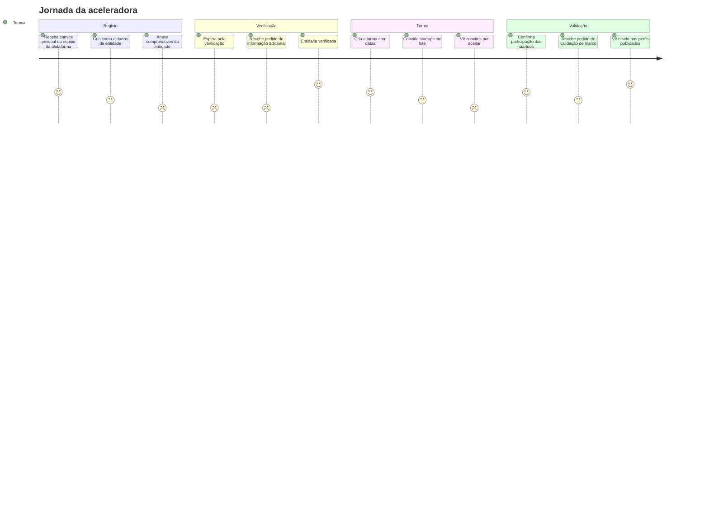

| Etapa | O que faz | O que pensa | Fricção | Resposta de design |
|---|---|---|---|---|
| Registo | Cria conta, indica tipo (aceleradora ou universidade), nome legal, NIF, responsável. | "Isto é sério? Quem está por trás?" | Formulário longo no telemóvel. | Formulário em passos curtos, rascunho guardado, explicação de para que serve cada documento. |
| Verificação | Espera. | "Quanto tempo demora? Fiz bem?" | Incerteza. **Pico negativo.** | Estado visível com prazo indicativo [S 3 dias úteis], o que a administração verifica e o que acontece a seguir. Pode já preparar a turma em rascunho. |
| Pedido de informação | Responde ao que falta. | "Porque não aceitaram logo?" | Sente-se posta em causa. | Mensagem que diz exactamente o que falta e porquê; responder sem recomeçar. |
| Criar turma | Nome do programa, edição, datas. | "Simples." | — | Três campos obrigatórios, nada mais. |
| Convidar | Lista de e-mails ou ligação para copiar. | "Será que chegou?" | E-mails errados, spam, a startup não abre. **Pico negativo.** | Estado por convite; reenviar; ligação para partilhar por WhatsApp (copiada pela aceleradora, não é mensagem interna). |
| Validar | Confirma participação e marcos. | "Estou a garantir o quê, exactamente?" | Medo reputacional. | O ecrã mostra a frase exacta que vai aparecer ao investidor antes de confirmar. Validação em lote para a participação. |

### 3.2 Startup: convite → perfil → sinais → pedido de acesso → decisão → actualizações → pipeline

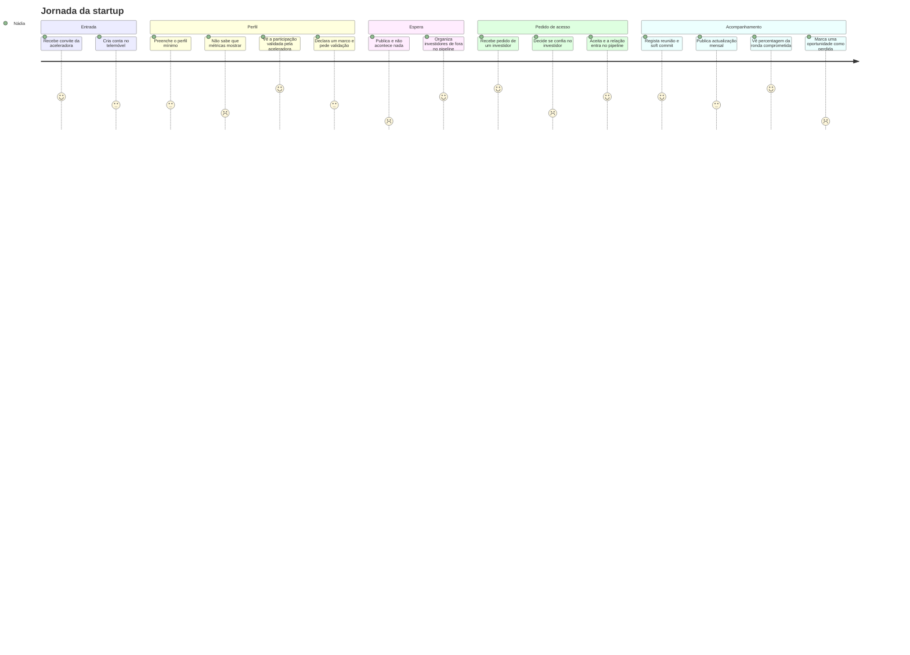

| Etapa | O que faz | O que pensa | Fricção | Resposta de design |
|---|---|---|---|---|
| Convite | Abre a ligação vinda por e-mail ou WhatsApp. | "É mesmo da aceleradora?" | Desconfiança de ligações. | O convite mostra o nome da aceleradora, que é verificada, e o nome de quem convidou. |
| Conta | Cria palavra-passe, aceita termos. | "Que dados vão guardar?" | Rede lenta; termos ilegíveis. | Aviso de privacidade em linguagem simples (Lei 22/11); página leve. |
| Perfil | Nome, sector, fase, cidade, resumo, ronda. | "O que é que um investidor quer ver?" | Não sabe o que escrever nem que métricas pôr [D aberta, 58%]. | Perfil mínimo para publicar (só o essencial) e um indicador de completude; exemplos por campo. |
| Sinais | Vê a participação na turma e declara marcos. | "Isto prova alguma coisa?" | Validação demora. | Mostra estado e prazo; mostra como o sinal vai aparecer ao investidor. |
| Espera | Perfil publicado, ninguém pede acesso. | "Ninguém me vê." | **Pior momento da jornada** (plataforma quase vazia). | Valor sem investidores: pipeline para contactos de fora, indicadores, lista de passos. Números honestos sobre a plataforma (ver 5.1). |
| Pedido | Recebe e analisa o pedido. | "Quem é esta pessoa? O que passa a ver?" | Medo de exposição [D privacidade]. **Pico negativo.** | Perfil do investidor, "porque este investidor encaixa", lista explícita do que fica visível, acesso revogável. |
| Pipeline | Move etapas, regista reuniões. | "Finalmente sei onde estou." | Esquecer de actualizar. | Lembretes de relações paradas; registar numa linha. |
| Perda | Marca como perdido. | "Mais um não." | Desânimo. | Motivo privado e obrigatório; mensagem que devolve o quadro geral da ronda. |

### 3.3 Investidor: registo → mandato → sugestões → pedido de acesso → acompanhamento

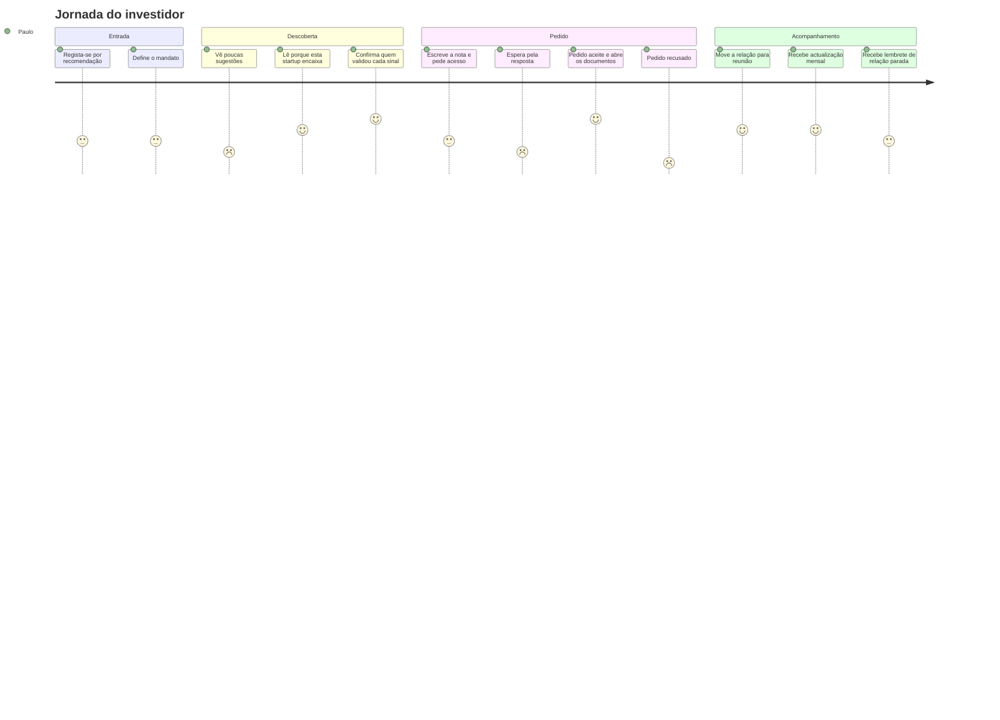

| Etapa | O que faz | O que pensa | Fricção | Resposta de design |
|---|---|---|---|---|
| Registo | Nome, organização, tipo (anjo, fundo, corporate). | "Vou ser bombardeado por startups?" | Receio de exposição. | Explicar que só as startups a quem pede acesso vêem o seu perfil. [S] |
| Mandato | Sectores, fase, cheque, geografia, risco. | "O que é 'risco' aqui?" | Campos ambíguos [H-03]. | Opções fechadas com exemplos; valores em Kz ou USD à escolha. |
| Sugestões | Lista curta. | "Só isto?" | Plataforma quase vazia. **Pico negativo.** | Estado honesto, opção de alargar critérios com explicação, aviso quando surgir uma nova startup compatível. |
| Porquê | Lê a decomposição da pontuação. | "Faz sentido" ou "isto não me interessa". | Pontuação opaca destrói confiança. | Pontuação sempre decomposta por critério, em linguagem simples. |
| Pedido | Escreve uma nota curta. | "O que digo?" | Página em branco. | Exemplo de nota, limite de caracteres, aviso do que a startup vai ver. |
| Espera | Aguarda. | "Leram?" | Silêncio. | Prazo de resposta visível; aviso de expiração. |
| Recusa | Recebe resposta negativa. | "Porquê?" | Frustração. | Texto neutro, motivo se a startup o partilhar, ligação para outras sugestões. |
| Acompanhamento | Move etapas, lê actualizações. | "Onde ia com esta startup?" | Esquecimento. | Histórico cronológico e lembretes. |

---

## 4. Arquitectura de informação

### 4.1 Decisões estruturais

| Decisão | Justificação |
|---|---|
| **Telemóvel primeiro:** navegação inferior com no máximo 5 destinos por papel; a administração pode ser optimizada para computador. | Foco em Angola, telemóvel primeiro, redes lentas (contexto). [S] A administração trabalha a partir de um computador. |
| **Uma conta, um papel** no MVP. | Simplifica a autenticação com papéis, que é o primeiro módulo a desenvolver. [S] Uma pessoa com dois papéis (ex.: fundador que é também anjo) usa duas contas. [F] multi-papel. |
| **Startups entram por convite** de uma entidade validadora. | O produto é para "startups aceleradas"; garante que cada startup tem pelo menos um sinal validável e alimenta o arranque pelas aceleradoras. [Dec-2] |
| **Investidores registam-se sozinhos.** | Sem isso não há procura no arranque. A verificação de investidores fica em [Dec-1]. |
| **Notificações não são mensagens.** Há um centro de notificações e e-mail; não há conversa interna. | Mensagens internas estão fora do escopo. |
| **O pipeline é privado de cada lado.** Cada lado tem as suas etapas e notas; só os eventos partilhados (pedido, aceitação, actualizações publicadas) são comuns. | Evita conflitos sobre "em que etapa estamos" e protege notas privadas. [S] [H-12] |

### 4.2 Área pública (sem sessão)

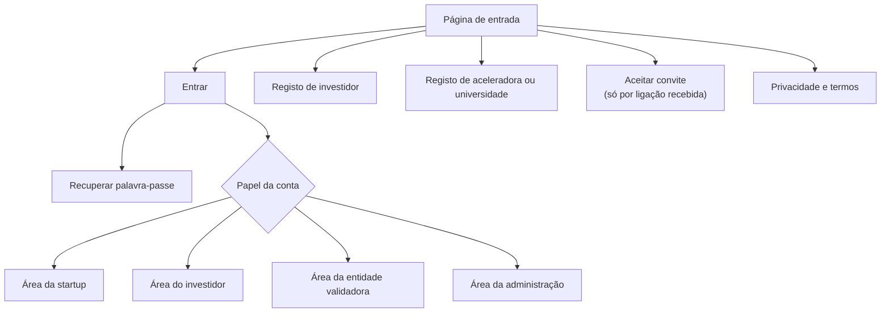

> [S] Não há perfis públicos de startups visíveis sem sessão. Só investidores autenticados vêem perfis (protecção de dados e confiança).

### 4.3 Startup

Navegação inferior: **Início · Investidores · Actualizações · Perfil · Conta**

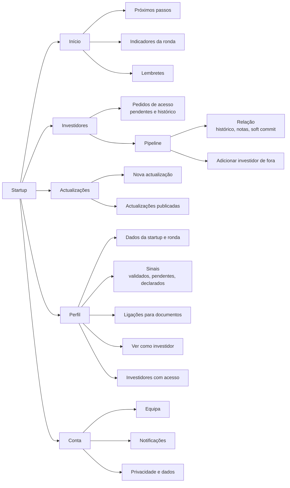

### 4.4 Investidor

Navegação inferior: **Início · Sugestões · Pipeline · Mandato · Conta**

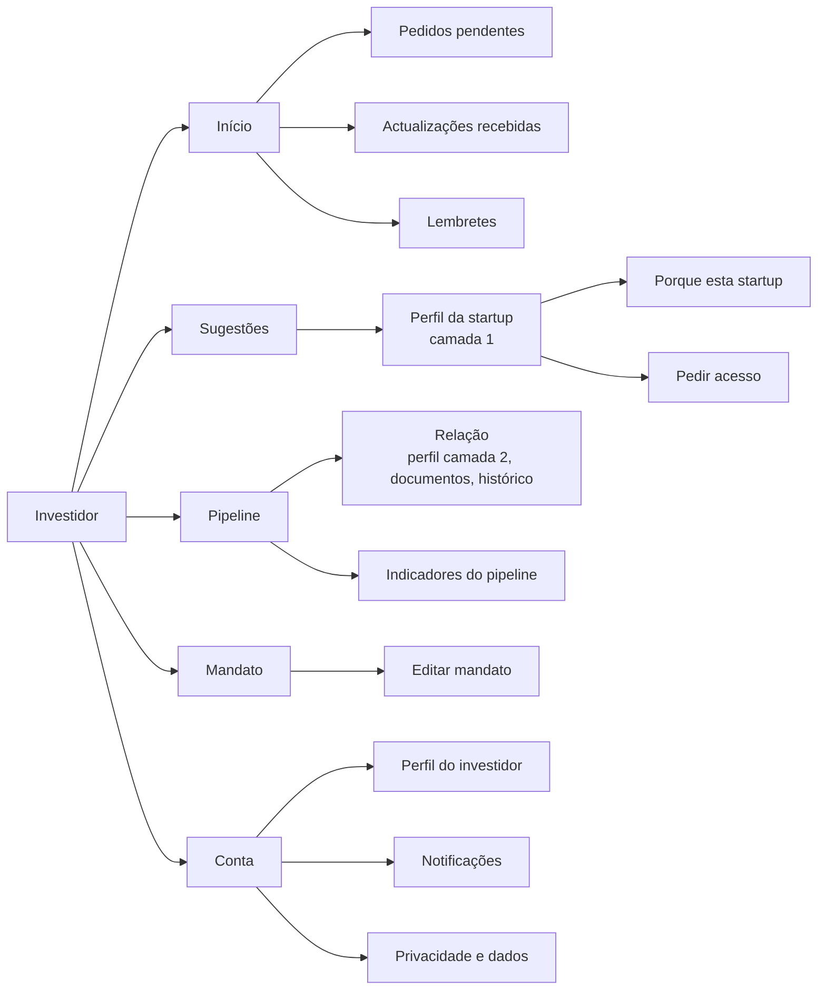

### 4.5 Entidade validadora (aceleradora ou universidade)

Navegação inferior: **Início · Turmas · Validações · Entidade · Conta**

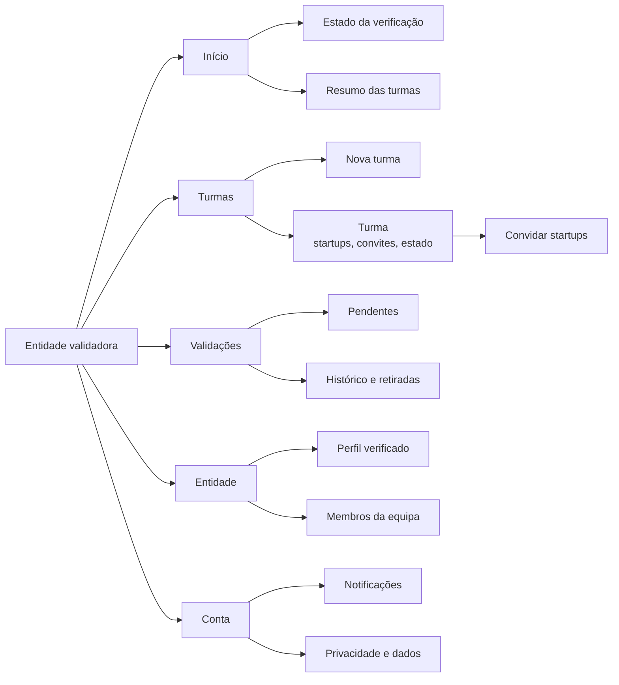

### 4.6 Administração

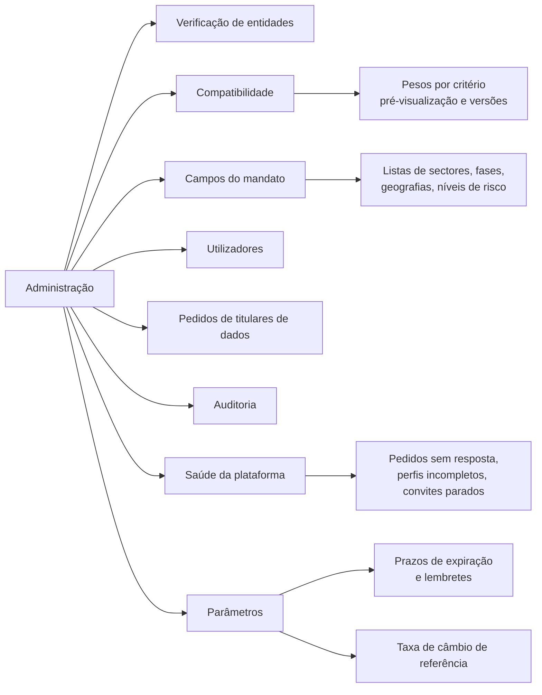

### 4.7 Objectos e permissões

| Objecto | Cria | Vê | Altera |
|---|---|---|---|
| Entidade validadora | Entidade | Todos (depois de verificada) | Entidade; administração verifica |
| Turma | Entidade | Entidade; startups da turma | Entidade |
| Convite | Entidade | Entidade; destinatário | Entidade (reenviar, cancelar) |
| Sinal | Startup (declara) ou sistema (participação na turma) | Investidores autenticados (camada 1) | Entidade valida, recusa ou retira |
| Perfil da startup | Startup | Camada 1: investidores autenticados · Camada 2: investidores com acesso | Startup |
| Mandato | Investidor | Startups que recebem pedido desse investidor [S] | Investidor |
| Pedido de acesso | Investidor | Investidor e startup | Startup aceita/recusa; investidor retira |
| Relação (pipeline) | Pedido aceite, ou startup/investidor manualmente | Só o lado que a tem | Só esse lado |
| Actualização | Startup | Investidores com acesso | Startup (até publicar) |
| Pesos e campos | Administração | Administração; explicação pública resumida | Administração, com versão |

---

## 5. Fluxos detalhados

### 5.0 Modelo comum de estados

Todos os ecrãs que mostram um objecto com estado usam os mesmos nomes e regras.

| Estado | Significado | Regra de experiência |
|---|---|---|
| **Vazio** | Ainda não existe nada. | Nunca é um beco sem saída: diz porquê está vazio e qual é a próxima acção útil. |
| **Pendente** | À espera de alguém. | Diz sempre **de quem** se espera e **até quando**. |
| **Aceite / Validado** | Concluído com sucesso. | Diz quem decidiu e quando; diz o que mudou. |
| **Recusado** | Decisão negativa. | Tom neutro; motivo quando existe; caminho alternativo. |
| **Expirado** | O prazo passou sem decisão. | Distinto de recusado (ninguém disse "não"); diz o que é possível fazer a seguir. |
| **Cancelado / Retirado / Revogado** | Desfeito por quem criou ou por quem concedeu. | Registo no histórico com autor e data. |
| **Erro** | Falha técnica (rede, servidor, validação). | Nunca perder o que o utilizador escreveu; diz se pode tentar de novo. |

**Prazos de partida** (todos configuráveis pela administração; todos [S] e a validar em [H-08]):

| Prazo | Valor de partida |
|---|---|
| Verificação de entidade (indicativo) | 3 dias úteis |
| Convite de turma | expira em 14 dias, lembrete ao 7.º dia |
| Pedido de acesso | expira em 14 dias, lembretes ao 3.º e ao 10.º dia |
| Novo pedido à mesma startup depois de recusa ou expiração | 90 dias |
| Pedido de validação de sinal | lembrete à entidade aos 7 dias; expira aos 30 |
| Relação parada | 21 dias sem movimento |
| Actualização periódica | lembrete mensal à startup |

### 5.1 Arranque com a plataforma quase vazia

**Problema:** nos primeiros meses haverá poucas startups e poucos investidores. A Nádia publica e ninguém pede acesso; o Paulo entra e vê duas sugestões. É o momento em que a plataforma pode ser abandonada.

**Estratégia (dentro do escopo):**

1. **Arranque pelas aceleradoras.** O desenvolvimento começa pelo módulo da aceleradora; cada aceleradora traz uma turma inteira de startups com um sinal já validável. A administração convida as primeiras entidades pessoalmente (Founder Institute Luanda, Acelera Angola, ISPTEC são candidatos óbvios pelos contactos do Kima). [S]
2. **Valor a solo para cada papel**, mesmo sem o outro lado:
   - Startup: pipeline com investidores de fora da plataforma, indicadores e lembretes. Responde directamente a 75% sem processo e a 50% em e-mail/Excel. [D]
   - Aceleradora: gestão da turma e validação com registo. [S]
   - Investidor: mandato guardado e aviso quando surgir uma startup compatível; pipeline próprio. [S]
3. **Honestidade sobre a dimensão.** Mostrar números reais ("12 startups verificadas, 3 compatíveis com o seu mandato"). Nunca simular actividade: a proposta é confiança.
4. **Alargar sem enganar.** Quando há poucas sugestões, oferecer "ver compatibilidades parciais", com o critério que falha explícito.
5. **Grupo fundador.** Os 22 voluntários do inquérito são convidados por aceleradoras parceiras (ou pela administração em nome delas, se não estiverem numa turma — ver [Dec-2]).

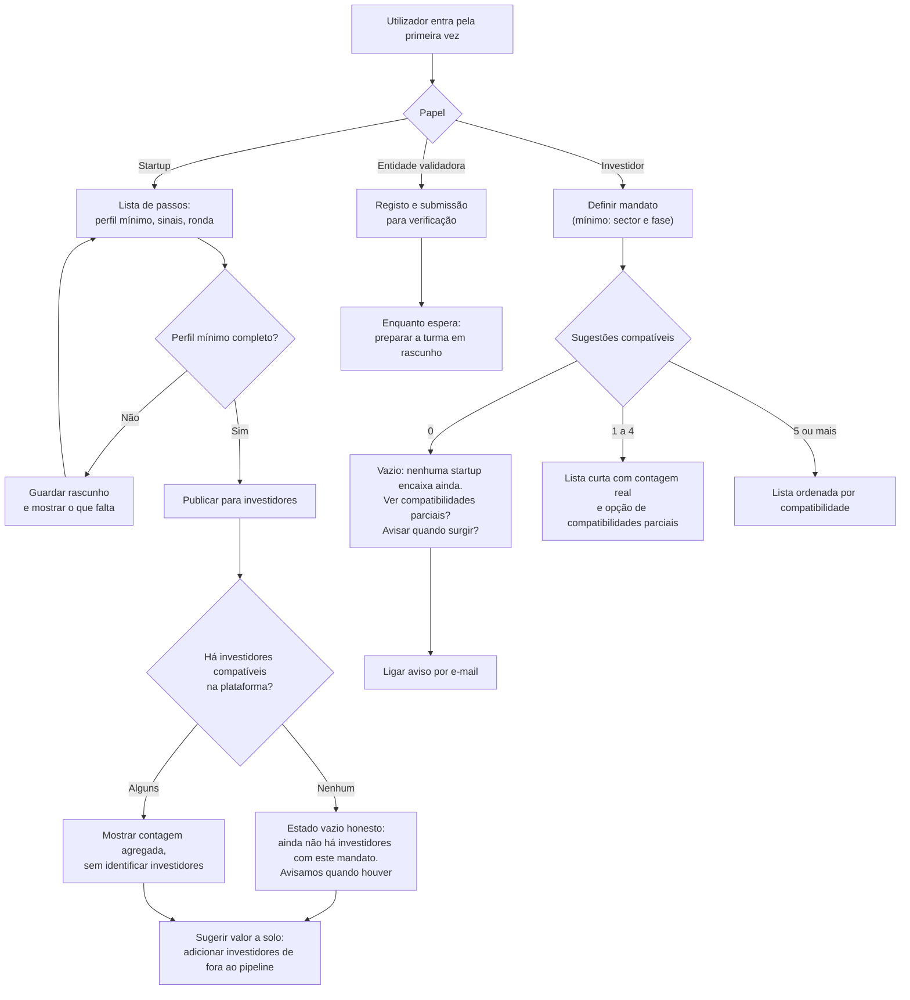

### 5.2 Verificação da entidade validadora (aceleradora ou universidade)

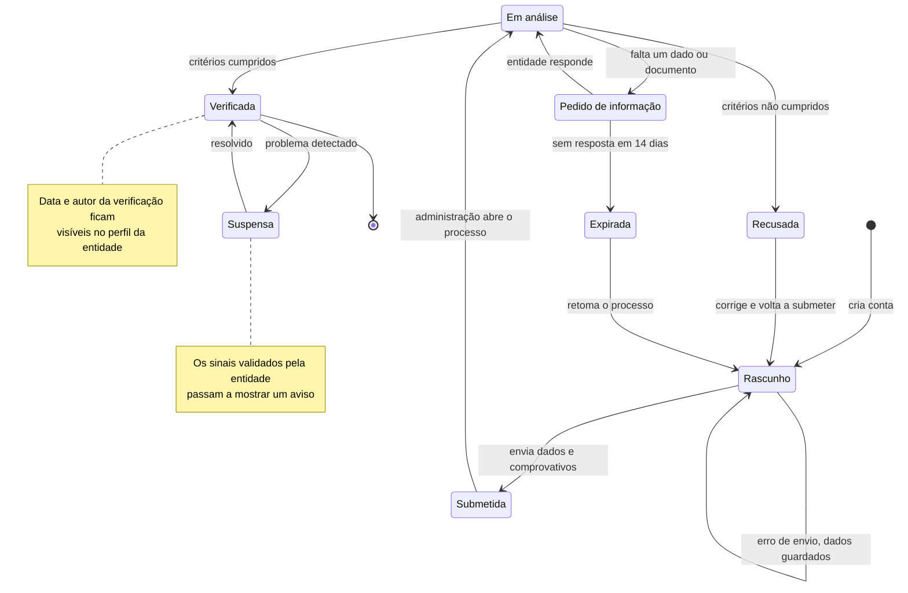

**Critérios de verificação** (lista fixa para a administração; [S] a confirmar com as aceleradoras): existência legal (NIF, registo), presença pública (site ou redes), pessoa responsável identificada com e-mail institucional, evidência de pelo menos um programa ou turma realizado.

**Enquanto está pendente**, a entidade pode criar turmas em rascunho mas **não pode enviar convites nem validar sinais**.

### 5.3 Turma e convites

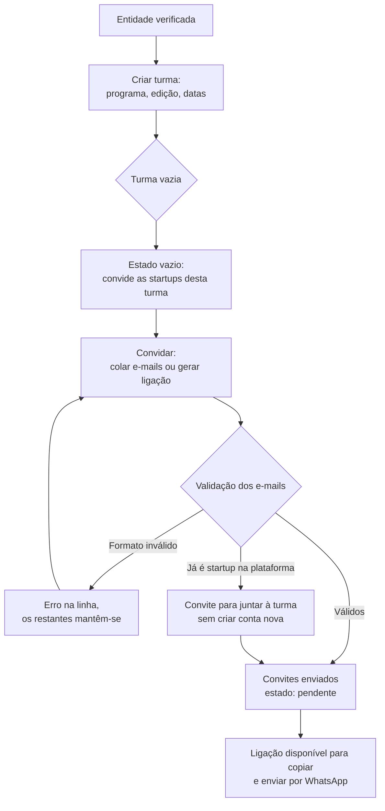

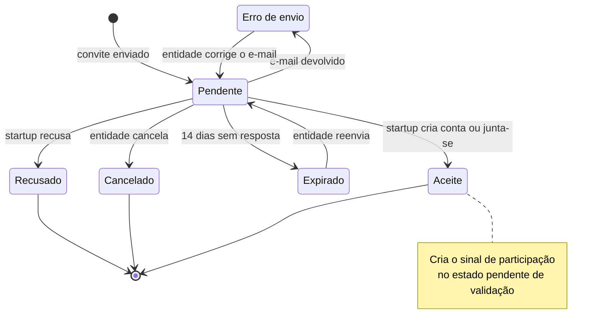

**Casos de borda:**
- Ligação aberta depois de expirar: ecrã "Este convite expirou", com o nome da entidade e a indicação de pedir novo convite à entidade.
- Ligação já usada: "Este convite já foi aceite. Entrar."
- Pessoa com sessão de investidor abre um convite de startup: explicar que é preciso outra conta (uma conta, um papel).

### 5.4 Sinal validado

Tipos de sinal no MVP:
1. **Participação num programa** (criado pelo convite da turma; validado pela entidade).
2. **Marco com data** (declarado pela startup; validação pedida a uma entidade a que a startup está ligada). [S] Exemplos: MVP lançado, primeiro cliente pagante, constituição legal.

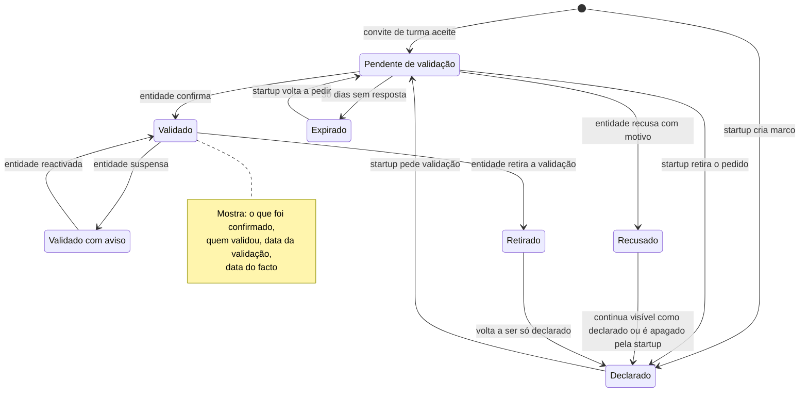

**Regras:**
- A entidade só pode validar sinais de startups ligadas a uma das suas turmas.
- Antes de confirmar, a entidade vê a frase exacta que o investidor vai ler.
- A recusa exige motivo (vai para a startup, não para o investidor).
- A retirada fica no histórico de auditoria; o investidor vê apenas o estado actual. [S] [H-07]

### 5.5 Mandato e sugestões (investidor)

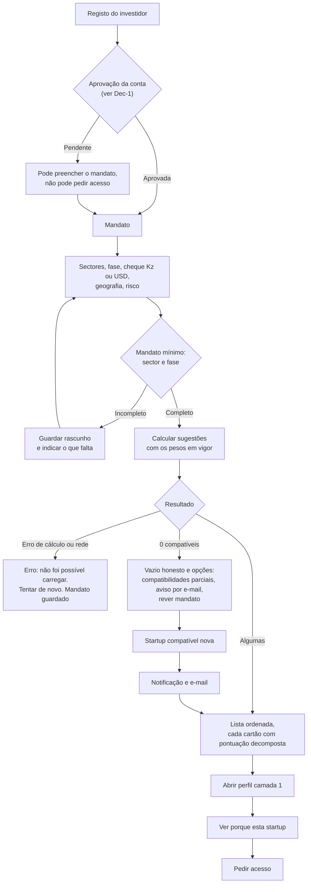

### 5.6 Pedido de acesso consentido

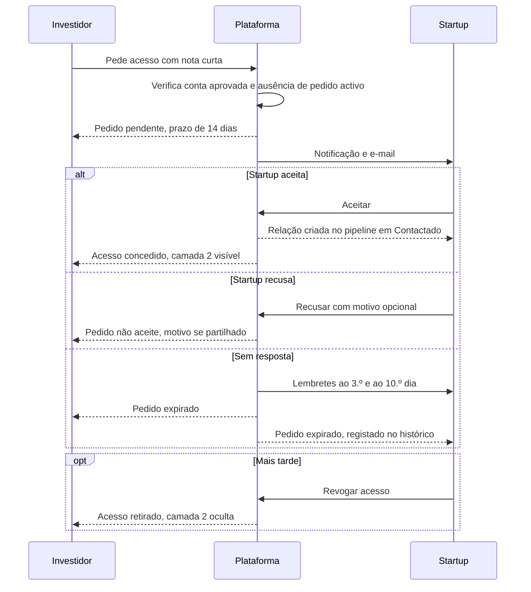

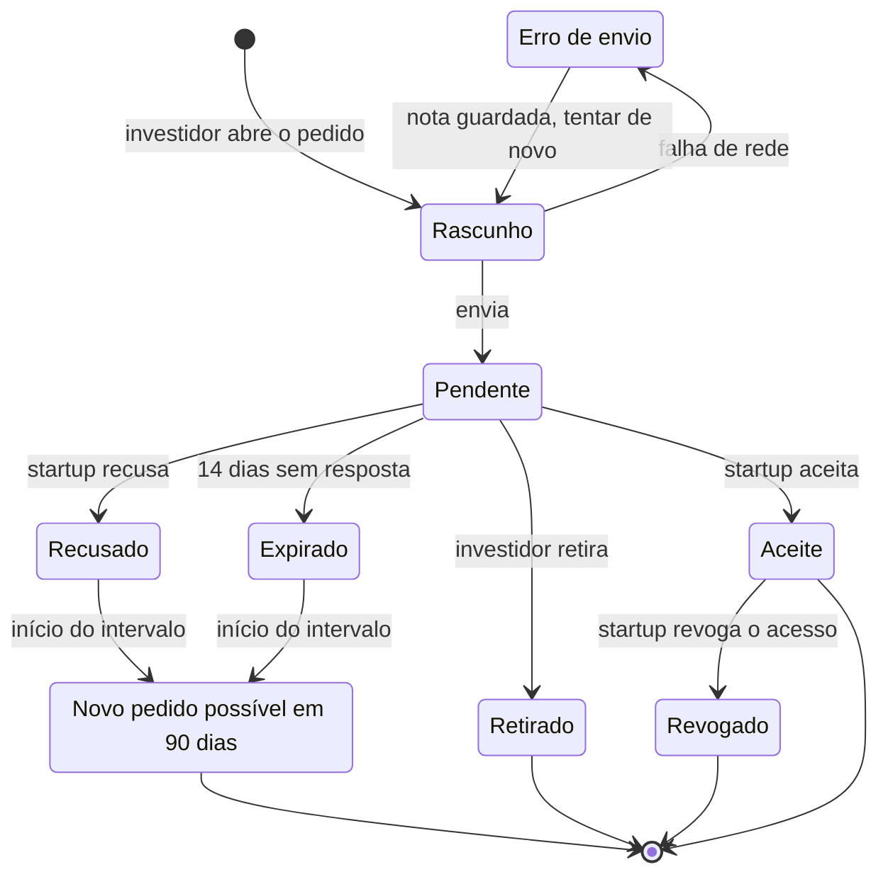

**O que muda com a aceitação** (camadas de visibilidade):

| Camada | Quem vê | Conteúdo |
|---|---|---|
| **1 · Descoberta** | Qualquer investidor autenticado (e aprovado, se [Dec-1]) | Nome, sector, fase, cidade, resumo, ronda (valor e moeda), sinais validados e declarados, compatibilidade. |
| **2 · Acesso concedido** | Investidores com pedido aceite | Contacto do fundador, ligações externas para documentos, indicadores detalhados, actualizações periódicas. |

**Documentos por ligação externa:** a plataforma só mostra a ligação depois de aceitar e esconde-a ao revogar. **Não consegue apagar o acesso no serviço externo** (Google Drive, OneDrive). A experiência tem de o dizer com clareza ao revogar (ver 8.2). Isto é coerente com o data room estar em último nas preferências [D 46%] e com o cofre estar fora do escopo.

**Erros e casos de borda:**
- Startup já tem pedido activo deste investidor: "Já pediu acesso a esta startup. Estado: pendente até {data}."
- Startup despublicou o perfil entre o pedido e a resposta: o pedido expira de imediato; o investidor é avisado sem detalhe.
- Investidor tenta pedir antes de ter a conta aprovada: botão substituído por explicação do estado.

### 5.7 Pipeline, perda e relações paradas

Etapas: **Identificado → Contactado → Reunião → Análise → Soft commit → Term sheet → Fechado / Perdido**

| Origem da relação | Lado | Etapa inicial |
|---|---|---|
| Investidor guarda uma sugestão | Investidor | Identificado |
| Pedido de acesso enviado | Investidor | Contactado (com estado do pedido) |
| Pedido de acesso aceite | Startup | Contactado |
| Investidor de fora da plataforma adicionado à mão | Startup | Identificado |

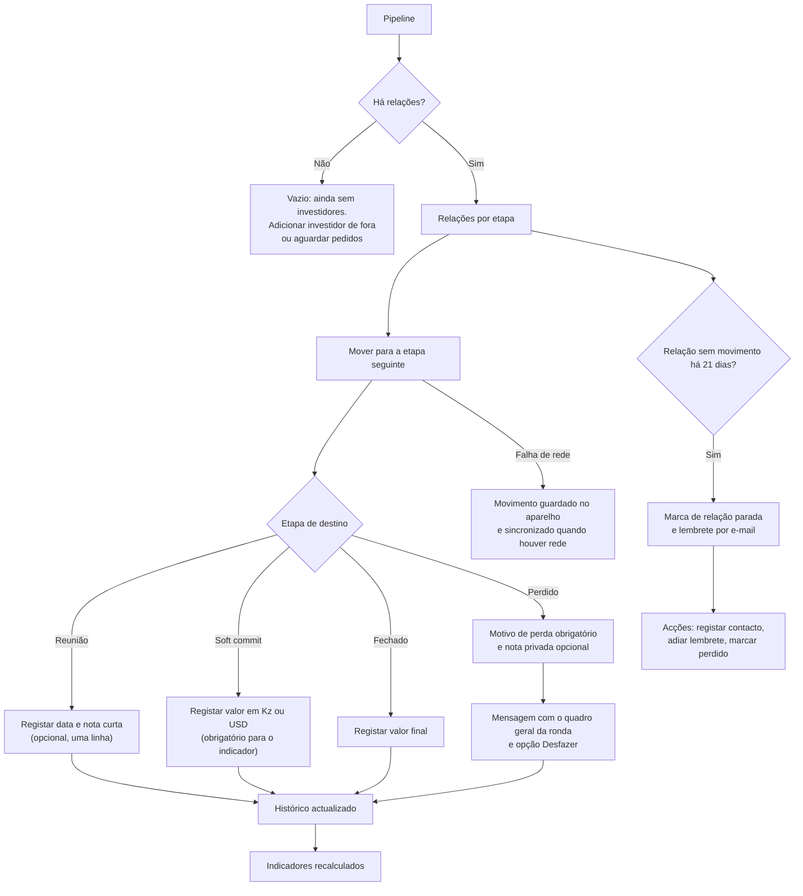

**Motivos de perda (lista fechada + Outro)** [S] [H-11]:
- Startup: Sem resposta do investidor · Fase não encaixa · Valor do cheque não encaixa · Sector não encaixa · Condições não aceites · Decidimos não avançar · Outro.
- Investidor: Fora do mandato · Equipa · Tracção insuficiente · Valorização · Sem capacidade neste momento · Outro.

**Indicadores** (calculados a partir do pipeline; nada é introduzido duas vezes):

| Indicador | Fórmula de partida [S] | Estado vazio |
|---|---|---|
| Conversão por etapa | relações que passaram da etapa N para N+1 ÷ relações que chegaram à etapa N | "Ainda sem dados suficientes: são precisas pelo menos 3 relações." |
| Tempo até ao primeiro soft commit | data do primeiro soft commit − data de início da ronda | "Ainda sem soft commits." |
| % da ronda comprometida | soma dos soft commits e fechados ÷ valor alvo da ronda | "Defina o valor da ronda no perfil para ver este indicador." |
| Relações paradas | número de relações sem movimento há mais de 21 dias | "Nenhuma relação parada." |

**Moeda:** cada valor é guardado na moeda em que foi introduzido; o equivalente na outra moeda aparece com "≈", a taxa de referência e a data da taxa, configuradas pela administração. [S] [H-16]

### 5.8 Actualização periódica

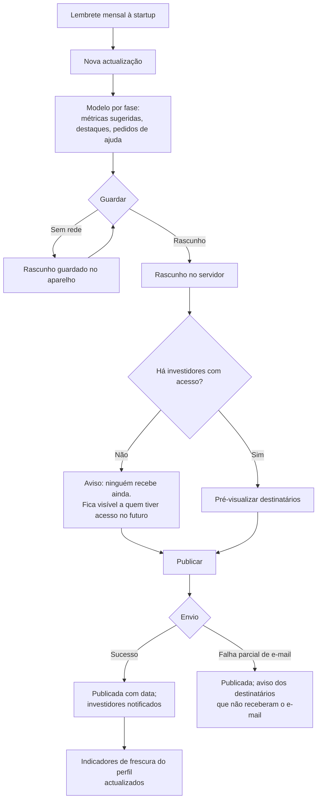

> [S] A actualização publicada não se edita; corrige-se com uma nova actualização ("Correcção à actualização de {data}"). Protege a confiança do investidor no histórico.

### 5.9 Erros transversais

| Situação | Comportamento |
|---|---|
| Sem rede ao submeter | Guardar no aparelho; mostrar "Guardado neste aparelho. Enviamos quando houver ligação." |
| Rede lenta | Mostrar conteúdo textual primeiro; imagens (logótipos) depois e opcionais. |
| Sessão expirada a meio de um formulário | Pedir para entrar de novo sem perder o que foi escrito. |
| Conflito (o mesmo objecto alterado por outra pessoa da equipa) | Mostrar a versão mais recente e o que se perdeu, nunca sobrescrever em silêncio. |
| Erro do servidor | Mensagem curta, código de referência para suporte, acção "Tentar de novo". |

---

## 6. Como a experiência reduz a assimetria de informação

Fundamento: no mercado de "limões" (Akerlof), quando o comprador não distingue qualidade, desconta tudo e as boas startups saem. A sinalização (Spence) só funciona se o sinal for **caro de falsificar**. Na plataforma, o sinal caro é a **confirmação por uma terceira entidade verificada, com nome e data**. A experiência tem uma função: tornar esse sinal visível, legível e distinto do que é apenas declarado.

### 6.1 Cadeia de confiança

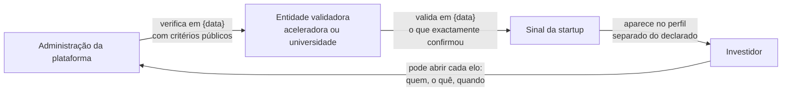

O investidor pode seguir a cadeia ao contrário: do sinal para a entidade, e da entidade para a data e os critérios da verificação.

### 6.2 Anatomia de um sinal

| Elemento | Exemplo | Obrigatório |
|---|---|---|
| O que foi confirmado | Participou no Programa de Aceleração 2025 (Março a Junho) | Sim |
| Estado | Validado · Pendente · Declarado | Sim |
| Quem validou | Aceleradora X | Sim, se validado |
| Estado da entidade | Entidade verificada pela plataforma em 10/01/2026 | Sim, se validado |
| Data da validação | Validado em 12/07/2025 | Sim, se validado |
| Data do facto | Concluído em Junho de 2025 | Sim |

**Forma textual de referência** (a especificação de interface decide a forma visual, mas a hierarquia é esta):

> **Validado** · Participou no Programa de Aceleração 2025 (Mar.–Jun. 2025)
> Validado por **Aceleradora X** em 12/07/2025 · entidade verificada pela plataforma

> **Declarado pela startup** · Primeiro cliente pagante (Nov. 2025)
> Ainda sem validação

**Regras obrigatórias:**
1. Validado e declarado nunca partilham o mesmo tratamento visual nem o mesmo título de secção.
2. No perfil, a secção "Verificado" vem antes de tudo o que é declarado.
3. Sem nome e data, não é validado.
4. Um sinal pendente não aparece ao investidor como sinal (aparece só à startup).

### 6.3 Onde aparece cada sinal

| Lugar | O que mostra | Para quem |
|---|---|---|
| Cartão da sugestão | Até 2 sinais validados mais fortes (participação primeiro) e a contagem total ("+2 validados") | Investidor |
| Perfil, camada 1 | Secção "Verificado" no topo; secção "Declarado pela startup" separada | Investidor |
| Perfil, "Ver como investidor" | Exactamente o que o investidor vê, nas duas camadas | Startup |
| Pedido de acesso (lado da startup) | Dados do investidor, todos como "declarado pelo investidor" ([Dec-1]) | Startup |
| Cartão da relação no pipeline | Marca de que a startup tem sinais validados | Investidor |
| Painel da entidade | Lista do que validou, com data, e opção de retirar | Entidade |

### 6.4 Frescura da informação

A assimetria também é temporal: um dado certo há um ano pode ser falso hoje.

- Cada indicador e actualização mostra "actualizado há N dias".
- [S] Ao fim de 90 dias sem actualização, o perfil mostra ao investidor "Sem actualizações há mais de 3 meses" e à startup um lembrete.
- O sinal mostra sempre a data do facto, não só a data da validação.

### 6.5 "Porque esta startup": explicação da compatibilidade

**Regras:**
1. A pontuação nunca aparece sem a decomposição por critério.
2. Cada critério diz se encaixa totalmente, parcialmente ou não encaixa, com uma frase.
3. Mostra os pesos em vigor e uma ligação para "Como calculamos" (texto público curto).
4. A pontuação é de **encaixe com o mandato**, não de **qualidade da startup**. Isto é dito explicitamente. Os sinais validados falam da credibilidade; a pontuação fala do encaixe. Misturar os dois seria criar uma nova assimetria.

**Forma textual de referência:**

> **Compatibilidade com o seu mandato: 87 de 100**
> - **Sector** · 40 de 40 · Agritech está no seu mandato.
> - **Fase** · 25 de 25 · Pré-seed está no seu mandato.
> - **Valor do cheque** · 12 de 25 · A ronda pede USD 80 000; o seu cheque vai até USD 50 000. Pode participar em parte.
> - **Geografia** · 10 de 10 · Luanda está no seu mandato.
>
> Esta pontuação mede o encaixe com o seu mandato, não a qualidade da startup.

**Regras de cálculo de partida** (para a engenharia; [S], configuráveis, a validar em [H-02]):

| Critério | Peso | Encaixe total | Encaixe parcial | Sem encaixe |
|---|---|---|---|---|
| Sector | 40 | sector da startup está no mandato | — | 0 |
| Fase | 25 | fase igual | fase adjacente: 50% | 0 |
| Valor do cheque | 25 | intervalo do investidor cobre a parcela típica da ronda | proporcional à sobreposição | 0 |
| Geografia | 10 | cidade ou província no mandato | "Angola" genérico: 100% | fora: 0 |
| Risco | 0 no MVP | — | — | — |

> O risco entra no mandato mas com peso 0 até ser validado, porque não há forma acordada de medir o risco de uma startup no MVP ([H-03]).

**Simetria:** quando a startup recebe um pedido, vê "Porque este investidor encaixa" com a mesma decomposição, a partir do mandato. A startup passa a ter informação sobre o investidor, que hoje não tem.

---

## 7. Princípios de UX do produto

### P1 · Validado nunca se confunde com declarado
**Porquê:** é o diferencial 1 e a resposta directa à teoria da sinalização; segurança e confiança aparecem em quase todas as respostas. [D]
**Aplica-se assim:** secções separadas; "validado" só com nome e data; pendente não é mostrado ao investidor.
**Anti-padrão:** um selo genérico "verificado" sem dizer quem verificou o quê.

### P2 · Nada sai sem o fundador saber, e o fundador sabe sempre quem vê o quê
**Porquê:** privacidade em quase todas as respostas [D]; Lei n.º 22/11; modelo de pedido de acesso consentido.
**Aplica-se assim:** "Ver como investidor"; lista "Investidores com acesso" com opção de revogar; cada ecrã de decisão lista o que muda.
**Anti-padrão:** partilhar documentos automaticamente ao aceitar sem dizer que a ligação externa continua a funcionar fora da plataforma.

### P3 · Toda a pontuação se explica numa frase
**Porquê:** uma pontuação opaca substitui uma assimetria por outra; as respostas abertas falam de "acesso a investidores do meu nicho". [D]
**Aplica-se assim:** decomposição por critério sempre visível; encaixe separado de qualidade.
**Anti-padrão:** "92% compatível" sozinho.

### P4 · Útil a solo antes de ser útil a dois
**Porquê:** arranque com a plataforma quase vazia; 75% sem processo e 50% em e-mail/Excel [D] mostram valor a solo imediato para a startup.
**Aplica-se assim:** pipeline aceita investidores de fora; aceleradora gere a turma mesmo sem investidores; nenhum estado vazio sem próxima acção.
**Anti-padrão:** ecrã "Sem resultados" como primeira experiência.

### P5 · Toda a espera tem dono e prazo
**Porquê:** "falta de resposta" [D aberta]; 54% não sabem em que etapa está cada investidor. [D]
**Aplica-se assim:** cada estado pendente diz de quem se espera e até quando; tudo expira; lembretes antes de expirar; relações paradas assinaladas.
**Anti-padrão:** pedidos pendentes para sempre.

### P6 · Pensado para um telemóvel com dados pré-pagos
**Porquê:** foco em Angola, telemóvel primeiro, redes lentas (contexto); [S] dados móveis caros.
**Aplica-se assim:** formulários em passos curtos com rascunho local; texto antes de imagens; nenhuma funcionalidade crítica depende de ficheiros grandes; valores em Kz e USD.
**Anti-padrão:** perder o que se escreveu porque a rede caiu.

### P7 · Ensinar enquanto se preenche
**Porquê:** 92% com menos de 3 anos no ecossistema, 58% sem indicadores e "não sei que métricas mostrar". [D]
**Aplica-se assim:** métricas sugeridas por fase na actualização; exemplos em cada campo do perfil; termos do sector (soft commit, term sheet) explicados na primeira ocorrência.
**Anti-padrão:** campos em branco com rótulos técnicos.

---

## 8. Microcopy dos momentos sensíveis

### 8.0 Tom e convenções

- **Tratamento:** [S] formas verbais de "você" sem escrever o pronome ("Aceite o convite", "Pode retirar o acesso"). Evita o "tu", que pode soar pouco profissional a investidores, e o "o senhor", que soa distante a fundadores jovens. A validar em [H-15].
- Frases curtas, uma ideia por frase. Diz sempre o que acontece a seguir.
- Termos do sector mantêm-se em inglês quando são correntes, explicados na primeira vez: "soft commit (compromisso indicativo)", "term sheet (proposta de termos)".
- Moeda: "Kz 45 000 000" e "USD 50 000"; equivalência com "≈".
- Datas: "12 de Março de 2026" em texto; "12/03/2026" em listas.
- `{chavetas}` marcam variáveis.

### 8.1 Convite da aceleradora

**E-mail**

> **Assunto:** {Aceleradora} convida a {Startup} para a turma {Programa} {Edição}
>
> Olá, {Nome}.
>
> A {Aceleradora} convidou a {Startup} para a turma {Programa} {Edição} na {Plataforma}.
>
> Ao aceitar, a {Aceleradora} pode confirmar no perfil da startup que participaram no programa. Os investidores verão essa confirmação com o nome de quem a fez e a data.
>
> A startup decide sempre o que partilha e com quem. Nenhum investidor vê os vossos documentos sem autorização.
>
> **[Aceitar convite]**
>
> O convite é válido até {data}. Convite enviado por {Nome do gestor}, {Aceleradora}.
> Se não reconhece este convite, ignore esta mensagem.

**Versão curta para a aceleradora copiar para WhatsApp ou SMS**

> {Aceleradora}: convidámos a {Startup} para a turma {Programa} {Edição} na {Plataforma}. Aceite até {data}: {ligação}

**Ecrã de aceitação**

> **{Aceleradora} convidou a {Startup}**
> Turma {Programa} {Edição} · Entidade verificada pela plataforma
>
> Depois de aceitar:
> - a {Aceleradora} pode confirmar a participação da startup;
> - o perfil fica em rascunho até decidir publicá-lo.
>
> [Aceitar e criar conta] · [Recusar convite]

**Convite expirado**

> **Este convite expirou em {data}.**
> Peça um novo convite a {Aceleradora}.

**Ecrã da aceleradora, antes de validar a participação**

> **Vai confirmar:** "{Startup} participou no {Programa} {Edição} ({datas})."
> Os investidores vão ver esta frase com o nome da {Aceleradora} e a data de hoje. Pode retirar a validação mais tarde.
> [Confirmar participação] · [Cancelar]

### 8.2 Pedido de acesso

**Investidor · composição**

> **Pedir acesso a {Startup}**
>
> A {Startup} vai ver o seu nome, a sua organização, o seu mandato e esta nota.
>
> **Porque quer conhecer a {Startup}?**
> *Ex.: Invisto em agritech pré-seed e quero perceber a vossa tracção com cantinas em Luanda.*
> Uma nota concreta ajuda a startup a decidir. {n}/300
>
> Se a {Startup} aceitar, passa a ver o contacto do fundador, os documentos e as actualizações.
>
> [Enviar pedido]

**Investidor · confirmação e estado**

> **Pedido enviado.** A {Startup} tem até {data} para responder. Avisamos por e-mail.

> Pendente · responde até {data} · [Retirar pedido]

**Startup · notificação**

> {Nome} ({Organização}) quer conhecer a {Startup}. Responda até {data}.

**Startup · ecrã de decisão**

> **Pedido de acesso de {Nome}**
> {Organização} · {Tipo de investidor} · dados declarados pelo investidor
>
> **Porque este investidor encaixa:** {decomposição por critério}
>
> **Nota:** "{nota do investidor}"
>
> **Se aceitar, {Nome} passa a ver:**
> - o contacto do fundador;
> - as ligações para os documentos;
> - os indicadores e as actualizações.
>
> Pode retirar o acesso quando quiser.
> Sem resposta até {data}, o pedido expira e {Nome} é avisado.
>
> [Aceitar] · [Recusar]

**Startup · depois de aceitar**

> **Acesso concedido a {Nome}.** Adicionado ao pipeline em Contactado.
> Confirme que as ligações dos documentos só abrem para quem tem a ligação.

**Startup · revogar acesso**

> **Retirar o acesso de {Nome}?**
> {Nome} deixa de ver o contacto, os documentos e as actualizações nesta plataforma.
> **Atenção:** se {Nome} guardou as ligações dos documentos, elas continuam a abrir até mudar a partilha no serviço onde estão (por exemplo, Google Drive).
> [Retirar acesso] · [Cancelar]

### 8.3 Recusa

**Startup · ao recusar**

> **Recusar o pedido de {Nome}?**
> {Nome} é avisado de que o pedido não foi aceite. Não passa a ver nada além do que já vê hoje.
>
> **Partilhar um motivo com {Nome}? (opcional)**
> ○ Não estamos a captar investimento neste momento
> ○ O valor do cheque não encaixa na nossa ronda
> ○ A fase ou o sector não encaixam
> ○ Prefiro não indicar motivo
>
> [Recusar pedido] · [Voltar]

**Investidor · recebe a recusa**

> **A {Startup} não aceitou o pedido desta vez.**
> {Se houver motivo:} Motivo indicado: {motivo}.
> Pode voltar a pedir a partir de {data + 90 dias}.
> [Ver outras startups compatíveis]

**Investidor · pedido expirado**

> **O pedido à {Startup} expirou em {data} sem resposta.**
> Pode voltar a pedir a partir de {data + 90 dias}.
> [Ver outras startups compatíveis]

**Entidade · recusa da validação de um marco (para a startup)**

> **{Aceleradora} não validou "{marco}".**
> Motivo: {motivo}.
> O marco continua no perfil como declarado pela startup. Pode corrigi-lo e pedir validação de novo, ou apagá-lo.

### 8.4 Perda de uma oportunidade

**Startup · marcar como perdido**

> **Porque é que esta oportunidade não avançou?** (obrigatório)
> ○ Sem resposta do investidor
> ○ A fase não encaixa
> ○ O valor do cheque não encaixa
> ○ O sector não encaixa
> ○ Não aceitámos as condições
> ○ Decidimos não avançar
> ○ Outro: ______
>
> Nota (só a sua equipa vê): ______
>
> Esta informação é privada. Serve para mostrar onde a captação está a parar.
>
> [Marcar como perdido]

**Startup · depois de marcar** (variante com outras relações activas)

> **Registado.** A ronda continua: {n} relações activas e {x}% comprometido. [Desfazer]

**Startup · depois de marcar** (variante sem outras relações activas)

> **Registado.** Guardar o motivo de cada perda ajuda a ver o padrão. [Ver motivos das perdas] · [Desfazer]

**Investidor · marcar como perdido**

> **Porque não vai avançar com a {Startup}?** (obrigatório, privado)
> A {Startup} não é avisada. Se quiser informá-la, faça-o pelo seu contacto directo.

> [S] A startup não é notificada quando um investidor marca a relação como perdida (pipeline privado). A validar em [H-12].

### 8.5 Estados vazios e erros (amostra)

| Momento | Texto |
|---|---|
| Startup sem pedidos | **Ainda sem pedidos de acesso.** Enquanto espera, organize no pipeline os investidores que já contactou fora da plataforma. [Adicionar investidor] |
| Investidor sem sugestões | **Nenhuma startup encaixa totalmente no seu mandato ainda.** Há {n} startups verificadas na plataforma. [Ver compatibilidades parciais] · [Avisar-me quando surgir uma] |
| Entidade à espera de verificação | **Estamos a verificar a {Entidade}.** Prazo indicativo: {data}. Enquanto isso, pode preparar a primeira turma. |
| Sem rede | **Sem ligação.** O que escreveu está guardado neste aparelho e será enviado quando houver rede. |

---

## 9. Plano de testes de usabilidade e de validação

### 9.1 Objectivos

1. Medir se cada papel consegue completar as tarefas críticas (sucesso, tempo, erros, SUS).
2. Medir se o investidor **percebe** os sinais e a compatibilidade (a hipótese central do TCC).
3. Validar campos do mandato, pesos da compatibilidade e prazos (secção 10), usando a mesma sessão como entrevista.

### 9.2 Participantes e recrutamento

| Grupo | Origem | Ronda 1 (moderada) | Ronda 2 (moderada) | Não moderado |
|---|---|---|---|---|
| Fundadores | 22 voluntários do inquérito [S maioria fundadores; confirmar o papel de cada um] | 5 | 5 (pessoas diferentes) | restantes: 3 tarefas + SUS |
| Investidores | 3 do inquérito + administrador de fundo (contacto do Kima) + 1 a 2 por indicação das aceleradoras | — | 4 a 6 | — |
| Entidades validadoras | 2 do inquérito + Founder Institute Luanda + ISPTEC [S] | 2 a 4 | — | — |

> Com 5 participantes por ronda e papel detectam-se a maioria dos problemas graves de usabilidade, mas os resultados quantitativos (sobretudo SUS) têm intervalos largos. No relatório, apresentar média, mínimo e máximo, e não tratar o SUS de investidores ou aceleradoras como estatisticamente conclusivo.

### 9.3 Rondas e formato

| Ronda | Quando | Protótipo | Papéis |
|---|---|---|---|
| **1** | Quando a autenticação com papéis e o módulo da aceleradora estiverem prontos | Código funcional para aceleradora e entrada da startup por convite; protótipo navegável para o resto | Entidades validadoras e fundadores |
| **2** | Antes de programar sugestões, pedido de acesso e pipeline | Protótipo navegável de média fidelidade | Fundadores e investidores |

- **Local:** presencial no ISPTEC ou num espaço de aceleradora, ou remoto por videochamada com partilha de ecrã. [S]
- **Aparelho:** o telemóvel do próprio participante sempre que possível (reflecte rede e aparelho reais). Em computador, simular rede lenta nas ferramentas do navegador.
- **Dados:** só dados fictícios no protótipo (startups e investidores inventados, documentos falsos).
- **Gravação:** só com consentimento explícito (9.7).

### 9.4 Tarefas

Tempos-alvo [S], a recalibrar com o primeiro participante de cada papel.

**Entidade validadora**

| ID | Cenário | Critério de sucesso | Tempo-alvo |
|---|---|---|---|
| A1 | "Registe a sua aceleradora e envie-a para verificação." | Submetida com todos os campos obrigatórios | ≤ 6 min |
| A2 | "A plataforma pediu mais informação. Descubra o que falta e responda." | Identifica o item em falta e reenvia | ≤ 2 min |
| A3 | "Crie a turma do vosso programa deste ano." | Turma criada com nome, edição e datas | ≤ 2 min |
| A4 | "Convide estas 3 startups; uma delas prefere receber por WhatsApp." | 2 convites por e-mail e 1 ligação copiada | ≤ 3 min |
| A5 | "Confirme a participação de duas startups e recuse o marco de uma terceira, explicando porquê." | 2 validações, 1 recusa com motivo | ≤ 3 min |
| A6 | "Um convite não chegou. Resolva." | Encontra o convite expirado ou com erro e reenvia | ≤ 2 min |

**Startup**

| ID | Cenário | Critério de sucesso | Tempo-alvo |
|---|---|---|---|
| S1 | "Recebeu este convite no WhatsApp. Entre na plataforma." | Conta criada a partir do convite | ≤ 4 min |
| S2 | "Deixe o perfil pronto para os investidores verem." | Perfil mínimo publicado | ≤ 8 min |
| S3 | "Lançaram o MVP em Março. Peça à aceleradora que o confirme." | Marco declarado com data e pedido de validação enviado | ≤ 3 min |
| S4 | "Antes de aceitar alguém, o que é que um investidor já vê sobre vocês? E o que passa a ver se aceitar?" | Distingue correctamente as duas camadas | ≤ 3 min |
| S5 | "Chegou um pedido de acesso. Decida se aceita e explique porquê." | Decide e cita pelo menos um elemento do ecrã | ≤ 3 min |
| S6 | "Recuse este segundo pedido e diga ao investidor que não estão a captar." | Recusa com motivo partilhado | ≤ 1 min |
| S7 | "Na semana passada reuniu-se com um investidor que não está na plataforma. Registe isso." | Investidor adicionado e na etapa Reunião | ≤ 3 min |
| S8 | "Um investidor desistiu porque o cheque era pequeno. Registe." | Relação em Perdido com motivo correcto | ≤ 1 min |
| S9 | "Publique a actualização deste mês." | Actualização publicada | ≤ 5 min |
| S10 | "Quanto da ronda já está comprometido? Que relação está parada?" | Responde correctamente às duas perguntas | ≤ 1 min |

**Investidor**

| ID | Cenário | Critério de sucesso | Tempo-alvo |
|---|---|---|---|
| I1 | "Registe-se e diga à plataforma em que tipo de startups investe." | Mandato mínimo guardado | ≤ 6 min |
| I2 | "Qual destas startups encaixa melhor no seu mandato? Porquê?" | Escolhe a de maior encaixe e explica pelo menos 1 critério | ≤ 3 min |
| I3 | "Quem confirmou que esta startup participou num programa, e quando?" | Nomeia a entidade e a data correctas | ≤ 1 min |
| I4 | "Peça acesso a esta startup." | Pedido enviado com nota | ≤ 3 min |
| I5 | "Ainda não teve resposta de uma startup. Até quando pode esperar?" | Encontra o estado e a data de expiração | ≤ 1 min |
| I6 | "Uma startup aceitou. Abra os documentos e registe que marcaram reunião." | Abre a ligação e move para Reunião | ≤ 3 min |
| I7 | "Altere o mandato para um sector sem startups. O que faz agora?" | Usa compatibilidades parciais ou liga o aviso | ≤ 2 min |

### 9.5 Métricas e metas

| Métrica | Como se mede | Meta |
|---|---|---|
| Taxa de sucesso | Por tarefa: sucesso, sucesso com ajuda, falha | ≥ 80% sem ajuda em cada tarefa crítica [S] |
| Tempo na tarefa | Do fim da leitura do cenário até ao critério de sucesso | ≤ tempo-alvo na mediana |
| Erros | Críticos (impedem a tarefa) e não críticos (recuperados) | 0 críticos nas tarefas S4, S5, I2, I3 |
| Facilidade por tarefa (SEQ) | "Quão fácil foi?" de 1 a 7, depois de cada tarefa | Mediana ≥ 5 |
| SUS | Questionário de 10 itens no fim; versão portuguesa validada (Martins et al., 2015) | **≥ 70** por papel |
| **Compreensão do sinal** | I3 e pergunta "o que significa 'validado'?" | ≥ 80% respondem correctamente |
| **Compreensão da compatibilidade** | I2: explica por que critério | ≥ 80% citam pelo menos um critério correcto |
| **Compreensão da privacidade** | S4 | ≥ 80% distinguem as duas camadas |
| Confiança | "Usaria esta informação para decidir marcar uma reunião?" de 1 a 7 | Mediana ≥ 5 (investidores) |

> Nota para o relatório: o SUS mede usabilidade percebida, não confiança. As três métricas de compreensão (sinal, compatibilidade, privacidade) são as que testam directamente a redução da assimetria de informação.

### 9.6 Guia de sessão (60 minutos)

**0–5 min · Boas-vindas e consentimento**
- "Estamos a testar a plataforma, não a si. Se algo for difícil, o problema é nosso."
- Explicar para que serve a sessão, o que se grava, onde fica guardado, por quanto tempo, e que pode desistir a qualquer momento (Lei n.º 22/11).
- Pedir consentimento verbal gravado e escrito.

**5–15 min · Entrevista de contexto (validação do problema)**

*Fundadores*
1. Conte-me a última vez que contactou um investidor. O que aconteceu a seguir?
2. Onde regista hoje os contactos com investidores? Mostre-me, se puder.
3. Que números mostra hoje a um investidor? Como os escolheu?
4. O que nunca partilharia com um investidor antes de o conhecer?
5. Que prova de credibilidade gostaria de mostrar e hoje não consegue?

*Investidores*
1. Como encontrou a última startup em que investiu ou quase investiu?
2. Que informação lhe faltou para decidir?
3. Em Angola, quem lhe dá confiança quando diz que uma startup é séria?
4. Como descreveria o seu mandato a um colega?
5. Como acompanha hoje as startups depois da primeira reunião?

*Entidades validadoras*
1. Como confirmam hoje que uma startup participou num programa?
2. O que estariam dispostos a confirmar além da participação?
3. Quanto tempo por mês podiam dedicar a validações?
4. O que vos preocupa em associar o nome da entidade a uma startup?
5. Que informação sobre a turma, depois do programa, vos seria útil?

**15–40 min · Tarefas com pensamento em voz alta**
- Ler cada cenário em voz alta e entregá-lo por escrito.
- Perguntas neutras apenas: "O que está a pensar?", "O que esperava que acontecesse?", "Onde procuraria?"
- Não ajudar antes de 2 minutos de bloqueio; registar como "sucesso com ajuda".
- SEQ depois de cada tarefa.

**40–45 min · SUS**

**45–58 min · Entrevista de validação (secção 10)**

*Investidores*
1. **Exercício dos 100 pontos:** "Tem 100 pontos para distribuir entre sector, fase, valor do cheque, geografia e risco, conforme a importância para decidir se olha para uma startup." Registar a distribuição. Testa [H-02].
2. **Ordenação de cartões:** dar 3 cartões de startups fictícias (sem pontuação) e pedir que as ordene; comparar com a ordem do algoritmo. Testa [H-02].
3. **Campos do mandato:** mostrar a lista de campos candidatos e pedir que classifique cada um em essencial, útil ou dispensável. Testa [H-01] e [H-03].
4. "Que critério falta?" e "Como define 'risco' quando escolhe uma startup?"
5. "Com que frequência quer actualizações? Por e-mail, WhatsApp ou na plataforma?" Testa [H-09] e [H-14].

*Fundadores*
1. "Aceitaria um pedido de um investidor que não conhece? O que precisaria de ver?" Testa [H-05] e [Dec-1].
2. "Quanto tempo acha razoável para responder a um pedido?" Testa [H-08].
3. "Que métricas mostraria todos os meses?" Testa [H-10].
4. "Prefere que a plataforma o trate por 'tu' ou 'você'?" Testa [H-15].

*Entidades validadoras*
1. Ver a frase de validação e perguntar: "Assinaria isto? O que mudaria?" Testa [H-06].
2. "Que marcos se sentem confortáveis a confirmar?" Testa [H-07].

**58–60 min · Fecho**
- "Há alguma coisa que não perguntei e devia ter perguntado?"
- Agradecer; explicar quando terá acesso à versão seguinte.

### 9.7 Registo, análise e ética

- **Folha de registo por sessão:** tarefa × resultado × tempo × erros × SEQ × citações relevantes.
- **Severidade dos problemas:** escala de Nielsen (0 a 4); corrigir todos os de severidade 3 e 4 antes da ronda seguinte.
- **Síntese:** matriz problemas × participantes; agrupamento por afinidade das respostas da entrevista.
- **Rastreabilidade para o relatório:** cada alteração de design aponta para o problema observado e para o dado do inquérito que a sustentava.
- **Ética e dados:** consentimento informado escrito; gravações guardadas apenas pelo tempo do TCC; transcrições anonimizadas; nenhum dado real de startups no protótipo. [S] Confirmar com o orientador se é necessário aprovação de comissão de ética do ISPTEC.

---

## 10. Hipóteses a validar

| ID | Hipótese | Origem | Como testar | Critério para confirmar |
|---|---|---|---|---|
| **H-01** | Os campos do mandato (sectores, fase, valor do cheque, geografia, risco) chegam para descrever o que um investidor procura em Angola. | Escopo do MVP; n = 3 | Classificação essencial/útil/dispensável; "que critério falta?" | ≥ 4 de 5 investidores classificam sector, fase e cheque como essenciais; nenhum campo em falta é citado por mais de metade |
| **H-02** | Os pesos 40/25/25/10 reflectem a importância real dos critérios. | Escopo do MVP | Exercício dos 100 pontos; ordenação de 3 cartões | Média de cada peso a ± 10 pontos do valor proposto; ordem do algoritmo coincide com a do investidor em ≥ 2 de 3 posições |
| **H-03** | "Risco" é interpretado da mesma forma pelos investidores. | [S] | Pedir definição livre | Pelo menos 3 de 5 dão a mesma definição; caso contrário, o campo é retirado ou reformulado |
| **H-04** | A lista de sectores e de fases de partida cobre as startups angolanas. | [S] | Validar com aceleradoras e com os 17 fundadores | < 10% das startups escolhem "Outro" |
| **H-05** | As startups aceitam pedidos de investidores que não conhecem, desde que vejam mandato, organização e nota. | Privacidade [D quase todas] | Tarefa S5 e entrevista | ≥ 70% aceitariam com a informação mostrada |
| **H-06** | As aceleradoras aceitam associar o nome à frase de validação proposta. | n = 2 | Mostrar a frase | ≥ 2 de 3 entidades aceitam sem mudanças de fundo |
| **H-07** | As aceleradoras aceitam validar marcos com data, além da participação. | n = 2 | Entrevista | Pelo menos 2 tipos de marco aceites por todas |
| **H-08** | Os prazos de partida (14 dias por pedido, 14 por convite, 21 para relação parada) são adequados. | [S] | Entrevista a fundadores e investidores | Mediana das respostas dentro de ± 50% do valor proposto |
| **H-09** | A actualização mensal é a frequência certa. | [S] | Entrevista | Maioria de investidores e fundadores escolhe mensal |
| **H-10** | Um modelo de métricas por fase resolve o "não sei que métricas mostrar". | [D] aberta; 58% | Tarefa S9 + entrevista | ≥ 80% publicam actualização sem ajuda e dizem que as sugestões ajudaram |
| **H-11** | As listas fechadas de motivos de perda cobrem a maioria dos casos. | [S] | Tarefa S8 + entrevista | "Outro" < 20% |
| **H-12** | O pipeline privado de cada lado é preferível a um pipeline partilhado. | [S] | Entrevista aos dois lados | Maioria de ambos os lados prefere privado |
| **H-13** | Separar "validado" de "declarado" aumenta a confiança do investidor. | Spence; diferencial 1 | Compreensão do sinal (I3) e escala de confiança | ≥ 80% de compreensão e mediana de confiança ≥ 5 |
| **H-14** | O e-mail chega como canal de notificação no MVP. | [S]; WhatsApp é o canal dominante | Entrevista | Maioria lê e-mail profissional pelo menos diariamente; caso contrário, WhatsApp vai para [F] com prioridade |
| **H-15** | O tratamento com formas de "você" é aceite por fundadores e investidores. | [S] | Pergunta directa | Maioria de ambos os grupos aceita |
| **H-16** | Mostrar Kz e USD com taxa de referência é útil e não confunde. | Foco em Angola | Tarefas S10 e I2 | Nenhum erro de leitura de valores |
| **H-17** | Os 22 voluntários aceitam entrar por convite de uma aceleradora. | [Dec-2] | Confirmar quantos estão ligados a uma aceleradora ou universidade | ≥ 70% ligados a uma entidade |
| **H-18** | As ligações externas para documentos satisfazem os investidores no MVP. | [D] data room em último (46%) | Entrevista a investidores | Nenhum investidor considera impeditivo |

Campos candidatos ao mandato **a testar, não a construir** (para a classificação de H-01): tipo de instrumento (capital, dívida convertível), exigência mínima de receita, ticket de seguimento, foco em impacto social.

---

## 11. Trabalho futuro (fora do MVP)

- Validadores de nível intermédio (mentores, investidores) e básico (clientes, parceiros).
- Verificação formal de investidores com selo (ver [Dec-1]).
- Startup pedir contacto a investidores (hoje só o investidor pede; resposta à queixa "acesso a investidores do meu nicho").
- Pesos personalizados por investidor.
- Cofre de documentos com controlo de acesso (data room).
- Mensagens e agenda internas.
- Notificações por WhatsApp ou SMS (dependente de H-14).
- Uma pessoa com vários papéis numa só conta.
- Importação de contactos a partir de Excel.
- Resultados de captação agregados por turma para a aceleradora (exige consentimento das startups).
- Exportação de relatórios para comités de investimento.
- Registo livre de startups sem entidade validadora.
- Aplicação nativa e modo totalmente offline.

---

## 12. Decisões em aberto para o Kima

| ID | Decisão | Opções | Recomendação | Dado que a sustenta |
|---|---|---|---|---|
| **Dec-1** | Os investidores são aprovados manualmente pela administração antes de poderem pedir acesso? | (a) não; (b) aprovação manual leve (identidade e organização) sem selo público | **(b)** — custo baixo com poucos utilizadores, e não é um novo módulo porque a administração já verifica entidades | Privacidade em quase todas as respostas [D]; medo de exposição das startups |
| **Dec-2** | As startups só entram por convite de uma entidade? | (a) só convite; (b) convite ou registo livre | **(a)** no MVP; a administração pode emitir convites em nome de uma entidade parceira para voluntários sem turma | Produto para "startups aceleradas"; arranque pelo módulo da aceleradora; confirmar com H-17 |
| **Dec-3** | O pipeline é privado de cada lado? | (a) privado; (b) partilhado | **(a)** até H-12 | Evita conflitos e protege notas; simplifica o MVP |
| **Dec-4** | A recusa de um pedido mostra o motivo ao investidor? | (a) nunca; (b) opcional, por categoria | **(b)** | "Falta de resposta" [D aberta]: o silêncio é a pior resposta |

---

## 13. Resumo para o desenho da interface

**Contexto em três linhas:** plataforma de dois lados, telemóvel primeiro, redes lentas. O diferencial que a interface tem de tornar visível é: sinais **validados** (com quem e quando) separados do que é **declarado**, e o **acompanhamento** depois da ligação. Não desenhar cofre, mensagens, pagamentos nem IA.

**Prioridades:** P0 = construir primeiro (dependência do desenvolvimento: autenticação e módulo da aceleradora). P1 = núcleo da ligação. P2 = acompanhamento (essencial ao diferencial, mas depende de P1).

| Papel | Ecrã | Prioridade | Estados obrigatórios |
|---|---|---|---|
| Comum | Entrar · Recuperar palavra-passe · Aceitar convite · Privacidade e termos | P0 | erro de credenciais, convite expirado, convite já usado, sem rede |
| Comum | Centro de notificações | P1 | vazio, não lidas |
| Entidade | Registo e submissão | P0 | rascunho, erro de envio (dados guardados) |
| Entidade | Início com estado da verificação | P0 | submetida, em análise, pedido de informação, verificada, recusada, suspensa |
| Entidade | Turmas (lista e detalhe) · Nova turma | P0 | vazio, rascunho (antes de verificada), activa |
| Entidade | Convidar startups | P0 | e-mail inválido por linha, já existe na plataforma, enviado; estados do convite: pendente, aceite, recusado, expirado, cancelado, erro de envio |
| Entidade | Validações (pendentes e histórico) · Confirmar com pré-visualização da frase | P0 | vazio, pendente, validado, recusado com motivo, retirado |
| Administração | Verificação de entidades (lista e processo) | P0 | submetida, em análise, pedido de informação, verificada, recusada, suspensa |
| Startup | Lista de passos de entrada | P1 | incompleto, completo |
| Startup | Perfil (editar) · Ver como investidor | P1 | rascunho, publicado, despublicado; camada 1 e camada 2 |
| Startup | Sinais | P1 | declarado, pendente, validado, recusado, expirado, retirado, validado com aviso |
| Startup | Pedidos de acesso (lista) · Decisão | P1 | vazio, pendente (com prazo), aceite, recusado, expirado, retirado pelo investidor |
| Startup | Investidores com acesso · Revogar | P1 | vazio, activo, revogado |
| Investidor | Registo · Mandato | P1 | rascunho, conta pendente de aprovação (Dec-1), mandato mínimo incompleto |
| Investidor | Sugestões · Perfil da startup camada 1 · Porque esta startup | P1 | erro, vazio honesto, poucas, normal, compatibilidade parcial |
| Investidor | Pedir acesso · Estado do pedido | P1 | rascunho, erro de envio, pendente, aceite, recusado (com/sem motivo), expirado, retirado, novo pedido bloqueado até {data} |
| Administração | Compatibilidade (pesos) · Campos do mandato · Parâmetros (prazos, taxa de câmbio) | P1 | pré-visualização, guardado com versão, erro de soma dos pesos ≠ 100 |
| Startup | Pipeline · Relação · Adicionar investidor de fora | P2 | vazio, por etapa, relação parada, perdido com motivo, sincronização pendente |
| Startup | Indicadores da ronda | P2 | dados insuficientes, valor da ronda em falta, normal |
| Startup | Actualizações (nova, lista) | P2 | rascunho local, rascunho, sem destinatários, publicada, falha parcial de envio |
| Investidor | Pipeline · Relação (camada 2, documentos, histórico) | P2 | vazio, por etapa, acesso revogado, relação parada, perdido com motivo |
| Investidor | Actualizações recebidas | P2 | vazio, nova, sem actualizações há mais de 3 meses |
| Administração | Utilizadores · Pedidos de titulares · Auditoria · Saúde da plataforma | P2 | vazio, pendente, concluído |

**Regras que não se negoceiam na interface:**
1. Validado e declarado com tratamento visual e secções diferentes; validado sempre com entidade e data.
2. A pontuação de compatibilidade nunca aparece sem a decomposição por critério e sem a frase "mede o encaixe, não a qualidade".
3. Todo o estado pendente mostra de quem se espera e até quando.
4. Todo o estado vazio tem uma acção seguinte.
5. Nenhum formulário perde dados por falha de rede.
6. Antes de qualquer decisão de partilha, a interface lista o que passa a ficar visível e a quem.
7. Navegação inferior com no máximo 5 destinos por papel; a administração pode ser optimizada para computador.
